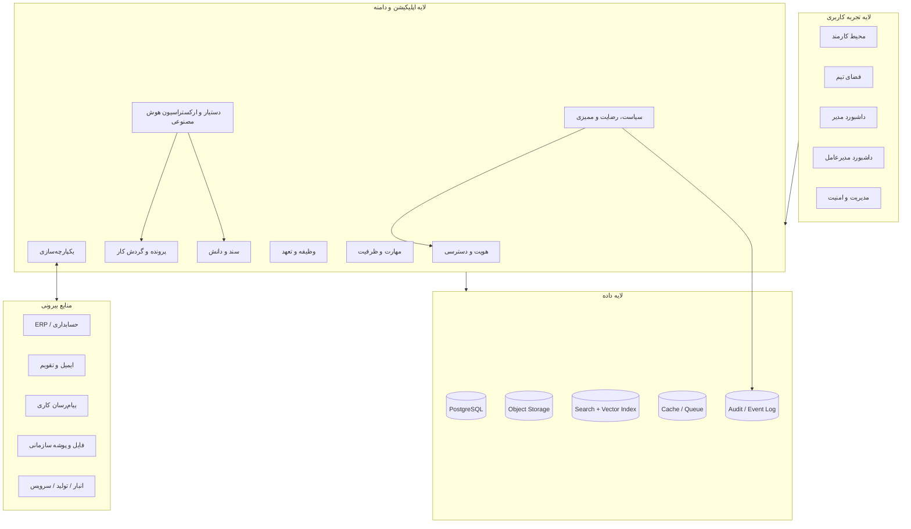
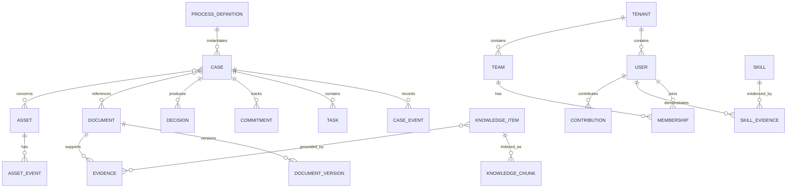
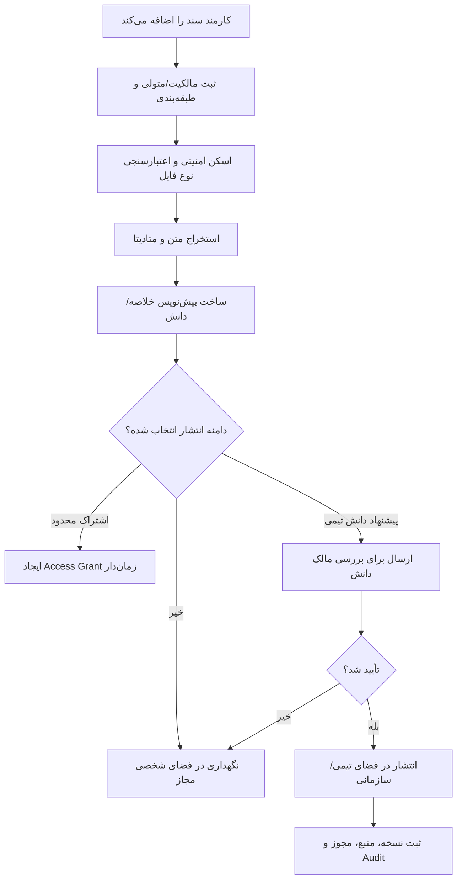
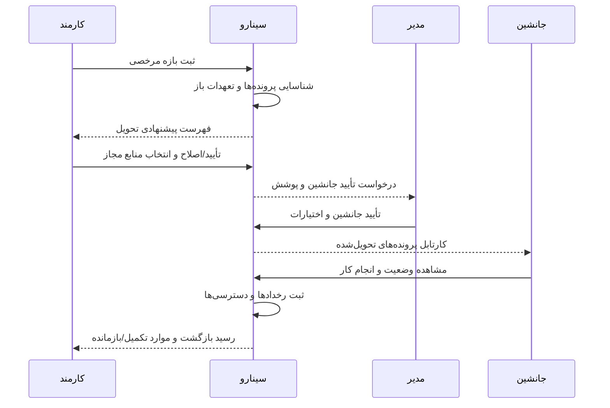

# SEYNARO (سینارو) — سند جامع محصول، معماری و نقشه پیاده‌سازی (نسخه کامل و یکپارچه)

**نام رسمی محصول:** سینارو (`SEYNARO`)  
**نسخه سند:** 2.0 (تلفیق کامل و بدون حذفیات معماری محصول `Blueprint v1.0` و هسته فنی نوروسمبولیک `v7.5 / v10.5`)  
**تاریخ تدوین:** آبان ۱۴۰۵ / ۱۵ نوامبر ۲۰۲۶  
**وضعیت:** سند مبنای نهایی و یکپارچه؛ نیازمند اعتبارسنجی در پایلوت واقعی  
**دامنه هدف اولیه:** شرکت‌های حدود ۳۰ تا ۳۰۰ نفره، با قابلیت توسعه به سازمان‌های بزرگ‌تر  

---

## مقدمه یکپارچه‌سازی و داوری تعارض‌ها (اولویت با `Blueprint v1.0`)

این سند حاصل ادغام **کامل و بدون حذفیات** دو مرجع زیر است:
1. **سند مبنای محصول و معماری (`Synaro_Product_Architecture_Blueprint_v1.md`):** به عنوان **مرجع اول و معیار صحت تصمیم‌های محصولی، تجربه کاربری، حریم خصوصی و معماری استقرار**.
2. **سند جامع فنی و ریاضی (`Continuity_OS_Comprehensive_Plan_v2` — نسخه‌های ۷٫۵ و ۱۰٫۵):** به عنوان **مرجع تفصیلی ماژول‌های ۱۸گانه (`M01–M18`)، موتورهای هیبریدی LLM/Z3، اطلس ۲۸ فرمول (`F01–F28`) و برنامه اجرایی ۹۰ روزه**.

### جدول حل تناقض‌ها (اعمال اولویت `Synaro_Product_Architecture_Blueprint_v1.md`)

| \# | موضوع تعارض | وضعیت در سند فنی اولیه | حکم قطعی در `Blueprint v1.0` (اولویت اول) | نحوه اعمال در این سند یکپارچه |
| :--- | :--- | :--- | :--- | :--- |
| **۱** | **نام محصول** | `Continuity OS` | تغییر نام رسمی به **`SEYNARO` (سینارو)** | نام محصول در کل سند، فرمول‌ها (`B_SY`) و عنوان‌ها به **SEYNARO (سینارو)** یکدست شد. |
| **۲** | **رصد رفتاری، اسکرین‌شات و کلیپ (`M08`)** | پیشنهاد اسکرین‌شات رویدادمحور با محوسازی و کلیپ کوتاه در `M08` | **خط قرمز Anti-Bossware:** ممنوعیت ضبط صفحه، صدا، کیبورد و رصد دسکتاپ | بخش اسکرین‌شات و کلیپ از `M08` حذف شد؛ `M08` صرفاً بر پایه متادیتای رویدادهای پرونده و ERP کار می‌کند. |
| **۳** | **پایگاه داده گراف (`Graph DB`)** | ارجاع به گراف مفاهیم و پایگاه گراف مستقل | **عدم نیاز به Graph DB مستقل در MVP:** نگهداری روابط در `PostgreSQL` | `PostgreSQL` (با `ltree`, `FTS`, `pgvector`) منبع حقیقت واحد است و نمایش گراف روی مدل رابطه‌ای ساخته می‌شود. |
| **۴** | **سبک معماری بک‌اند** | اشاره به ساختارهای توزیع‌شده و چندایجنتی در اجرا | شروع با **Modular Monolith** و جداسازی Workerها در صورت نیاز | `Modular Monolith` به عنوان معماری استاندارد استقرار اولیه تثبیت شد. |
| **۵** | **مرزبندی فضای شخصی و مالکیت** | تمرکز بر ماسک `FF1` و محیط تمرین ۳۰ روزه در RAM | **سیاست سه‌دامنه‌ای** (`شخصی`، `اشتراک کنترل‌شده`، `سازمانی`) و تفکیک مالکیت حقوقی از حریم UI | هر دو سازوکار در بخش حاکمیت داده (`M12`) ترکیب شدند؛ دسترسی موقت با `Access Grant` زمان‌دار کنترل می‌شود. |
| **۶** | **محوریت عملیات روزمره** | تمرکز اولیه بر استخراج دانش هنگام مرخصی/خروج | محوریت **پرونده عملیاتی (`Case ID`)**، **رادار تعهدات**، **فضای تیم** و **دروازه‌بان سؤال** | کارمند ابتدا برای رفع نیازهای روزمره وارد سینارو می‌شود و ثبت دانش محصول جانبی کار است. |
| **۷** | **گزارش مالی `VaR` و شاخص `WBI`** | جمع کردن ساعت توقف و هزینه جایگزینی در یک عدد؛ بازتخصیص خودکار با `WBI` | تفکیک `VaR` به ۳ دسته مجزا با تأیید CFO؛ ممنوعیت تنبیه سرعت بالا در `WBI` | `F20` به ۳ دسته گزارش مجزا تفکیک شد و قید ضدتنبیه سرعت بالا به `F08` اضافه گردید. |
| **۸** | **امتیاز اطمینان (`Confidence`)** | اتکا به امتیازهای عددی ساده | عدم اکتفا به یک عدد واحد و نمایش ابعاد چندگانه منشأ، تازگی، تناقض و تأیید مالک | مدل چندبُعدی منشأ و اطمینان به عنوان استاندارد نمایش به کاربر تثبیت شد. |
| **۹** | **ابزار ساخت ایجنتی (`Agentic Factory`)** | توصیف شرکت ایجنتی ۱۹۲/۱۹۵ مهارتی در پیوست | خروج کامل ابزارهای ساخت از محصول و عدم پیچیده‌سازی MVP | صراحتاً قید شد که کارخانه ایجنتی صرفاً ابزار داخلی توسعه است و هیچ بخشی از محصول نیست. |

---

# بخش اول: سند جامع محصول، معماری و نقشه پیاده‌سازی سینارو (SEYNARO Blueprint v1.0)

## فهرست مطالب بخش اول

1. خلاصه مدیریتی و تعریف محصول
2. مسئله‌ای که سینارو حل می‌کند
3. اصول طراحی و تصمیم‌های بنیادین
4. درخت مسئله‌ها و راه‌حل‌ها
5. گروه‌های کاربری و ارزش پیشنهادی هرکدام
6. نقشه قابلیت‌های محصول
7. معماری مفهومی و لایه‌های سیستم
8. مدل داده و موجودیت‌های اصلی
9. جریان‌های کاری انتهابه‌انتها
10. معماری هوش مصنوعی و حافظه سازمانی
11. حریم خصوصی، امنیت و اعتماد کارمند
12. یکپارچه‌سازی با ابزارهای سازمان
13. نگاشت قابلیت‌ها به ماژول‌های ۱۸گانه SEYNARO
14. بسته‌های فرایندی و پشتیبانی از صنایع مختلف
15. نقشه راه پیاده‌سازی و محدوده MVP
16. شاخص‌های موفقیت و سنجش ارزش
17. پایلوت، اسکن اولیه و مدل ورود به بازار
18. ریسک‌ها و کنترل‌های لازم
19. معیارهای پذیرش قابلیت‌ها
20. تصمیم‌های باز و فرضیات نیازمند اعتبارسنجی

---

## 1. خلاصه مدیریتی و تعریف محصول

### 1.1 سینارو (`SEYNARO`) چیست؟

سینارو یک **زیرساخت هوشمند حافظه، هماهنگی و تداوم عملیات سازمانی** است. این پلتفرم اطلاعات، اسناد، رخدادها، تصمیم‌ها، تعهدات، مهارت‌ها و دارایی‌های عملیاتی را به هم متصل می‌کند تا کارها با تغییر افراد، مرخصی، استعفا، جابه‌جایی شغلی یا افزایش حجم فعالیت متوقف نشوند.

سینارو قرار نیست صرفاً یک سامانه مستندسازی، ویکی سازمانی، مدیریت کار، HRIS، اتوماسیون اداری یا چت‌بات باشد. وجه تمایز آن این است که **دانش را به کار واقعی و پرونده عملیاتی متصل می‌کند** و نشان می‌دهد:

- چه کاری در جریان است؟
- چرا و بر اساس کدام شواهد انجام می‌شود؟
- اکنون مسئول آن چه کسی است؟
- گام بعدی چیست و به چه چیزی وابسته است؟
- چه تصمیم یا تأییدی هنوز باز مانده است؟
- در غیاب مالک فعلی چه کسی و با چه سطح اختیاری می‌تواند ادامه دهد؟
- کدام دانش معتبر، قدیمی، تأییدنشده یا متناقض است؟
- کارمند از کار با این سیستم چه منفعت شخصی و حرفه‌ای می‌برد؟

### 1.2 تعریف کوتاه محصول

> سینارو حافظه عملیاتی سازمان را ایجاد می‌کند و آن را به تجربه کاری مفید برای کارمند، دید مدیریتی برای مدیر واحد و اطمینان تداوم برای مدیرعامل تبدیل می‌کند.

### 1.3 سه ارزش اصلی

| ذی‌نفع | ارزش اصلی | نتیجه قابل مشاهده |
|---|---|---|
| کارمند | انجام راحت‌تر کار، کنترل بر داده‌های مجاز، کاهش وقفه، بازیابی اطلاعات و اثبات مهارت | زمان کمتر برای جست‌وجو و پاسخ تکراری؛ سابقه حرفه‌ای مستند؛ تحویل منظم‌تر |
| مدیر واحد | شناخت ظرفیت واقعی، وابستگی فرایندها، کارهای باز و آمادگی جانشین | کاهش گلوگاه، برنامه‌ریزی بهتر، پوشش مرخصی و گزارش سریع‌تر |
| مدیرعامل/شرکت | تداوم عملیات، کاهش ریسک و مشاهده وضعیت واقعی سازمان | کاهش توقف، کنترل تعهدات، کاهش وابستگی به افراد کلیدی و اندازه‌گیری ارزش عملیاتی |

### 1.4 اصل استراتژیک: طراحی افقی، پیکربندی عمودی

سینارو نباید در ابتدا به هفت نرم‌افزار جداگانه برای مالی، تولید، پخش، بازرگانی، انبار، خدمات فنی و منابع انسانی تبدیل شود. باید یک هسته افقی مشترک داشته باشد:

- پرونده عملیاتی
- سند و شواهد
- رخداد و تاریخچه
- تصمیم و قاعده
- وظیفه، تعهد و موعد
- مالک، جانشین و اختیار
- حافظه و جست‌وجو
- دسترسی و حریم خصوصی
- مهارت و مشارکت

سپس الگوها و فرایندهای هر صنعت روی این هسته پیکربندی می‌شوند. به این ترتیب معماری از روز اول برای صنایع مختلف آماده است، اما محصول لازم نیست از روز اول همه بسته‌های تخصصی را کامل عرضه کند.

---

## 2. مسئله‌ای که سینارو حل می‌کند

مسئله اصلی فقط «ثبت نشدن دانش» نیست. سازمان‌ها با مجموعه‌ای از مشکلات به‌هم‌پیوسته مواجه‌اند.

### 2.1 هشت خانواده مسئله

#### A. گم‌شدن اطلاعات و دانش

**مشکلات:**
- فایل‌ها در پوشه‌ها، ایمیل‌ها، پیام‌رسان‌ها، رایانه‌های شخصی و سامانه‌های مختلف پراکنده‌اند.
- دانش اجرایی در ذهن افراد یا در فایل‌های غیرقابل جست‌وجو باقی می‌ماند (حدود ۸۰٪ دانش در ذهن افراد است).
- چند نسخه متفاوت از یک سند وجود دارد.
- معلوم نیست کدام دستورالعمل معتبر و به‌روز است.
- منبع یک پاسخ یا قاعده مشخص نیست.

**راه‌حل‌های سینارو:**
- فضای شخصی، تیمی و سازمانی با مرز دسترسی روشن.
- جست‌وجوی معنایی و بازیابی فایل با رعایت مجوزها.
- مدیریت نسخه و تاریخچه تغییرات.
- اتصال هر دانش به منبع و شواهد.
- سنجش تازگی و چرخه عمر دانش.

#### B. وابستگی عملیات به افراد کلیدی

**مشکلات:**
- یک فرایند فقط توسط یک نفر انجام می‌شود (`SPOF`).
- هنگام مرخصی، استعفا یا جابه‌جایی، کارهای باز و استثناها گم می‌شوند.
- جانشین فقط فایل دریافت می‌کند، نه منطق و وضعیت پرونده‌ها را.
- فرد اصلی در زمان مرخصی همچنان پاسخ‌گوی تماس‌هاست.
- خروج کارمند بدون تحویل قابل‌ردیابی انجام می‌شود.

**راه‌حل‌های سینارو:**
- Leave Continuity و انتقال موقت مسئولیت.
- فهرست خودکار پرونده‌ها، موعدها و تصمیم‌های باز.
- تعیین جانشین و سطح اختیار او.
- ShadowBox و آزمون آمادگی جانشین.
- پروتکل خروج محترمانه ۳۰ روزه و رسید تحویل.

#### C. توقف کار و گم‌شدن پیگیری

**مشکلات:**
- موعدها در تقویم‌ها و اکسل‌های فردی پنهان‌اند.
- معلوم نیست اقدام بعدی بر عهده کدام واحد یا نقش است.
- استثناها و موانع بین واحدها رها می‌شوند.
- سابقه پرونده در چند کانال پراکنده است.

**راه‌حل‌های سینارو:**
- پرونده عملیاتی یکتا (Case ID) و خط زمانی واحد.
- رادار تعهدات و موعدها.
- ثبت مالک، جانشین، موعد و وابستگی.
- موتور استثنا و ارجاع.
- اعلان مبتنی بر اقدام و اولویت، نه اعلان‌های بی‌هدف.

#### D. سؤال‌های تکراری و اتلاف وقت

**مشکلات:**
- نیروهای تازه‌وارد سؤال‌های تکراری از متخصصان می‌پرسند.
- تمرکز کارشناس ارشد مرتب قطع می‌شود.
- پاسخ‌ها در گفتگوها می‌مانند و دوباره قابل استفاده نیستند.
- کارمند باید برای پاسخ ساده، فرد دیگری را پیدا کند.

**راه‌حل‌های سینارو:**
- دستیار پاسخ‌گو با استفاده از دانش تأییدشده و مجاز.
- پاسخ خودکار در محدوده کم‌ریسک و مجاز.
- ساخت پیش‌نویس برای تأیید کارمند در موارد حساس.
- تبدیل پرسش جدید به میکروپرسش یا ثبت تجربه.
- شمارنده مزاحمت‌های حذف‌شده و شکاف‌های دانشی.

#### E. خطا و تصمیم بدون پشتوانه

**مشکلات:**
- مغایرت میان سفارش، فاکتور، رسید یا فایل محاسباتی دیر کشف می‌شود.
- تصمیم شفاهی ثبت نمی‌شود.
- قواعد بین افراد متفاوت اجرا می‌شوند.
- دانش قدیمی به‌عنوان دستورالعمل معتبر استفاده می‌شود.
- خروجی هوش مصنوعی بدون منبع یا تأیید، قابل اتکا فرض می‌شود.

**راه‌حل‌های سینارو:**
- تطبیق اسناد و کشف مغایرت.
- قواعد تصمیم نسخه‌دار با ساختار `IF–THEN–UNLESS`.
- رسید تصمیم و تأیید انسانی.
- قرنطینه خروجی‌های نامطمئن.
- منبع‌دهی، سطح اطمینان و تاریخ بازبینی.

#### F. ظرفیت کاری پنهان و گلوگاه مدیریتی

**مشکلات:**
- حجم واقعی کار با تخصیص ثبت‌شده هم‌خوان نیست.
- کار خارج از شرح وظیفه دیده نمی‌شود.
- کار جدید بدون جابه‌جایی اولویت‌ها به افراد اضافه می‌شود.
- مدیرعامل یا یک مدیر میانی گلوگاه تأیید همه تصمیم‌هاست.
- مدیر نمی‌داند در غیاب یک فرد چه کاری روی زمین می‌ماند.

**راه‌حل‌های سینارو:**
- دفتر تعهدات و ظرفیت کاری.
- رسید کار اضافه.
- نمایش بار واقعی در کنار تخصیص ثبت‌شده.
- ماتریس اختیار و جانشین تأیید.
- پیشنهاد بازتخصیص و پوشش غیبت.

#### G. دیده‌نشدن رشد و مشارکت کارمند

**مشکلات:**
- مهارت فرد در رزومه یا سیستم سازمانی منعکس نمی‌شود.
- کمک به آموزش همکار یا اصلاح فرایند دیده نمی‌شود.
- کارمند نگران است داده‌های مشارکتش برای تنبیه یا حذف شغلی استفاده شود.
- فرد نمی‌داند چه داده‌ای از او جمع شده یا چه کسی به آن دسترسی دارد.

**راه‌حل‌های سینارو:**
- گذرنامه مهارتی مبتنی بر شواهد.
- سابقه حرفه‌ای و رزومه قابل‌صدور با انتخاب کارمند.
- انتساب مشارکت دانشی.
- دفتر شفافیت داده و دسترسی.
- حق اصلاح، اعتراض و انتخاب محدوده انتشار.
- سیاست منع استفاده از شاخص‌های شخصی برای رتبه‌بندی تنبیهی پنهان.

#### H. ضعف هماهنگی تیم و مدیریت

**مشکلات:**
- کارمند جدید نمی‌داند در محیط تیم چه مراحلی را طی کند.
- دانش تیم وابسته به توضیح شفاهی اعضاست.
- گزارش هفتگی مدیر به‌صورت دستی و پراکنده تهیه می‌شود.
- مدیرعامل دید یکپارچه‌ای از ریسک‌های واحدها ندارد.

**راه‌حل‌های سینارو:**
- فضای عملیاتی مشترک هر تیم.
- راهنمای گام‌به‌گام و پرسش‌وپاسخ تیمی.
- پیش‌نویس گزارش هفتگی بر اساس رخدادها.
- داشبورد تداوم، ظرفیت، موعدها و پوشش شواهد.

---

## 3. اصول طراحی و تصمیم‌های بنیادین

این اصول باید مبنای تصمیم‌های محصول، UX، معماری و فروش باشند.

### 3.1 کارمند ابتدا منفعت می‌گیرد، سپس دانش مشارکت می‌کند

کارمند نباید برای «مستندسازی» به سینارو بیاید. او باید برای رفع یک نیاز واقعی روزمره وارد شود:

- پیدا کردن سریع فایل.
- آماده‌کردن گزارش یا رسید.
- پاسخ به سؤال تکراری بدون قطع تمرکز.
- بررسی خصوصی فایل پیش از ارسال.
- انجام تحویل موقت در مرخصی.
- اثبات مهارت و ساخت سابقه حرفه‌ای.

ثبت دانش باید تا جای ممکن محصول جانبی انجام کار باشد، نه یک کار اداری جداگانه.

### 3.2 مرزبندی سه فضای اطلاعاتی

#### فضای شخصی (Personal Knowledge Space)

محیطی برای فایل‌ها، یادداشت‌ها، پیش‌نویس‌ها، جست‌وجو و ابزارهای شخصی کاری فرد. پیش‌فرض دسترسی محدود به خود کارمند است. با این حال «خصوصی بودن در رابط کاربری» به‌تنهایی تعیین‌کننده مالکیت حقوقی سند نیست؛ نوع سند، قرارداد کاری، سیاست سازمان و قوانین قابل اعمال باید بررسی شوند.

#### فضای اشتراک‌گذاری کنترل‌شده (Controlled Sharing)

کارمند می‌تواند منبع یا بخشی از آن را برای فرد، نقش یا تیم مشخص، در محدوده‌ای معین و برای مدت مشخص به اشتراک بگذارد. دسترسی باید قابل لغو، قابل ممیزی و محدود به عملیات مجاز باشد.

#### فضای دانش سازمانی (Organizational Knowledge)

دانش، سند یا قاعده‌ای که با مجوز معتبر و مطابق سیاست سازمان برای استفاده عملیاتی تیم یا سازمان منتشر شده است. این فضا منبع پاسخ‌های سازمانی و اجرای فرایندهاست.

**قانون محصول:** داده فضای شخصی به‌طور خودکار به فضای تیمی یا سازمانی منتشر نشود. انتقال دانش باید قابل مشاهده، قابل کنترل و قابل حسابرسی باشد. اسناد سازمانی نیز نباید صرفاً به دلیل حضور در فضای شخصی کارمند، از تعهدات نگهداری یا مالکیت سازمانی خارج تلقی شوند.

### 3.3 تداوم کار بدون مصادره دانش شخصی

در مرخصی یا خروج، سینارو ابتدا «وضعیت کار» را منتقل می‌کند:
- پرونده‌های باز.
- مسئول بعدی.
- موعدها.
- موانع.
- تصمیم‌های باز.
- دانش عملیاتی منتشرشده و مجاز.

این انتقال لزوماً به معنی انتقال تمام اسناد یا فضای شخصی فرد نیست.

### 3.4 عدم تبدیل سینارو به Bossware

موارد زیر خط قرمز هستند:
- ضبط مخفیانه صفحه، صدا، کلیدهای صفحه‌کلید یا فعالیت شخصی.
- امتیازدهی پنهانی به افراد بر مبنای رفتارهای غیرشفاف.
- استفاده از زمان آنلاین به‌عنوان معادل بهره‌وری.
- استفاده از داده‌های شخصی برای تنبیه، بدون سیاست روشن و امکان اعتراض.

داده‌ها از منابع مجاز، رویدادهای کاری ثبت‌شده، اسناد سازمانی و تعاملات شفاف تأمین می‌شوند.

### 3.5 هوش مصنوعی پیشنهاد می‌دهد؛ اختیار حساس دست انسان می‌ماند

مدل زبانی می‌تواند سند را خلاصه کند، پیشنهاد قاعده بدهد، پیش‌نویس پاسخ بسازد یا پرونده را طبقه‌بندی کند؛ اما نباید بدون مجوز، پرداخت، تأیید خرید، تغییر حقوق، تغییر دسترسی حساس یا ارسال تعهد حقوقی را اجرا کند.

### 3.6 معماری افقی، نه فهرست بی‌پایان ماژول‌ها

قابلیت‌ها باید بر پایه چند زیرساخت مشترک ساخته شوند. برای هر فیچر نباید یک سرویس مستقل یا ماژول جدید سنگین ایجاد شود.

### 3.7 شواهد قبل از شاخص

هر شاخصی که به مدیر یا مدیرعامل نشان داده می‌شود باید تعریف، منبع، بازه زمانی، کیفیت داده و محدودیت خود را داشته باشد. «زمان آزادشده» لزوماً «صرفه‌جویی نقدی» نیست؛ «کاهش اصل مطالبات» هم سود شرکت محسوب نمی‌شود.

---

## 4. درخت مسئله‌ها و راه‌حل‌ها

درخت محصول باید چنین خوانده شود:

- **ریشه:** راه‌حل‌ها و زیرساخت‌های مشترک سینارو؛ فقط راه‌حل.
- **تنه:** پلتفرم سینارو، یعنی تداوم عملیات و حافظه سازمانی.
- **شاخه‌ها:** دسته‌های مسئله‌ای سازمان.
- **برگ‌ها:** راه‌حل‌های مشخصی که سینارو ارائه می‌کند.

### 4.1 ریشه‌های راه‌حل (Shared Solution Foundations)

ریشه‌ها صرفاً این زیرساخت‌ها هستند:

1. حریم خصوصی و دسترسی نقش‌محور.
2. شواهد قابل ردیابی و منشأ داده.
3. کنترل انسانی و تأیید تصمیم‌های حساس.
4. ثبت تغییرات و نسخه‌بندی.
5. چرخه عمر دانش و بازبینی اعتبار.
6. اتصال پرونده‌ها، افراد، دارایی‌ها و تعهدات.
7. امنیت چندمستاجری و تفکیک سازمان‌ها.

### 4.2 تنه محصول

**SEYNARO Continuity Core: پلتفرم حافظه سازمانی و تداوم عملیات**

### 4.3 شاخه‌ها و برگ‌ها

| شاخه / دسته مشکل | مسائل زیرشاخه | برگ‌ها / راه‌حل‌های سینارو |
|---|---|---|
| گم‌شدن اطلاعات و دانش | فایل پراکنده، دانش ضمنی، نسخه متناقض، منبع نامشخص | Personal/Team/Org Space، Semantic Search، File Recovery، Version Control، Provenance، Knowledge Lifecycle |
| وابستگی به افراد | نبود جانشین، غیبت، استعفا، دانش حل بحران | Leave Continuity، Temporary Handover، Open Case Pack، ShadowBox، 30-Day Exit Protocol، Handover Certificate |
| توقف کار و پیگیری | موعد فراموش‌شده، مسئول نامشخص، استثنای معطل | Case ID، Commitment Radar، Next Action Owner، Exception Engine، Case Timeline |
| سؤال تکراری و اتلاف وقت | قطع تمرکز، سؤال تازه‌وارد، پراکندگی پاسخ | Team Assistant، Answer Gatekeeper، Approved Auto-Answer، Draft for Approval، Question-to-Knowledge Loop |
| خطا و تصمیم بدون پشتوانه | مغایرت، تصمیم شفاهی، قاعده قدیمی، خطای فایل | Document Matching، Formula Integrity، Versioned Rules، Decision Receipt، Human Approval، Quarantine |
| ظرفیت پنهان و گلوگاه | کار اضافه، تخصیص نادرست، تک‌نفره بودن، مدیر گلوگاه | WBI، Extra Work Receipt، Capacity Ledger، Authority Matrix، Delegation/Fallback Approver |
| رشد و مشارکت نامرئی | مهارت اثبات‌نشده، مشارکت ثبت‌نشده، ترس از داده | Skill Passport، Evidence-based CV، Contribution Attribution، Data Access Ledger، Correction/Appeal |
| هماهنگی تیم و مدیریت | آموزش شفاهی، گزارش دستی، نبود دید سازمانی | Team Operational Space، SOP/Guided Workflow، Weekly Report Draft، Executive Continuity Dashboard |

---

## 5. گروه‌های کاربری و ارزش پیشنهادی

### 5.1 کارمند (Employee)

#### نیازها
- انجام کار بدون جست‌وجوی طولانی.
- حفظ کنترل بر داده‌ها و اسناد قابل اشتراک.
- پاسخ‌گویی کمتر به سؤال‌های تکراری.
- داشتن سند روشن از تحویل کار و مسئول بعدی.
- آرامش بیشتر در مرخصی.
- مشاهده سابقه و رشد مهارتی.
- ثبت کار اضافه و مشارکت دانشی.

#### محیط کارمند

1. داشبورد کارهای من.
2. فضای شخصی اسناد و دانش.
3. جست‌وجو و بازیابی فایل.
4. دستیار شخصی و دستیار پاسخ‌گو.
5. پرونده‌های من و تاریخچه تصمیم‌ها.
6. اشتراک‌گذاری زمان‌دار.
7. تحویل موقت / درخواست مرخصی.
8. گذرنامه مهارتی و رزومه.
9. دفتر شفافیت داده و دسترسی.
10. رسید کار اضافه و مشارکت.

### 5.2 مدیر تیم یا واحد (Manager)

#### نیازها
- فهمیدن بار واقعی و ظرفیت تیم.
- شناسایی فرایندهای تک‌نفره.
- برنامه‌ریزی جانشین و پوشش غیبت.
- دیدن کارهای باز و موعدهای پرریسک.
- فهمیدن کار اضافه و تخصیص‌های متعارض.
- تهیه گزارش هفتگی بدون جمع‌آوری دستی اطلاعات.

#### محیط مدیر

1. Team Capacity.
2. Workload & WBI.
3. Single-Point-of-Failure Map.
4. Leave & Absence Impact.
5. Open Cases & Commitments.
6. Skill Coverage & Successor Readiness.
7. Task Allocation & Reallocation.
8. Extra Work Ledger.
9. Weekly Report Draft.

### 5.3 مدیرعامل / مدیر اجرایی (CEO / Executive)

#### نیازها
- دانستن کجا سازمان به افراد خاص وابسته است.
- مشاهده ریسک توقف و تأخیر.
- شناخت واحدهای دارای کمبود جانشین.
- دیدن تعهدات مالی و عملیاتی با ریسک بالا.
- مقایسه وضعیت واحدها بدون نظارت فردی پنهانی.
- دریافت گزارش قابل اتکا و مستند.

#### محیط مدیرعامل

1. سازمان در یک نگاه.
2. Continuity Risk Map.
3. فرآیندهای تک‌نفره و پوشش جانشین.
4. تعهدات بحرانی و موعدهای پیش رو.
5. پرونده‌های متوقف و گلوگاه‌ها.
6. ارزش مالی ریسک مهارشده با شواهد.
7. وضعیت آمادگی خروج/تغییر نقش افراد کلیدی.
8. گزارش مدیریتی مبتنی بر رخدادها.

### 5.4 نقش‌های سازمانی تکمیلی

- **Process Owner:** مالک فرایندی که صحت راهنماها و قواعد را تأیید می‌کند.
- **Successor:** فردی که در غیاب مالک، بخشی از کار را ادامه می‌دهد.
- **Approver:** فرد دارای اختیار تأیید مشخص.
- **Knowledge Steward:** مسئول بازبینی اعتبار و کیفیت دانش در یک حوزه.
- **System Administrator:** مسئول پیکربندی، کاربران و اتصال‌ها.
- **Privacy/Security Officer:** مسئول سیاست‌های دسترسی، ممیزی و رسیدگی به درخواست‌های داده.

یک فرد می‌تواند چند نقش داشته باشد؛ نقش‌ها باید قابل تفکیک و قابل ممیزی باشند.

---

## 6. نقشه قابلیت‌های محصول

### 6.1 Personal Knowledge Space — فضای شخصی کارمند

#### هدف
ایجاد محیطی که کارمند برای نیاز واقعی خود از آن استفاده کند و بتواند اسناد و اطلاعات مجاز کاری را مدیریت و بازیابی کند.

#### قابلیت‌ها
- بارگذاری و دسته‌بندی فایل.
- اتصال پوشه‌های منتخب یا منابع کاری مجاز.
- جست‌وجوی متنی و معنایی.
- خلاصه و استخراج نکات از سند.
- یادداشت و برچسب شخصی.
- نسخه‌بندی و بازیابی نسخه قبلی.
- نشان دادن منبع هر پاسخ.
- پیشنهاد تبدیل تجربه به راهنمای تیمی.
- کنترل اشتراک‌گذاری.

#### الزامات
- فضای شخصی نباید به مخزن پنهان شرکت برای نظارت بر کارمند تبدیل شود.
- سیاست سازمان باید روشن کند کدام دسته از اسناد، سوابق سازمانی‌اند و چه قواعد نگهداری دارند.
- جست‌وجوی شخصی و سازمانی باید از نظر دامنه داده جدا باشد.
- هر فایل باید سطح طبقه‌بندی و مالک/متولی مشخص داشته باشد.

### 6.2 Controlled File Access — دسترسی زمان‌دار به فایل

#### سناریو
کارمند می‌خواهد یک فایل یا بخش مشخصی از دانش را برای همکار یا جانشین به اشتراک بگذارد.

#### تنظیمات اشتراک
- گیرنده: کاربر، نقش یا تیم.
- منبع: فایل، نسخه یا مجموعه مشخص.
- عملیات مجاز: مشاهده، دانلود، ویرایش یا افزودن نظر.
- زمان شروع و پایان.
- امکان واگذاری مجدد: پیش‌فرض خاموش.
- امکان لغو فوری.
- دلیل اشتراک و ارتباط با پرونده.

#### کنترل فنی
- استفاده از مجوز کوتاه‌عمر سمت سرور یا URL امضاشده کوتاه‌مدت.
- بررسی مجدد مجوز در هر درخواست؛ صرف پنهان‌کردن لینک کافی نیست.
- ثبت زمان ایجاد، مشاهده، دانلود، تغییر و لغو دسترسی.
- در فایل‌های حساس، نمایش پیش‌نمایش به‌جای دانلود در صورت نیاز سیاستی.
- واترمارک می‌تواند بازدارنده باشد، اما جلوگیری قطعی از کپی یا اسکرین‌شات نیست.

### 6.3 Team Operational Space — فضای عملیاتی تیم

#### هدف
هر تیم یک محیط مشخص داشته باشد تا اعضای مجاز برای فهمیدن روش کار، پرسیدن سؤال و پیگیری پرونده‌ها مجبور نباشند دائماً از یک نفر توضیح بگیرند.

#### اجزا
- صفحه معرفی مأموریت و دامنه تیم.
- فرایندها و راهنماهای تأییدشده.
- پرونده‌های فعال و وضعیت آن‌ها.
- پرسش‌وپاسخ از دانش تیم.
- قواعد، استثناها و ماتریس اختیار.
- فهرست نقش‌ها و جانشین‌ها.
- موعدها و تعهدات مشترک.
- دارایی‌ها یا مشتریان مرتبط با تیم.
- تاریخچه تغییر دستورالعمل‌ها.

#### رفتار دستیار تیم
1. ابتدا سؤال را طبقه‌بندی می‌کند.
2. فقط منابعی را بازیابی می‌کند که سؤال‌کننده مجاز به دیدن آن‌هاست.
3. پاسخ را با منابع و نسخه راهنما نمایش می‌دهد.
4. اگر پاسخ قطعی یا تأییدشده وجود ندارد، عدم قطعیت را اعلام می‌کند.
5. در صورت نیاز، سؤال را به مالک دانش می‌فرستد.
6. پاسخ جدید را تنها پس از بررسی و مجوز لازم به دانش تیم اضافه می‌کند.

### 6.4 Operational Case / Case Graph — پرونده عملیاتی

#### هدف
هر اتفاق مهم کسب‌وکار یک شناسه و خط زمانی مشخص داشته باشد.

#### نمونه
**C-1048 — سفارش خرید**
- وضعیت: در انتظار تأیید.
- واحد: تدارکات.
- مالک فعلی: کارشناس خرید.
- جانشین: سرپرست تدارکات.
- موعد: تاریخ مورد توافق.
- وابستگی: تأیید مالی.

**خط زمانی:**
1. درخواست خرید ثبت شد.
2. پیشنهاد تأمین‌کنندگان دریافت شد.
3. مغایرت قیمت تشخیص داده شد.
4. تصمیم برای تأیید مالی ارجاع شد.

#### هر پرونده شامل
- شناسه یکتا.
- نوع پرونده و قالب فرایند.
- سازمان، واحد و تیم.
- مالک، نقش‌های درگیر و جانشین.
- وضعیت و مرحله جاری.
- وظیفه و اقدام بعدی.
- موعد و تعهدات.
- اسناد و شواهد.
- رخدادها و تصمیم‌ها.
- قواعد و استثناهای مرتبط.
- تأییدیه‌ها.
- تاریخچه تغییرات.
- سطح حساسیت و سیاست دسترسی.

#### نکته معماری
در نسخه اول به Graph Database جداگانه نیاز قطعی نیست. روابط را می‌توان با کلیدهای خارجی و جدول‌های رابطه‌ای در PostgreSQL نگهداری کرد و نمای گرافی را در لایه جست‌وجو/نمایش ساخت. پایگاه گراف مستقل زمانی بررسی شود که پیچیدگی و حجم مسیرهای چندمرحله‌ای توجیه‌کننده باشد.

### 6.5 Commitment Radar — رادار تعهدات و موعدها

#### دامنه
- چک و پرداخت.
- ضمانت‌نامه و تمدید.
- قرارداد و تمدید.
- موعد ترخیص و دموراژ.
- تحویل سفارش.
- تعهدات مشتری و تأمین‌کننده.
- سرویس دوره‌ای دستگاه.
- انقضای مواد اولیه.
- موعد گزارش یا مدرک.

#### فیلدهای تعهد
- موضوع و نوع تعهد.
- تاریخ سررسید و منطقه زمانی.
- مالک و جانشین.
- هزینه یا پیامد تأخیر، در صورت داشتن منبع معتبر.
- وابستگی‌ها.
- وضعیت.
- منبع ایجاد تعهد.
- سطح اطمینان استخراج.
- تأیید مسئول.

#### رفتار
سیستم فقط اعلان نمی‌دهد؛ وابستگی‌ها را نشان می‌دهد. مثال: تمدید ضمانت‌نامه پنج روز دیگر سررسید می‌شود، اما یک مدرک از حقوقی هنوز دریافت نشده است.

### 6.6 Leave Continuity — سپر مرخصی و تحویل موقت

#### تجربه کارمند
1. انتخاب تاریخ غیبت.
2. مشاهده پرونده‌های باز و موعدهای واقع در بازه غیبت.
3. تأیید یا اصلاح فهرست.
4. انتخاب جانشین یا درخواست پیشنهاد از مدیر.
5. انتخاب اطلاعات مجاز برای اشتراک.
6. تعیین سطح دسترسی و زمان انقضا.
7. صدور رسید تحویل.

#### تجربه مدیر
- مشاهده اثر غیبت بر عملیات.
- دیدن پرونده‌هایی که مالک دوم ندارند.
- انتخاب یا تأیید جانشین.
- مشاهده آمادگی جانشین.
- تعیین مسیر تشدید اضطراری.

#### تجربه جانشین
- کارتابل پرونده‌های تحویل‌شده.
- خلاصه وضعیت و اقدام بعدی.
- دسترسی موقت به منابع مجاز.
- امکان پرسش از دستیار.
- ثبت تصمیم‌ها و اقدامات انجام‌شده.

#### مرز مهم
دسترسی به فضای شخصی کارمند به شکل پیش‌فرض منتقل نمی‌شود. تنها پرونده‌ها، اسناد سازمانی یا دانش منتشرشده و مجاز در محدوده تحویل قرار می‌گیرند.

### 6.7 30-Day Exit Protocol — پروتکل خروج محترمانه ۳۰ روزه

#### محرک
ثبت تاریخ خروج یا استعفا توسط فرایند مجاز منابع انسانی/مدیر.

#### مراحل
1. ایجاد پرونده خروج.
2. استخراج وظایف، پرونده‌ها و موعدهای باز.
3. فهرست دارایی‌ها و دسترسی‌های سازمانی قابل تحویل.
4. انتخاب مالک جدید و جانشین.
5. انتقال دانش سازمانی مجاز.
6. ثبت وضعیت انتقال هر پرونده.
7. جمع‌آوری موارد باقی‌مانده و پذیرش ریسک توسط مدیر.
8. لغو یا تغییر دسترسی‌ها طبق زمان‌بندی مصوب.
9. صدور گواهی تحویل با تفکیک «تحویل‌شده»، «تأییدشده» و «بازمانده».

#### منفعت دوطرفه
- شرکت: خروج قابل برنامه‌ریزی و کاهش غافلگیری.
- کارمند: سابقه روشن از موارد تحویل‌داده‌شده و مشارکت حرفه‌ای.

این گواهی نباید تضمین‌کننده صحت همه امور یا ارزیابی عملکرد کلی فرد معرفی شود.

### 6.8 Delegated Work Assistant — دستیار پاسخ‌گو و انجام‌دهنده کارهای کم‌ریسک

#### سه حالت پاسخ

| حالت | رفتار | مثال |
|---|---|---|
| Auto Answer | پاسخ از دانش تأییدشده و در محدوده مجاز | وضعیت راهنمای عمومی ثبت درخواست |
| Draft for Approval | تهیه پیش‌نویس و ارسال برای تأیید فرد | پاسخ به مشتری درباره موعد تحویل |
| Human Escalation | ارجاع به فرد دارای اختیار | تغییر قیمت، تعهد حقوقی، پرداخت یا استثنای حساس |

#### اتصال به حساب‌های کاری
- اتصال OAuth یا سازوکار امن مشابه، با کمترین دامنه دسترسی.
- انتخاب حساب‌ها و پوشه‌های مجاز.
- ورود انتخابی ایمیل‌ها/پیام‌ها یا استفاده از API رسمی در صورت وجود.
- امکان قطع اتصال و حذف دسترسی.
- نشان‌دادن منبع هر پاسخ.
- جلوگیری از پاسخ‌گویی به‌جای فرد در موضوعات حساس بدون اجازه.

#### حفاظت از دسترسی
دستیار باید مجوز سؤال‌کننده را رعایت کند، نه صرفاً مجوز مالک دانش را. اگر کاربر به سندی دسترسی ندارد، دستیار نباید محتوای آن را از طریق خلاصه‌سازی یا پاسخ غیرمستقیم افشا کند.

### 6.9 Answer Gatekeeper — دروازه‌بان سؤال

#### جریان
1. سؤال از کارمند تازه‌وارد یا همکار دریافت می‌شود.
2. دستیار دانش تأییدشده را جست‌وجو می‌کند.
3. در صورت وجود پاسخ معتبر، همراه با منبع پاسخ می‌دهد.
4. در صورت نبود پاسخ، سؤال را با زمینه لازم به مالک دانش می‌فرستد.
5. مالک می‌تواند با متن کوتاه یا ویس پاسخ دهد.
6. پاسخ به‌صورت پیش‌نویس دانش ثبت می‌شود.
7. پس از بررسی و تعیین دامنه انتشار، وارد فضای تیمی می‌شود.

#### شاخص منفعت
- تعداد سؤال‌هایی که بدون قطع تمرکز متخصص پاسخ داده شده‌اند.
- زمان پاسخ.
- نسبت پاسخ‌های مستند به پاسخ‌های بی‌منبع.
- نرخ ارجاع صحیح به انسان.

### 6.10 Extra Work Receipt — رسید کار اضافه

#### هدف
ثبت شفاف کارهایی که خارج از تخصیص یا شرح کار توافق‌شده به فرد واگذار می‌شوند.

#### داده‌ها
- درخواست‌کننده و زمان.
- شرح کار و ارتباط با فرایند.
- اولویت و موعد.
- برآورد/زمان واقعی در صورت ثبت مجاز.
- کارهای اصلی که جابه‌جا شده‌اند.
- تأیید یا اعتراض کارمند.
- وضعیت تعیین تکلیف یا جبران.

#### اصل محصولی
این قابلیت نباید ابزار شکایت تنبیهی یا رتبه‌بندی فردی شود. هدف، تصویر واقعی ظرفیت و اولویت‌های سازمان است. سیاست استفاده، مشاهده و نگهداری باید برای کارکنان روشن باشد.

### 6.11 Workload Intelligence / WBI — هوشمندی بار کاری

#### مسئله
مدیر ممکن است ببیند تخصیص ثبت‌شده یک فرد ۱۰۰ واحد است، در حالی که تعهدات و کارهای واقعی ۱۲۱ واحد برآورد می‌شود. این اختلاف به‌تنهایی به معنی ۲۱٪ بهره‌وری کمتر یا بیشتر نیست؛ باید روش محاسبه و کیفیت داده مشخص باشد.

#### خروجی‌ها
- بار ثبت‌شده.
- تعهدات باز.
- بار تخمینی بر اساس پیچیدگی/زمان تاریخی.
- کار اضافه و تغییر اولویت.
- بار وابسته به شخص.
- ظرفیت قابل دسترس با عدم قطعیت.
- پیشنهاد بازتخصیص.

#### کنترل ضدتنبیه سرعت بالا
بهبود سرعت کار نباید به‌طور خودکار به مبنای افزایش وظایف بدون مذاکره تبدیل شود. هر تخصیص جدید باید ظرفیت، اولویت و تعهدات موجود را در نظر بگیرد. زمان آزادشده نیز به‌خودی‌خود معادل ظرفیت قطعی قابل واگذاری نیست.

### 6.12 Skill Passport & Career Progress — گذرنامه مهارتی

#### منبع شواهد
- پرونده‌های واقعی که فرد در آن‌ها نقش داشته.
- ارزیابی عملی ShadowBox.
- تأیید مالک فرایند.
- مشارکت در اصلاح یا تأیید راهنما.
- آموزش یا مربی‌گری همکار.

#### سطح مهارت
سطوح پیشنهادی:
1. آشنا (Familiar): دانش پایه را می‌شناسد.
2. با راهنما (Guided): با کمک راهنما می‌تواند انجام دهد.
3. مستقل (Independent): در موارد عادی مستقل عمل می‌کند.
4. متخصص (Advanced): استثناهای متداول را مدیریت می‌کند.
5. مربی/مالک (Mentor/Owner): می‌تواند راهنما را آموزش دهد یا تأیید کند.

این سطح‌ها باید برای هر مهارت تعریف شوند؛ نباید یک امتیاز کلی و مبهم برای ارزش کارمند ساخته شود.

#### رزومه قابل‌صدور
- فرد انتخاب می‌کند چه مهارت‌ها و شواهدی صادر شوند.
- نام مشتری، تأمین‌کننده، مبلغ، اطلاعات محرمانه و جزئیات سازمانی حذف یا ناشناس می‌شوند.
- خروجی می‌تواند PDF/JSON باشد.
- صادرکردن رزومه به معنی انتقال مالکیت داده سازمانی نیست.

### 6.13 Knowledge Contribution Attribution — انتساب مشارکت دانشی

#### ثبت مشارکت
- ایجاد راهنمای جدید.
- اصلاح قاعده اشتباه.
- افزودن استثنای تأییدشده.
- آموزش جانشین.
- تأیید دانش یا منبع.
- بهبود فرایند.

#### کنترل
- هر مشارکت دارای نویسنده/مشارکت‌کنندگان، تاریخ، نسخه و تأیید است.
- مشارکت مشترک قابل ثبت است.
- انتساب قابل اصلاح و اعتراض است.
- مالکیت حقوقی دانش از انتساب مشارکت جدا نگه داشته می‌شود.
- سیاست پاداش باید قراردادی و قابل حسابرسی باشد؛ وعده امتیاز یا پول بدون قواعد مشخص ارائه نشود.

### 6.14 Knowledge Lifecycle Management — چرخه عمر دانش

وضعیت‌های پیشنهادی:
- Draft
- Under Review
- Approved
- Published
- Needs Review
- Expired
- Superseded
- Archived

هر دانش مهم باید دارای مالک بازبینی، تاریخ تأیید، تاریخ بازبینی بعدی، دامنه کاربرد و نسخه باشد. دانش منقضی نباید به‌عنوان دستورالعمل معتبر پیشنهاد شود.

### 6.15 Decision Pack و Decision Receipt

هر تصمیم مهم می‌تواند شامل موارد زیر باشد:
- پرسش یا موضوع تصمیم.
- گزینه‌های بررسی‌شده.
- شواهد و منابع.
- قاعده یا محدودیت مرتبط.
- تصمیم‌گیرنده و سطح اختیار.
- دلیل و استثنا.
- زمان و نسخه قاعده.
- نتیجه و مسئول اقدام بعدی.

رسید تصمیم باید نشان دهد چه چیزی تصویب شده و چه چیزی هنوز صرفاً پیشنهاد است.

### 6.16 Asset & Equipment Memory — حافظه دارایی و تجهیزات

برای دستگاه، خط، قالب، خودرو یا ابزار:
- شناسه و مکان.
- مدل و مشخصات.
- تاریخچه خرابی و تعمیر.
- قطعات تعویض‌شده و قطعات سازگار.
- پارامترهای تأییدشده.
- دستورالعمل ایمنی.
- مسئول نقش‌محور.
- موعد سرویس.
- پرونده‌های مرتبط.

این قابلیت در هسته با الگوی Entity/Case/Evidence ساخته می‌شود؛ جزئیات صنعتی آن از طریق Process Pack پیکربندی می‌شود.

---

## 7. معماری مفهومی و لایه‌های سیستم

### 7.1 نمای کلان



### 7.2 لایه تجربه کاربری (Experience Layer)

یک وب‌اپلیکیشن واکنش‌گرا و PWA نقطه ورود اصلی باشد. پیام‌رسان‌ها و اعلان‌ها ابزار مکمل‌اند، نه وابستگی اصلی.

#### تجربه‌ها
- Employee Workspace
- Team Operational Space
- Manager Console
- Executive Console
- Admin & Security Console

#### اصول UX
- کارتابل نقش‌محور، نه داشبورد شلوغ یکسان برای همه.
- اقدام بعدی باید واضح باشد.
- وضعیت دانش (تأییدشده/پیش‌نویس/منقضی) در UI مشخص باشد.
- منبع پاسخ با یک کلیک باز شود.
- اشتراک‌گذاری و انتشار، قبل از انجام به‌روشنی نشان داده شود.
- عملیات حساس نیازمند تأیید دو مرحله‌ای یا تأیید دوم باشد.
- برای کاربران عملیاتی، موبایل و حالت کم‌اتصال در نظر گرفته شود.

### 7.3 لایه هویت و مجوز (Identity & Access)

- ورود سازمانی و مدیریت نشست.
- MFA برای نقش‌ها و عملیات حساس.
- RBAC برای نقش‌های پایه.
- ABAC برای ویژگی‌هایی مانند واحد، حساسیت سند، پرونده، محل، وضعیت همکاری و زمان.
- پشتیبانی از دسترسی موقت و قابل لغو.
- جداسازی مستأجرها (Tenant Isolation).
- مجوزدهی در سطح API و داده، نه فقط رابط کاربری.

### 7.4 لایه دامنه (Domain Layer)

برای شروع، **Modular Monolith** پیشنهاد می‌شود: یک اپلیکیشن بک‌اند با مرزهای دامنه روشن، قراردادهای داخلی مشخص و پایگاه داده مشترک با تفکیک schema/table. این انتخاب از پیچیدگی استقرار و هماهنگی چندین سرویس مستقل در MVP جلوگیری می‌کند.

ماژول‌های دامنه:
1. Identity & Organization.
2. Documents & Knowledge.
3. Cases & Workflows.
4. Commitments & Tasks.
5. Rules & Decisions.
6. Leave & Handover.
7. Skills & Contributions.
8. Workload & Capacity.
9. Integrations.
10. Governance & Audit.
11. AI Orchestration.

بعد از اثبات نیاز، بار عملیاتی یا نیاز امنیتی/استقرار مستقل، اجزایی مانند پردازش اسناد، جست‌وجو یا AI Worker می‌توانند جدا شوند.

### 7.5 لایه داده (Data Layer)

| ذخیره‌ساز | کاربرد | پیشنهاد اولیه |
|---|---|---|
| دیتابیس تراکنشی | کاربران، پرونده‌ها، وظایف، قواعد، مجوزها | PostgreSQL |
| Object Storage | فایل اصلی، نسخه‌ها، خروجی‌ها و پیوست‌ها | S3-compatible؛ در استقرار داخلی MinIO یا مشابه |
| جست‌وجوی متنی/معنایی | متن، قطعه‌ها، embedding و بازیابی | PostgreSQL FTS + pgvector در MVP؛ موتور مستقل در صورت نیاز |
| Cache و Queue | صف پردازش، کش نشست و کارهای پس‌زمینه | Redis یا ابزار مشابه |
| Event/Audit | رخدادهای کسب‌وکار و ردپای ممیزی | Event table + Outbox در PostgreSQL؛ انتقال به سامانه تحلیلی در مقیاس بالاتر |

#### تصمیم مهم درباره ذخیره‌ساز گراف
در نسخه اول پایگاه گراف اختصاصی ضروری نیست. ارتباطات Case، Person، Document، Asset، Rule و Commitment می‌توانند در مدل رابطه‌ای ذخیره شوند. لایه نمایش گراف از روی این روابط ساخته شود. استفاده از گراف مستقل فقط پس از سنجش نیاز واقعی بررسی شود.

### 7.6 معماری استقرار

#### گزینه پیشنهادی برای MVP
- Docker Compose یا استقرار ساده کانتینری.
- یک محیط توسعه، یک محیط staging و محیط production.
- پایگاه داده مدیریت‌شده یا داخلی.
- ذخیره‌ساز فایل مستقل.
- Worker برای پردازش پس‌زمینه.
- پشتیبان‌گیری رمزنگاری‌شده و آزمون بازیابی.

#### مسیر توسعه
- ابتدا Modular Monolith.
- سپس جداکردن Workerهای سنگین پردازش اسناد/هوش مصنوعی.
- سپس استخراج سرویس‌های مستقل فقط بر اساس بار، مقیاس، امنیت یا نیاز استقرار مشتری.
- Kubernetes از روز اول الزام نیست؛ زمانی استفاده شود که نیاز عملیاتی آن اثبات شده باشد.

### 7.7 انتخاب فناوری پیشنهادی

انتخاب نهایی باید با مهارت تیم، زیرساخت مشتری و الزامات استقرار تطبیق یابد. یک پشته مرجع قابل اجرا:

| بخش | گزینه مرجع | ملاحظه |
|---|---|---|
| Frontend | React / Next.js + TypeScript | PWA و UI نقش‌محور |
| Backend Core | TypeScript/NestJS یا Python/FastAPI | یکی را برای هسته انتخاب کنید؛ از دو هسته موازی بدون دلیل پرهیز شود |
| AI/Document Workers | Python | اکوسیستم مناسب پردازش سند، NLP و اتصال مدل‌ها |
| Database | PostgreSQL | منبع حقیقت تراکنشی |
| Vector Search | pgvector در شروع | تا زمانی که مقیاس نیازمند موتور مستقل شود |
| Object Storage | S3-compatible | نسخه فایل و لینک موقت |
| Queue | Redis Streams / RabbitMQ یا صف مدیریت‌شده | انتخاب بر اساس نیاز قابلیت اطمینان |
| Auth | OIDC-compatible Identity Provider | MFA، SSO و مدیریت نشست |
| Observability | OpenTelemetry + logs/metrics/traces | بدون ثبت محتوای حساس در logهای عمومی |

این جدول توصیه معماری است، نه الزام به استفاده از تمام فناوری‌ها.

---

## 8. مدل داده و موجودیت‌های اصلی

### 8.1 اصول مدل داده

- همه داده‌ها به Tenant/Organization تعلق دارند مگر صریحاً خلاف آن تعریف شده باشد.
- داده‌های شخصی، تیمی و سازمانی باید scope مشخص داشته باشند.
- منبع و provenance برای داده‌های استخراج‌شده اجباری است.
- رویدادها append-only یا دارای تاریخچه غیرقابل‌دستکاری باشند؛ اصلاح با رویداد جدید ثبت شود.
- داده تراکنشی از خروجی‌های هوش مصنوعی تفکیک شود.
- مجوز دسترسی باید در سطح شیء و عملیات قابل بررسی باشد.

### 8.2 موجودیت‌های پایه

| موجودیت | فیلدهای کلیدی پیشنهادی | توضیح |
|---|---|---|
| Tenant | id, name, status, region, policy_profile | سازمان مشتری |
| User | id, tenant_id, identity_ref, status | حساب کاربر |
| Role | id, tenant_id, name, scope | نقش پایه |
| Team | id, tenant_id, name, parent_team_id | تیم و ساختار واحدها |
| Membership | user_id, team_id, role_id, valid_from/to | عضویت و نقش در تیم |
| ProcessDefinition | id, version, owner_role, schema | قالب فرایند |
| Case | id, tenant_id, process_id, status, owner_id, team_id | پرونده عملیاتی |
| CaseEvent | id, case_id, event_type, actor, timestamp, payload | رویداد پرونده |
| Task | id, case_id, title, owner_role, due_at, status | اقدام قابل انجام |
| Commitment | id, case_id, due_at, impact, source_id, status | تعهد/موعد |
| Document | id, tenant_id, classification, scope, owner_ref | فراداده سند |
| DocumentVersion | id, document_id, version, object_key, checksum | نسخه فایل |
| Evidence | id, source_type, source_id, excerpt_ref, provenance | شاهد پشتیبان |
| KnowledgeItem | id, type, status, scope, review_at, owner_role | دانش قابل جست‌وجو |
| KnowledgeChunk | id, knowledge_id, text_ref, embedding_ref, acl_ref | قطعه‌های جست‌وجو |
| Rule | id, version, condition, action, exceptions, status | قاعده تصمیم |
| Decision | id, case_id, rule_version, approver, outcome, rationale | تصمیم ثبت‌شده |
| Approval | id, target_type, target_id, approver, status, signed_at | گردش تأیید |
| AccessGrant | id, resource_id, grantee, permissions, expires_at | دسترسی موقت/محدود |
| AuditEvent | id, actor, action, resource, timestamp, context | ثبت دسترسی و تغییر |
| Skill | id, name, skill_definition, level_criteria | تعریف مهارت |
| SkillEvidence | id, user_id, skill_id, case_id, evidence_ref, verified_by | شاهد مهارت |
| Contribution | id, user_id, knowledge_id, contribution_type, review_status | مشارکت دانشی |
| WorkloadEntry | id, user_id, source_case, estimate, actual, period | داده بار کاری |
| Asset | id, tenant_id, asset_type, location, status | دارایی/تجهیز |
| AssetEvent | id, asset_id, event_type, case_id, evidence_id | رخداد دارایی |
| IntegrationConnection | id, tenant_id, provider, scopes, status | اتصال خارجی |
| ExitPlan | id, user_id, exit_date, owner, status | برنامه خروج |

### 8.3 رابطه‌های مهم



### 8.4 تفکیک منبع حقیقت

- PostgreSQL منبع حقیقت کاربران، مجوزها، پرونده‌ها، تصمیم‌ها و گردش‌کار است.
- Object Storage منبع حقیقت بایت فایل‌هاست.
- Search/Vector Index فقط نمای مشتق‌شده برای بازیابی است و نباید مرجع مجوز یا صحت نهایی باشد.
- خروجی LLM یک پیشنهاد یا artefact مشتق‌شده است؛ تا زمان تأیید، نباید به عنوان قاعده معتبر ذخیره شود.
- Audit Log مرجع ممیزی اعمال و دسترسی‌هاست.

---

## 9. جریان‌های کاری انتهابه‌انتها

### 9.1 ورود سند و تبدیل اختیاری آن به دانش سازمانی



#### مراحل فنی
1. دریافت فایل با upload session امن.
2. بررسی MIME واقعی، حجم، آنتی‌ویروس و checksum.
3. ذخیره فایل اصلی در Object Storage.
4. ایجاد Document و DocumentVersion.
5. استخراج متن با parser مناسب؛ OCR فقط برای فایل تصویری/اسکن‌شده در صورت نیاز.
6. ساخت chunkهای قابل جست‌وجو با اتصال به نسخه و صفحه/بخش منبع.
7. تعیین ACL برای هر chunk یا منبع.
8. تولید خلاصه یا پیشنهاد قاعده به‌صورت draft.
9. انتشار فقط بر اساس مجوز و جریان تأیید.

### 9.2 اشتراک‌گذاری زمان‌دار

1. کارمند منبع و گیرنده را انتخاب می‌کند.
2. سطح دسترسی را انتخاب می‌کند.
3. تاریخ انقضا را تعیین می‌کند.
4. سیستم پیش‌نمایش می‌دهد که گیرنده چه چیزی خواهد دید.
5. کارمند تأیید می‌کند.
6. AccessGrant با محدوده و انقضا ایجاد می‌شود.
7. سرویس مجوز در هر مشاهده/دانلود مجدداً grant را بررسی می‌کند.
8. در انقضا یا لغو، دسترسی رد می‌شود.
9. AuditEvent ثبت می‌شود.

### 9.3 مرخصی و تحویل موقت



#### کنترل‌های الزامی
- جانشین فقط پرونده‌ها و منابع مجاز را می‌بیند.
- دسترسی موقت تاریخ انقضا دارد.
- تصمیم حساس همچنان نیازمند فرد دارای اختیار است.
- تماس اضطراری با فرد اصلی باید دلیل و مسئول درخواست‌کننده داشته باشد.
- بازگشت کارمند با Resume Point انجام می‌شود: خلاصه رخدادهای زمان غیبت، اقدامات انجام‌شده و موارد باز.

### 9.4 پاسخ به سؤال همکار

1. درخواست‌کننده در وب‌اپ یا اتصال کاری سؤال می‌پرسد.
2. هویت و مجوز او مشخص می‌شود.
3. بازیابی فقط از منابع مجاز انجام می‌شود.
4. پاسخ با ارجاع به سند و نسخه ساخته می‌شود.
5. اگر پاسخ در سطح اطمینان/ریسک مجاز باشد، خودکار ارائه می‌شود.
6. اگر حساس یا جدید باشد، پیش‌نویس به مالک دانش ارجاع می‌شود.
7. اگر تصمیم یا اختیار لازم باشد، به مسئول مجاز منتقل می‌شود.
8. در صورت تأیید، پاسخ یا دانش جدید ذخیره می‌شود.

### 9.5 گزارش هفتگی مدیر

1. رخدادهای هفته از پرونده‌ها و تعهدات خوانده می‌شوند.
2. پرونده‌های بسته‌شده، باز، معطل و دارای ریسک تفکیک می‌شوند.
3. داده‌های ناقص یا بدون شواهد مشخص می‌شوند.
4. AI پیش‌نویس گزارش را تهیه می‌کند.
5. مدیر موارد را اصلاح می‌کند.
6. مدیر گزارش را تأیید و ارسال می‌کند.
7. منبع هر بند گزارش قابل مشاهده است.

### 9.6 خروج کارمند

1. رویداد خروج آغاز می‌شود.
2. سیستم پرونده‌ها، تعهدات، دسترسی‌ها، دارایی‌ها و دانش منتشرشده فرد را جمع‌بندی می‌کند.
3. مدیر و کارمند موارد را بررسی می‌کنند.
4. جانشین برای هر پرونده مشخص می‌شود.
5. انتقال و آموزش در صورت نیاز انجام می‌شود.
6. موارد حل‌نشده ثبت و ریسک آن‌ها پذیرفته می‌شود.
7. گواهی تحویل صادر می‌شود.
8. دسترسی‌ها طبق سیاست و زمان‌بندی تغییر می‌کنند.

---

## 10. معماری هوش مصنوعی و حافظه سازمانی

### 10.1 اصل کلی

**LLM مترجم، استخراج‌گر و دستیار است؛ منبع حقیقت یا صاحب اختیار تصمیم نیست.**

### 10.2 پایپ‌لاین ورود دانش

1. Ingestion: دریافت سند، رخداد، فایل یا ورودی دستی.
2. Normalization: پاک‌سازی و تبدیل قالب.
3. Extraction: استخراج متن، جدول، موجودیت و رویداد.
4. Classification: تشخیص نوع سند، حساسیت و حوزه.
5. Evidence Linking: اتصال استخراج‌ها به بخش دقیق منبع.
6. Rule/Knowledge Drafting: پیشنهاد قاعده، خلاصه یا راهنما.
7. Validation: بررسی ساختاری، تناقض و قواعد.
8. Human Review: تأیید مالک یا نقش مجاز.
9. Publication: انتشار با نسخه، ACL و تاریخ بازبینی.
10. Monitoring: پایش پرسش‌های بی‌پاسخ، خطاها و تازگی.

### 10.3 بازیابی افزوده‌شده با تولید (RAG)

#### مراحل بازیابی امن
1. احراز هویت کاربر.
2. محاسبه مجوزها و scope کاربر.
3. اعمال فیلتر دسترسی پیش از بازیابی یا در لایه retrieval.
4. بازیابی قطعات مرتبط.
5. بررسی مجدد مجوز منابع منتخب.
6. ساخت پاسخ با ارجاعات دقیق.
7. حذف/پنهان‌سازی اطلاعات حساس غیرمجاز.
8. ثبت منبع پاسخ و نسخه دانش.

**فیلتر مجوز نباید صرفاً بعد از تولید پاسخ اجرا شود.** اگر مدل ابتدا سند غیرمجاز را بخواند، افشای اطلاعات ممکن است پیش از فیلتر رخ داده باشد.

### 10.4 مدل اطمینان و منشأ

برای هر پاسخ/دانش مشتق‌شده، ابعاد زیر ثبت شوند:
- منبع اولیه موجود است یا خیر.
- منبع به نسخه/صفحه/بخش دقیق متصل است یا خیر.
- منبع رسمی، تأییدشده یا خوداظهاری است.
- چند منبع مستقل آن را پشتیبانی می‌کنند.
- منبع چه زمانی بازبینی شده است.
- تناقض حل‌نشده وجود دارد یا خیر.
- مالک فرایند آن را تأیید کرده است یا خیر.

یک امتیاز عددی واحد ممکن است بیش از حد ساده‌سازی کند. ابتدا این ابعاد نمایش داده شوند و در صورت نیاز امتیاز ترکیبی با توضیح و کالیبراسیون ساخته شود.

### 10.5 پاسخ‌گویی با سه سطح اختیار

- **سطح A — اطلاعات کم‌ریسک:** پاسخ خودکار از دانش تأییدشده.
- **سطح B — اقدام یا پاسخ حساس متوسط:** پیش‌نویس با تأیید کارمند.
- **سطح C — تصمیم پرریسک:** ارجاع به فرد دارای اختیار؛ بدون اجرای خودکار.

ریسک بر اساس نوع داده، اثر بیرونی، هزینه خطا، قابلیت بازگشت و سیاست سازمان تعیین شود.

### 10.6 قواعد و اعتبارسنجی با Z3

Z3 برای بررسی سازگاری منطقی محدودیت‌ها و قواعد مناسب است؛ به‌تنهایی حقیقت جهان واقعی را اثبات نمی‌کند.

نمونه:
- اگر مجموع خرید از سقف اختیار نقش بیشتر باشد، تأیید نقش بالاتر لازم است.
- اگر سند لازم وجود نداشته باشد، پرونده نمی‌تواند به مرحله پرداخت برود.
- اگر تاریخ اعتبار ضمانت‌نامه گذشته باشد، فرایند تمدید باید فعال شود.

#### تفکیک مسئولیت‌ها
- LLM: استخراج پیشنهاد شرط‌ها از متن و توضیح نتیجه.
- Rule Engine: اجرای قواعد تأییدشده.
- Z3: بررسی سازگاری منطقی constraints.
- Process Owner: تأیید معنای تجاری قاعده.
- Human Approver: تصمیم نهایی در نقاط حساس.

### 10.7 ShadowBox

ShadowBox محیط تمرین کنترل‌شده برای سنجش آمادگی جانشین است.

- سناریو از پرونده واقعی گذشته ساخته می‌شود، اما داده محرمانه و شخصی باید ماسک شود.
- سناریو می‌تواند شامل استثنا، مغایرت، تصمیم باز یا شرایط بحرانی باشد.
- عملکرد با معیارهای روشن بررسی می‌شود: تشخیص نشانه، ترتیب اقدام، رعایت اختیار، درخواست کمک به‌موقع و کیفیت ثبت شواهد.
- نتیجه ارزیابی باید قابل توضیح و قابل اعتراض باشد.
- داده تمرین نباید بی‌اطلاع به‌عنوان ارزیابی پنهان کارمند استفاده شود.

---

## 11. حریم خصوصی، امنیت و اعتماد کارمند

### 11.1 سیاست سه‌دامنه‌ای

| دامنه | هدف | دسترسی پیش‌فرض | انتقال به دامنه دیگر |
|---|---|---|---|
| شخصی | مدیریت و بازیابی اطلاعات مجاز فرد | خود فرد | با انتخاب/مجوز و رعایت سیاست سازمان |
| اشتراک کنترل‌شده | همکاری محدود و زمان‌دار | گیرنده‌های مشخص | با تغییر grant و ثبت audit |
| سازمانی | اجرای فرایند و دانش مشترک | نقش‌های مجاز | طبق سیاست و approval |

### 11.2 کنترل‌های امنیتی پایه

- رمزنگاری انتقال با TLS.
- رمزنگاری داده ذخیره‌شده و نسخه پشتیبان.
- مدیریت امن کلیدها؛ در مشتریان حساس امکان کلید اختصاصی.
- MFA برای مدیران و عملیات حساس.
- جداسازی Tenant در API، دیتابیس، فایل و جست‌وجو.
- اصل کمترین دسترسی (Least Privilege).
- دسترسی موقت و انقضادار.
- ممیزی مشاهده، دانلود، ویرایش، انتشار و لغو دسترسی.
- مدیریت نشست و لغو توکن.
- اسکن فایل‌های ورودی.
- محافظت در برابر prompt injection و دستورهای مخرب داخل اسناد.
- پشتیبان‌گیری، آزمون بازیابی و برنامه پاسخ به رخداد.

### 11.3 شفافیت برای کارمند

کارمند باید بتواند ببیند:
- چه داده‌هایی درباره فعالیت کاری او ثبت شده‌اند.
- منبع هر داده چیست.
- چه کسی به آن دسترسی داشته است.
- کدام داده در فضای شخصی، تیمی یا سازمانی قرار دارد.
- کدام خروجی هوش مصنوعی از داده او استفاده کرده است، در محدوده‌ای که افشای آن مجاز است.
- چگونه می‌تواند اشتباه را اصلاح یا اعتراض کند.
- سیاست نگهداری و حذف چیست.

### 11.4 حق اصلاح و اعتراض

- ثبت درخواست اصلاح.
- اتصال اعتراض به رکورد اصلی.
- بررسی توسط نقش مستقل یا مالک داده.
- نگهداری تاریخچه اصلاح، نه حذف بی‌ردپا.
- جلوگیری از کاهش امتیاز صرفاً به‌دلیل اعتراض.

### 11.5 نگهداری و حذف

سیاست Retention باید بر اساس نوع داده، قرارداد، نیاز کسب‌وکار و قوانین قابل اعمال تعیین شود. نباید وعده حذف فوری همه داده‌ها داده شود؛ ممکن است برخی سوابق سازمانی نیازمند نگهداری یا legal hold باشند. این موارد باید از ابتدا در قرارداد و طراحی سیاست‌ها لحاظ شوند.

### 11.6 HR Firewall

اطلاعات حساس فردی، کارنامه مهارتی و داده‌های شخصی نباید به‌طور خودکار در اختیار HR یا مدیرعامل قرار گیرند. هر گزارش باید هدف، دامنه و مجوز داشته باشد. گزارش‌های تجمیعی نیز باید حداقل اندازه گروه و کنترل بازشناسایی داشته باشند.

---

## 12. یکپارچه‌سازی با ابزارهای سازمان

### 12.1 اصل Integration-first، نه Replacement-first

سینارو نباید در MVP جایگزین ERP، حسابداری، ایمیل، WMS یا اتوماسیون اداری شود. ابتدا داده‌های مجاز را بخواند و به پرونده، شواهد، تصمیم و تعهد متصل کند.

### 12.2 روش‌های اتصال

1. فایل استاندارد Excel/CSV.
2. ورود دستی کنترل‌شده.
3. پوشه سازمانی یا فضای فایل.
4. API رسمی.
5. Webhook.
6. اتصال به ایمیل/تقویم/چت سازمانی با OAuth و scope محدود.
7. کانکتور اختصاصی برای ERP یا سامانه صنعتی، در فازهای بعد.

### 12.3 ترتیب بلوغ اتصال

- Read-only first.
- ثبت منبع و زمان همگام‌سازی.
- نمایش مغایرت و تأیید انسانی.
- سپس نوشتن یا اجرای عملیات فقط برای actionهای کم‌ریسک و مجاز.

### 12.4 پیام‌رسان

وب‌اپ/PWA باید مسیر اصلی باشد. پیام‌رسان می‌تواند برای اعلان، دریافت سؤال یا ورود سریع استفاده شود؛ اما محصول نباید به دسترس‌پذیری یک پیام‌رسان خاص وابسته باشد.

---

## 13. نگاشت قابلیت‌ها به ماژول‌های ۱۸گانه SEYNARO

این بخش نگاشت محصول به معماری ماژولار ۱۸گانه است. هدف این نیست که برای هر قابلیت یک M جدید ایجاد شود؛ بسیاری از قابلیت‌ها ترکیبی از ماژول‌های موجود و لایه تجربه/دامنه‌اند.

| ماژول | نقش در معماری SEYNARO | قابلیت‌های محصولی مرتبط |
|---|---|---|
| M01 | ورود شواهد و داده | اسناد، فایل‌ها، رخدادها، داده‌های پرونده و دارایی |
| M02 | انطباق و نقاط تصمیم بحرانی | کشف نقاط حساس، وابستگی‌ها، گلوگاه‌ها و شرایط فرایند |
| M03 | پرسش‌گری فعال و مصاحبه کوتاه | تکمیل دانش ناقص، سؤال ۲۰ تا ۶۰ ثانیه‌ای، پاسخ به شکاف دانش |
| M04 | پارسر معنایی و قالب قواعد | استخراج قاعده، خلاصه فرایند و ساختار `IF–THEN–UNLESS` |
| M05 | حافظه شناختی | جست‌وجوی شخصی/تیمی/سازمانی، حافظه پرونده، ارتباط دانش |
| M06 | راستی‌آزمایی منطقی با Z3 | بررسی محدودیت‌ها و تناقض قواعد تأییدشده |
| M07 | قرنطینه انحراف | نگه‌داشتن خروجی مشکوک، خطا و استثنا برای بررسی |
| M08 | امضای تصمیم و رسید تصمیم (مبتنی بر متادیتای لاگ) | تأیید انسانی، رسید تصمیم و ثبت اختیار |
| M09 | اسکنر مرخصی | Leave Continuity، کشف پرونده‌های در معرض توقف |
| M10 | انتقال و ShadowBox | تحویل، جانشین، تمرین و سنجش آمادگی |
| M11 | سازمان و بار کاری / WBI | ظرفیت، کار اضافه، تخصیص، واحدهای تک‌نفره و داشبورد مدیر |
| M12 | حریم خصوصی و دیوار آتش HR | فضای شخصی/سازمانی، سیاست دسترسی، محدودیت گزارش فردی |
| M13 | آداپتور مدل و دروازه طلایی | تعویض ایمن مدل/پرامپت با مجموعه آزمون طلایی |
| M14 | پاسپورت مهارت | مهارت، شواهد، سابقه و رشد حرفه‌ای |
| M15 | پاداش و تسویه | مشارکت و پاداش قراردادی، مشروط به سیاست تأییدشده |
| M16 | تله‌متری اجرایی | رخدادهای عملیاتی، KPI و اندازه‌گیری تداوم |
| M17 | سرور R&D | محیط آزمایش و ارزیابی مدل/قواعد؛ نه وابستگی MVP |
| M18 | بازارچه فریلنسری | قابلیت افق بعدی؛ خارج از هسته MVP |

### نگاشت قابلیت‌های کلیدی

| قابلیت | ماژول‌های غالب |
|---|---|
| Personal Knowledge Space | M01, M05, M12 |
| Team Operational Space | M01, M03, M05, M12 |
| Case Graph | M01, M02, M05, M16 |
| Commitment Radar | M01, M02, M09, M16 |
| Leave Continuity | M09, M10, M11, M12 |
| 30-Day Exit Protocol | M09, M10, M11, M12, M14 |
| Answer Gatekeeper | M03, M05, M12 |
| Delegated Work Assistant | M01, M03, M05, M08, M12, M16 |
| WBI / Extra Work Receipt | M11, M16 |
| Skill Passport | M10, M14, M15 |
| Knowledge Lifecycle | M01, M04, M05, M07, M12, M16 |
| Decision Receipt | M04, M06, M07, M08 |
| Asset Memory | M01, M02, M05, M06, M16 |

---

## 14. بسته‌های فرایندی و پشتیبانی از صنایع مختلف

### 14.1 چرا بسته‌های صنعتی از روز اول نباید محور محصول باشند؟

اگر محصول از ابتدا بر اساس صنعت تقسیم شود، به‌سرعت به چند محصول پراکنده با مدل داده، UI و منطق متفاوت تبدیل می‌شود. اما ساختار مشترک Case، Event، Evidence، Rule، Commitment، Asset، Approval و Handover در صنایع مختلف قابل استفاده است.

پس پیشنهاد:
- هسته محصول از ابتدا صنعت‌خنثی باشد.
- فرایندها از طریق Process Definition و Process Pack پیکربندی شوند.
- در فروش اولیه، فقط چند سناریوی فرایندی واقعی و قابل اثبات انتخاب شوند.
- بسته‌های عمودی بر اساس تقاضای مشتریان تکامل یابند.

### 14.2 قالب هر Process Pack

هر بسته تخصصی باید شامل این عناصر باشد:

1. Entity Types: مشتری، تأمین‌کننده، کالا، دستگاه، محموله، قرارداد و غیره.
2. Event Types: درخواست، تحویل، تأیید، مغایرت، خرابی، تغییر وضعیت.
3. Evidence Types: فاکتور، سفارش، رسید، عکس، گزارش، قرارداد.
4. Decision Points: نقاط نیازمند قضاوت یا تأیید.
5. Rules: قواعد `IF–THEN–UNLESS`.
6. Exceptions: موارد خارج از مسیر عادی.
7. Authority: نقش‌های مجاز برای تصمیم.
8. Commitments: موعدها و SLAها.
9. Handover: مالک، جانشین و وضعیت انتقال.
10. Metrics: شاخص‌های ارزش و تداوم.
11. ShadowBox Scenarios: سناریوهای تمرین.

### 14.3 نمونه حوزه‌ها

#### مالی و حسابداری
- مغایرت‌گیری بانک.
- تطبیق سفارش، رسید و فاکتور (Three-Way Match).
- بستن ماه (Month-End Close).
- پیگیری مطالبات و پرونده‌های معطل.
- چک، ضمانت‌نامه و موعد پرداخت.
- کنترل سلامت فرمول اکسل.

#### خرید و تدارکات
- سابقه تأمین‌کننده.
- مقایسه قیمت، کیفیت، زمان تحویل و شرایط.
- سفارش باز و تحویل ناقص.
- تغییر قیمت و استثنای خرید.
- سقف اختیار و تأیید خرید.

#### فروش و بازرگانی
- حافظه مشتری و تاریخچه مذاکره.
- کنترل تخفیف و حاشیه سود (Margin Guard).
- سقف اعتبار و استثنای فروش.
- انتقال حساب مشتری.
- شکایت، مرجوعی و تمدید قرارداد.

#### تولید و کیفیت
- تحویل شیفت.
- تنظیم و تغییر محصول/خط (Changeover).
- انحراف کیفیت، ضایعات و دوباره‌کاری.
- توقف خط و بازیابی.
- آزادسازی بچ و تأییدهای حساس.

#### انبار، پخش و لجستیک
- مغایرت موجودی.
- تحویل و اثبات تحویل.
- کنترل تاریخ انقضا و FEFO.
- اعتبارسنجی بارگیری.
- پرونده محموله و اسناد ترخیص.

#### تعمیرات و خدمات فنی
- تاریخچه تجهیز.
- راهنمای عیب‌یابی.
- سازگاری قطعات.
- نگهداری دوره‌ای.
- تحویل سرویس و تأیید تعمیر.
- First-Time Fix Assistant.

#### منابع انسانی و امور اداری
- ورود و خروج.
- تغییر نقش.
- جانشینی و انتقال مسئولیت.
- کارنامه مهارتی.
- چرخه اسناد و تعهدات اداری.

این‌ها نمونه پیکربندی‌اند، نه تعهد به توسعه همه قابلیت‌ها در نسخه اول.

---

## 15. نقشه راه پیاده‌سازی و محدوده MVP

### 15.1 اصل MVP

MVP نباید تلاش کند تمام سینارو را به‌صورت ناقص بسازد. باید یک چرخه ارزش کامل را در یک واحد و چند فرایند واقعی اثبات کند.

### 15.2 فاز صفر — کشف و طراحی با مشتری

خروجی‌ها:
- انتخاب یک شرکت طراحی‌همکار.
- انتخاب یک واحد و ۲ تا ۳ فرایند گلوگاهی.
- شناسایی منابع داده مجاز.
- مصاحبه با کارمند، مدیر و مدیرعامل.
- تعریف baseline و شاخص‌های قبل از پایلوت.
- توافق بر سیاست داده، محرمانگی و دسترسی.
- ساخت نقشه فرایند و پرونده نمونه.

### 15.3 فاز یک — SEYNARO Core MVP

قابلیت‌ها:
1. مدیریت سازمان، کاربر، تیم و نقش.
2. ورود فایل و CSV/Excel به‌صورت کنترل‌شده.
3. مدیریت سند، نسخه و منشأ.
4. جست‌وجوی متنی/معنایی با ACL.
5. فضای شخصی و فضای تیمی پایه.
6. Case ID، خط زمانی، مالک و اقدام بعدی.
7. Commitment Radar پایه.
8. دستیار پاسخ‌گو با ارجاعات و عدم‌پاسخ در موارد نامطمئن.
9. Access Grant و Audit.
10. پنل مدیر ساده برای پرونده‌ها، موعدها و وابستگی‌ها.

#### خارج از MVP اولیه
- اتصال عمیق به همه ERPها.
- اجرای خودکار پرداخت/خرید/تغییر ERP.
- بازارچه فریلنسری.
- همه Process Packها.
- تحلیل رفتاری یا رصد دسکتاپ.
- میکروسرویس‌کردن تمام دامنه‌ها.
- امتیازدهی سراسری و پیچیده کارمندان.

### 15.4 فاز دو — تداوم مرخصی و جانشینی

- Leave Continuity.
- بسته تحویل پرونده باز.
- تخصیص جانشین.
- دسترسی موقت به منابع مجاز.
- Resume Point هنگام بازگشت.
- ShadowBox اولیه با سناریوهای محدود.
- شاخص ZICR و MTTR با تعریف دقیق.

### 15.5 فاز سه — ارزش مستقیم کارمند و مدیر

- Answer Gatekeeper.
- پیش‌نویس گزارش هفتگی.
- Extra Work Receipt.
- WBI و ظرفیت.
- Skill Passport.
- Contribution Attribution.
- Data Access Ledger و Appeal.

### 15.6 فاز چهار — دستیار و تخصص فرایندی

- اتصال حساب‌های کاری مجاز.
- Draft for Approval و Auto Answer محدود.
- Decision Pack و Decision Receipt.
- تطبیق مالی/خرید یا سناریوی تخصصی منتخب.
- Asset Memory در صورت تقاضای پایلوت.
- Process Packهای بیشتر بر اساس فروش و نیاز واقعی.

### 15.7 اولویت‌بندی قابلیت‌ها

| اولویت | قابلیت | دلیل |
|---|---|---|
| P0 | Tenant, Identity, RBAC/ABAC, Audit | زیربنای امنیت و همه قابلیت‌ها |
| P0 | Document Ingestion, Version, Provenance | منبع دانش |
| P0 | Personal/Team scope | اعتماد و تجربه پایه |
| P0 | Case ID, Timeline, Owner, Next Action | هسته تداوم عملیات |
| P0 | Search + ACL-aware RAG | منفعت روزمره کارمند |
| P0 | Knowledge Review/Approval | جلوگیری از دانش نادرست |
| P1 | Commitment Radar | ارزش عملیاتی مستقیم |
| P1 | Temporary Access & Handover | حل غیبت و انتقال کار |
| P1 | Team Q&A / Answer Gatekeeper | کاهش وقفه و کشف شکاف دانش |
| P1 | Manager Capacity / SPOF View | ارزش مدیریتی |
| P1 | Weekly Report Draft | کاهش کار گزارش‌سازی |
| P2 | Skill Passport & Contribution | رشد و مشارکت کارمند |
| P2 | Exit Protocol | ارزش رویدادمحور |
| P2 | ShadowBox پیشرفته | آزمون مهارت و آمادگی |
| P2 | اتصال حساب‌های کاری و Agent Actions | نیازمند بلوغ امنیت/دسترسی |
| P3 | Process Packs تخصصی متعدد | پس از اعتبارسنجی تقاضا |
| P3 | Marketplace M18 | خارج از هسته تداوم اولیه |

---

## 16. شاخص‌های موفقیت و سنجش ارزش

### 16.1 شاخص‌های کارمند

- زمان متوسط بازیابی سند.
- تعداد سؤال‌های تکراری پاسخ‌داده‌شده بدون وقفه متخصص.
- زمان صرف‌شده برای گزارش‌نویسی قبل و بعد.
- درصد تحویل‌های موقت کامل.
- تعداد اعتراض/اصلاح داده و زمان رسیدگی.
- نرخ استفاده از فضای شخصی و دستیار.
- میزان اعتماد ادراک‌شده به سیاست داده.

### 16.2 شاخص‌های مدیر

- تعداد فرایندهای تک‌نفره.
- درصد فرایندهای دارای جانشین معتبر.
- تعهدات سررسیدشده/در معرض تأخیر.
- پرونده‌های بدون مالک یا اقدام بعدی.
- اختلاف تخصیص ثبت‌شده و بار تخمینی.
- زمان تهیه گزارش هفتگی.

### 16.3 شاخص‌های مدیرعامل/شرکت

- تعداد و شدت گلوگاه‌های عملیاتی.
- توقف عملیات ناشی از غیبت یا خروج.
- نرخ پوشش جانشین.
- هزینه‌های قابل انتساب به تأخیر یا خطا.
- زمان بازیابی و تحویل.
- ارزش ریسک مهارشده با شواهد.

### 16.4 تعریف عملیاتی شاخص‌ها

#### ZICR — نرخ تداوم بدون مداخله

درصد پرونده‌های واجد شرایط که در دوره غیبت یا تمرین، بدون تماس غیرضروری با مالک اصلی و در محدوده اختیار جانشین پیش رفته‌اند.

تعریف عملیاتی باید روشن کند:
- چه پرونده‌هایی در مخرج قرار می‌گیرند.
- تماس اضطراری چه تعریفی دارد.
- کدام تماس‌ها لازم و کدام غیرضروری‌اند.
- چه کیفیتی برای «پیش رفتن» کافی است.

#### MTTR — زمان بازیابی/تحویل

زمان بین شروع رویداد غیبت/تغییر مالک تا بازگشت پرونده به وضعیت عملیاتی قابل انجام توسط مالک یا جانشین جدید. نقطه شروع و پایان باید برای هر نوع سناریو مشخص شود.

#### VaR — ارزش ریسک مالی مهارشده

فقط مبلغی ثبت شود که:
- منبع مالی و علت ریسک دارد.
- روش برآورد احتمال/اثر شفاف است.
- با نتیجه واقعی یا تأیید CFO پشتیبانی می‌شود.
- با سایر منافع دوباره‌شماری نشده است.

سه دسته گزارش جدا باشند:
1. منفعت نقدی محقق‌شده.
2. هزینه قطعی اجتناب‌شده و قابل اثبات.
3. ریسک بالقوه مهارشده یا در معرض خطر.

این سه نباید در یک رقم مبهم جمع شوند.

#### WBI — شاخص بار کاری

مقایسه تخصیص ثبت‌شده با تعهدات و کار واقعی/تخمینی. فرمول باید شامل روش برآورد پیچیدگی، زمان، داده ناقص و عدم قطعیت باشد. WBI معیار بهره‌وری فردی یا رتبه‌بندی تنبیهی نیست.

#### Continuity Score / F25

شاخص ترکیبی در سطح واحد/فرایند که می‌تواند پوشش جانشین، کامل‌بودن پرونده‌ها، وضعیت موعدها، اعتبار دانش و نتیجه تمرین را لحاظ کند. وزن‌ها باید قابل مشاهده و قابل تنظیم باشند؛ امتیاز نباید از داده ناقص به‌صورت قطعی ساخته شود.

---

## 17. پایلوت، اسکن اولیه و مدل ورود به بازار

### 17.1 اسکن ۷۲ ساعته (Read-only Continuity Scan)

هدف: کشف سریع ریسک‌های قابل مشاهده بدون نصب عامل نظارتی یا تغییر سامانه اصلی.

#### ورودی‌های ممکن
- فایل‌های Excel/CSV منتخب.
- فهرست پرونده‌های باز.
- فهرست موعدها و قراردادها.
- ساختار نقش‌ها و جانشین‌ها.
- داده‌های محدود و مورد توافق از یک یا دو فرایند.

#### خروجی‌ها
- فهرست فرایندهای تک‌نفره قابل مشاهده.
- فایل‌ها و فرمول‌های دارای نشانه خطر.
- موعدهای نزدیک و وابستگی‌های ناقص.
- پرونده‌های بدون مالک/اقدام بعدی.
- شکاف‌های داده و محدودیت‌های تحلیل.

#### محدودیت‌ها
- اسکن Read-only تضمین‌کننده کشف همه ریسک‌ها نیست.
- داده غیررسمی، تلفنی یا پیام‌رسانی فقط در صورت ارائه مجاز قابل تحلیل است.
- خروجی باید یافته مشاهده‌شده را از فرضیه و تخمین جدا کند.
- بدون تأیید CFO نباید مبلغ ریسک مالی قطعی اعلام شود.

### 17.2 پایلوت ۳۰ روزه

پیشنهاد: یک واحد و ۲ تا ۳ فرایند گلوگاهی.

#### هفته اول
- توافق دامنه، دسترسی و سیاست داده.
- ثبت baseline.
- ورود اسناد و داده‌های مجاز.
- ساخت Caseها و مالکیت.

#### هفته دوم
- جست‌وجو، دستیار پاسخ‌گو و خط زمانی.
- شناسایی موعدها و وابستگی‌ها.
- بازبینی با کارمند و مالک فرایند.

#### هفته سوم
- اجرای سناریوی مرخصی/تحویل.
- انتخاب جانشین.
- تمرین ShadowBox محدود.
- ثبت نتایج.

#### هفته چهارم
- تحلیل KPI قبل/بعد.
- بازبینی با مدیر، کارمند و مدیرعامل.
- جمع‌بندی ارزش قابل انتساب.
- تصمیم ادامه/توقف/توسعه.

### 17.3 شروط شروع

- حامی اجرایی مشخص.
- مالک فرایند مشخص.
- کارمندهای مشارکت‌کننده مطلع باشند.
- منابع داده و مجوز آن‌ها روشن باشد.
- داده کافی و قابل استفاده وجود داشته باشد.
- حداقل یک مسئله یا رویداد محرک واقعی وجود داشته باشد.

---

## 18. ریسک‌ها و کنترل‌های لازم

| ریسک | اثر | کنترل پیشنهادی |
|---|---|---|
| ترس کارمند از جایگزینی | عدم مشارکت یا داده صوری | منفعت فوری، شفافیت، کنترل انتشار، عدم تنبیه مشارکت |
| انتشار ناخواسته سند شخصی | نقض حریم خصوصی | سه دامنه داده، preview اشتراک، Access Grant، audit |
| افشای سند از طریق RAG | نشت داده | ACL در retrieval، re-check، تست تفکیک Tenant |
| پاسخ نادرست AI | تصمیم اشتباه | citation، abstention، human approval، Golden Set |
| دانش قدیمی | اجرای روش منسوخ | مالک بازبینی، Freshness، Expiration، Superseded state |
| اطلاعات ناقص کانال‌های غیررسمی | تصویر ناقص عملیات | Evidence Coverage، اعلام محدودیت، ورودی انتخابی و مجاز |
| پیچیدگی بیش از حد | تأخیر و هزینه ساخت | Modular Monolith، MVP محدود، Process Pack تدریجی |
| تبدیل WBI به ابزار فشار | مقاومت و بی‌اعتمادی | شفافیت روش، عدم رتبه‌بندی فردی، دسترسی محدود، اعتراض |
| پاداش مبهم یا غیرقابل اجرا | بی‌اعتمادی و ریسک حقوقی | سیاست قراردادی روشن و بررسی حقوقی |
| وابستگی به پیام‌رسان | توقف محصول | PWA به‌عنوان مسیر اصلی |
| تصور غلط از Z3 | اعتماد کاذب به خروجی | توضیح محدوده: سازگاری منطقی، نه کشف حقیقت |
| دوباره‌شماری منافع مالی | ادعای ROI نادرست | دفتر ارزش، تأیید مالی، تفکیک realized/avoided/at-risk |
| دسترسی گسترده مدیر | تبدیل محصول به نظارت | HR Firewall، least privilege، audit، aggregation |

---

## 19. معیارهای پذیرش قابلیت‌ها

### 19.1 جست‌وجوی دانش
- نتایج فقط از منابع مجاز کاربر باشند.
- هر پاسخ شامل منبع و نسخه باشد.
- در نبود شواهد کافی، سیستم صریحاً اعلام کند پاسخ قطعی ندارد.
- جست‌وجوی شخصی و تیمی طبق scope از هم تفکیک شوند.

### 19.2 انتشار دانش
- هیچ دانش پیش‌نویسی بدون وضعیت روشن منتشر نشود.
- تأییدکننده و نسخه ثبت شوند.
- دامنه انتشار قابل مشاهده باشد.
- کارمند بتواند اصلاح یا اعتراض کند.

### 19.3 دسترسی زمان‌دار
- grant دارای منبع، گیرنده، عملیات و انقضا باشد.
- پس از انقضا درخواست دسترسی رد شود.
- دسترسی قابل لغو باشد.
- همه عملیات مهم audit شوند.

### 19.4 تحویل مرخصی
- پرونده‌های باز و موعدهای دوره نمایش داده شوند.
- مالک و جانشین برای موارد لازم مشخص شوند.
- دسترسی‌های موقت تاریخ انقضا داشته باشند.
- بعد از بازگشت، خلاصه اتفاقات ارائه شود.

### 19.5 دستیار پاسخ‌گو
- کاربر فقط پاسخ مبتنی بر مجوز خود را دریافت کند.
- پاسخ حساس در صورت نیاز به تأیید انسانی برود.
- پاسخ با منبع قابل بررسی باشد.
- سؤال بی‌پاسخ به شکاف دانشی تبدیل شود، نه حدس مدل.

### 19.6 Skill Passport
- هر سطح مهارت به معیار قابل مشاهده متصل باشد.
- شواهد و تأییدکننده مشخص باشند.
- کارمند بتواند داده نادرست را اعتراض کند.
- خروجی رزومه اطلاعات محرمانه سازمان را حذف کند.

### 19.7 گزارش مدیریتی
- هر بند گزارش به رخداد/پرونده/منبع متصل باشد.
- تخمین، واقعیت ثبت‌شده و نظر تحلیلی از هم تفکیک شوند.
- مدیر قبل از انتشار بتواند اصلاح و تأیید کند.

---

## 20. تصمیم‌های باز و فرضیات نیازمند اعتبارسنجی

این سند، معماری پیشنهادی را تثبیت می‌کند اما چند موضوع نیازمند تصمیم محصولی، حقوقی یا فنی‌اند.

### 20.1 تصمیم‌های محصولی

1. آیا فضای شخصی برای هر سازمان روی زیرساخت اختصاصی مستقر می‌شود یا چندمستاجری؟
2. کدام انواع سند در فضای شخصی مجازند و کدام حتماً باید در فضای سازمانی بمانند؟
3. آیا کارمند می‌تواند هر نوع فایل را به بیرون سازمان صادر کند یا فقط کارنامه مهارتی و محتوای غیرمحرمانه؟
4. سطح خودکارسازی دستیار در هر فرایند چقدر باشد؟
5. آیا Extra Work Receipt در MVP لازم است یا پس از اعتماد اولیه عرضه شود؟
6. چه مدل پاداشی از نظر اقتصادی و حقوقی قابل اجراست؟
7. آیا مدیر می‌تواند بار کاری فردی را ببیند یا فقط داده نقش/تیم و اطلاعات عملیاتی را؟

### 20.2 تصمیم‌های فنی

1. انتخاب نهایی Backend اصلی.
2. انتخاب Identity Provider.
3. استانداردهای استخراج سند فارسی و فایل‌های اسکن‌شده.
4. انتخاب مدل‌های زبانی محلی/خصوصی/ابری برای هر سطح حساسیت.
5. مدل استقرار on-prem، private cloud یا hybrid.
6. ظرفیت موردنیاز برای embedding و جست‌وجو.
7. روش audit مقاوم در برابر دستکاری.
8. سیاست backup، disaster recovery و RPO/RTO.

### 20.3 اعتبارسنجی بازار

1. کدام رویداد محرک بیشترین تمایل خرید را ایجاد می‌کند: استعفا، مرخصی، خطای مالی، تأخیر سفارش یا onboarding؟
2. کارمند حاضر است چه نوع داده‌ای را در فضای شخصی/تیمی ثبت کند؟
3. مدیرعامل برای کدام خروجی بودجه می‌دهد: کاهش ریسک، کاهش هزینه مستقیم یا تداوم بدون تماس؟
4. کدام دو یا سه فرایند در مشتری طراحی‌همکار بیشترین تکرار و هزینه توقف را دارند؟
5. آیا شرکت حاضر است دسترسی فقط‌خواندنی به داده‌های موردنیاز پایلوت بدهد؟

### 20.4 تصمیم‌های حقوقی و قراردادی

- تعریف مالکیت و متولی سند.
- حقوق کارمند نسبت به سوابق حرفه‌ای و خروجی رزومه.
- قواعد نگهداری و حذف اطلاعات.
- رضایت و اطلاع‌رسانی درباره اتصال به حساب‌های کاری.
- نحوه استفاده از داده عملکردی و مهارتی.
- ساختار پاداش مشارکت و انتقال دانش.

این موارد باید پیش از عرضه تجاری با مشاور حقوقی آشنا به حوزه قضایی محل فعالیت و قراردادهای کار بررسی شوند.

### جمع‌بندی اجرایی بخش اول

سینارو باید به‌عنوان یک **پلتفرم تداوم عملیات با تجربه دوطرفه برای کارمند و سازمان** ساخته شود. سه سطح محصول در کنار هم قرار می‌گیرند:
1. **Personal Layer:** به کارمند کمک می‌کند اسناد، دانش، مهارت و فعالیت‌های خودش را مدیریت کند.
2. **Team/Operational Layer:** دانش مجاز، پرونده‌ها، تعهدات و قواعد را بین اعضای تیم متصل می‌کند.
3. **Executive/Continuity Layer:** به مدیر و مدیرعامل وضعیت ظرفیت، وابستگی، ریسک و تداوم را نشان می‌دهد.

هسته فنی این سه سطح یکسان است: Identity، Case، Document، Evidence، Event، Rule، Decision، Commitment، Access، Skill و Audit. نسخه اول باید حول چرخه «سند و رخداد $\rightarrow$ پرونده عملیاتی $\rightarrow$ جست‌وجو و پاسخ مستند $\rightarrow$ تحویل موقت $\rightarrow$ ادامه کار توسط جانشین» ساخته شود.

---

# بخش دوم: مشخصات فنی تفصیلی هسته نوروسمبولیک، ۱۸ ماژول، ۲۸ فرمول و برنامه ۹۰ روزه (ویرایش تلفیقی نسخه‌های ۷٫۵ و ۱۰٫۵)

> **تذکر انطباق با بخش اول:** در تمامی بخش‌های زیر، نام سامانه **SEYNARO (سینارو)** است و هر جا در متن فنی اولیه به ساختارهای گراف یا رصد اشاره شده بود، مطابق تصمیم‌های بخش اول (عدم نیاز به Graph DB مستقل در MVP و ممنوعیت ضبط صفحه/صدا در `M08`) بازتنظیم شده است.

## ۲۱. SEYNARO در یک نگاه (معماری فنی و شش مسئله محوری)

* **۱۸** ماژول معماری (`M01–M18`) | **۲۸** فرمول و الگوریتم (`F01–F28`) | **۶** فاز ساخت (`F0` تا `F5`) | **۱۲** گیت سلامت

### ۲۱٫۱ شش مسئله فنی-سازمانی و پاسخ طرح

| مسئله | چرا سخت است | پاسخ در طرح SEYNARO | 
| ----- | ----- | ----- | 
| **دانش ضمنی** | حدود ۸۰٪ دانش در ذهن است و کسی نمی‌تواند همه‌اش را بنویسد. | استخراج فعال با CDM و گرید رپرتوار + `ShadowBox` به جای فرم مستندسازی (`M03`, `M10`) | 
| **پنهان‌کاری** | دانش برای کارمند قدرت چانه‌زنی است. | قدرت جدید از کارنامهٔ اثبات‌شده می‌آید؛ پاداش با حساب امانی؛ دیوار آتش HR (`F01`, `F02`, `M12`, `M15`) | 
| **LLM چاپلوس و فراموش‌کار** | با کاربر همنوا می‌شود و بین جلسه‌ها قواعد را گم می‌کند. | LLM فقط مترجم؛ حقیقت = لاگ + `Z3` + آزمون تفاضلی؛ حافظه بیرون از وزن‌ها (`M05`, `M06`) | 
| **«سبز» بودن دروغین** | کارهای فصلی در پنجرهٔ ۳۰ روزه دیده نمی‌شوند. | برچسب چرخهٔ ۶گانه، زوال ۹۰ روزه، مانور غیبت (`F25`, `M09`) | 
| **هزینهٔ خطا** | یک قاعدهٔ غلط در مالی، گمرک یا ایمنی گران تمام می‌شود. | قرنطینهٔ انحراف با `Default-Deny` روی ۷ موجودیت و تأیید دونفره (`M07`) | 
| **دیده نشدن ارزش** | مدیرعامل ارزش را نمی‌بیند. | سه عدد سخت: `ZICR`، `MTTR` تحویل، `VaR` مهارشده (`M16`) | 

> **⚠️ هشدار درباره اعداد شبیه‌سازی:**
> در این سند هر عدد یکی از سه برچسب را دارد: **هدف طراحی** (آستانه‌ای که باید ثابت شود)، **خروجی شبیه‌سازی** یا **اندازه‌گیری‌شده در میدان**. اعداد شبیه‌سازی نسخهٔ ۱۰٫۰ (مثل همگرایی ۹۹/۷۶٪ یا بازده ۳,۵۷۳٪) در فضای بسته به دست آمده‌اند و شواهد میدانی نیستند؛ برنامهٔ ۹۰ روزه برای جایگزینی‌شان با شواهد واقعی و درآمد طراحی شده است.

---

## ۲۲. نقشهٔ کل فنی: معماری پنج لایه‌ای و اصول طراحی

### ۲۲٫۱ معماری پنج لایهٔ SEYNARO

* **منابع ورودی خام (همیشه Read-Only و ماسک‌شده):** `Git و کد` | `لاگ ERP` | `اکسل و CSV` | `پرونده‌ها و رخدادهای عملیاتی` | `مصاحبه صوتی/متنی کوتاه`
* **لایه ۱ — شواهد:** `M01` ورود شواهد | `M02` انطباق و نقاط تصمیم بحرانی
* **لایه ۲ — شناخت:** `M03` پرسش‌گری | `M04` پارسر و قالب قاعده | `M05` حافظه شناختی | `M06` راستی‌آزمایی `Z3` | `M07` قرنطینه انحراف | `M08` امضای تصمیم (متادیتای لاگ)
* **لایه ۳ — انتقال:** `M09` اسکنر مرخصی | `M10` انتقال و `ShadowBox` | `M11` سازمان و بار کاری
* **لایه ۵ — رشد و اقتصاد:** `M14` مهارت و کارنامه | `M15` پاداش و حساب امانی | `M16` تله‌متری مدیرعامل | `M17` سرور R&D | `M18` بازارچه فریلنسری
* **لایه ۴ — حاکمیت (پایهٔ همهٔ لایه‌ها):** `M12` حاکمیت داده (`FF1`، دیوار آتش، نقش‌ها) | `M13` آداپتور مدل، دروازه طلایی، نسخه‌بندی

> **سه قاعده‌ای که همهٔ لایه‌ها رعایت می‌کنند:**
> 1. **LLM مترجم است، نه قاضی:** درستی را لاگ، `Z3` و آزمون تفاضلی تعیین می‌کنند.
> 2. **حافظه بیرون از وزن‌های مدل است:** قاعده در مخزن نسخه‌دار می‌ماند، نه در فاین‌تیون.
> 3. **هر قاعده شناسنامهٔ شواهد دارد:** منبع، نسخهٔ مدل/پرامپت، تأییدکننده و انقضای ۹۰ روزه.

### ۲۲٫۲ فهرست ۱۸ ماژول معماری

| شناسه | ماژول | فاز ساخت | سطح بلوغ شواهد | 
| ----- | ----- | ----- | ----- | 
| `M01` | ورود شواهد | `F0` قالب - `F1` کانکتور | اثبات‌شده | 
| `M02` | انطباق و نقاط تصمیم بحرانی | `F1` | اثبات‌شده | 
| `M03` | موتور پرسش‌گری فعال | `F2` دست‌ساز - `F5` بیزی | نیمه‌اثبات‌شده | 
| `M04` | پارسر معنایی و قالب قاعده | `F0` قالب - `F2` پارسر | نیازمند اعتبارسنجی | 
| `M05` | حافظه شناختی | `F2` | نیمه‌اثبات‌شده | 
| `M06` | راستی‌آزمایی منطقی | `F3` | اثبات‌شده | 
| `M07` | قرنطینه انحراف | `F3` | طراحی قطعی | 
| `M08` | پروفایل امضای تصمیم (مبتنی بر متادیتای لاگ) | `F5` | نیازمند اعتبارسنجی | 
| `M09` | اسکنر مرخصی و حیاتی بودن | `F4` | نیمه‌اثبات‌شده | 
| `M10` | انتقال و سنجش جانشین | `F4` | نیمه‌اثبات‌شده | 
| `M11` | سازمان، دسترسی و بار کاری | `F0` درخت - `F4` بار | اثبات‌شده | 
| `M12` | حاکمیت داده و حریم خصوصی | `F0` | اثبات‌شده | 
| `M13` | آداپتور مدل و دروازهٔ طلایی | `F0` | طراحی قطعی | 
| `M14` | مهارت و کارنامه | `F4` ساده - `F5` `Glicko-2` | نیمه‌اثبات‌شده | 
| `M15` | پاداش و حساب امانی | `F4` | طراحی قطعی | 
| `M16` | تله‌متری مدیرعامل | `F4` | نیمه‌اثبات‌شده | 
| `M17` | سرور R&D خارجی | `F5+` | نیمه‌اثبات‌شده | 
| `M18` | بازارچه فریلنسری | افق پس از `F5` | نیازمند اعتبارسنجی | 

### ۲۲٫۳ قانون طلایی: ثابت‌ها را بساز، متغیرها را اجاره کن

| می‌سازیم و در شرکت می‌ماند (دارایی اصلی) | اجاره می‌کنیم و ساده تعویض می‌شود (پشت آداپتور) | 
| ----- | ----- | 
| قالب شواهد و قاعده (رخداد، منبع، `IF-THEN-UNLESS`، نسخه، انقضا) | مدل زبانی محلی یا ابری پشت `BaseLLMProvider` | 
| مخزن مدل تصمیم نسخه‌دار و مستقل از وزن‌های مدل | موتورهای تبدیل گفتار به متن و متن به گفتار | 
| هستهٔ راستی‌آزمایی قطعی (انطباق با لاگ، `Z3`، آزمون تفاضلی) | مدل‌های Embedding و بازیابی | 
| مجموعهٔ آزمون طلایی و رگرسیون خودکار | قالب‌های پرامپت نسخه‌بندی‌شده | 
| لایهٔ حاکمیت داده (`FF1`، `RBAC/ABAC/ReBAC`، دیوار آتش، قرنطینه) | — | 

### ۲۲٫۴ سه سطح شدت کنترل

| سطح | نوع دانش | مسیر کنترل | 
| ----- | ----- | ----- | 
| **۱ - کم‌ریسک** | راهنمای ابزارها، پرسش و پاسخ داخلی | هستهٔ استاندارد + بازبینی نمونه‌ای؛ بدون ممیز دوم | 
| **۲ - عملیاتی** | اولویت‌بندی سفارش، انتخاب تأمین‌کننده، استثناهای روزمره | هستهٔ کامل + راستی‌آزمایی با لاگ + تأیید مالک فرآیند | 
| **۳ - حساس** | اعتبار مالی، ارز، گمرک، ایمنی، قیمت‌گذاری | هستهٔ کامل + قرنطینهٔ پیش‌فرض مسدود + تأیید دوگانه (مالک و ممیز) + آزمون تفاضلی | 

### ۲۲٫۵ دو پایپ‌لاین روی یک هسته

| شاخص | پایپ‌لاین A — مهندسی نرم‌افزار | پایپ‌لاین B — عملیات کسب‌وکار | 
| ----- | ----- | ----- | 
| **سهم بدنهٔ سازمان** | حدود ۱۰٪ | حدود ۹۰٪ (مالی، گمرک، خرید، فروش، انبار، تولید) | 
| **منبع شواهد** | Git، `Tree-sitter AST`، گراف ویژگی کد (`CPG`) | لاگ ERP (`Read-Only`/`CDC`)، گراف فرمول اکسل، لاگ پرونده‌ها | 
| **سنجش پیچیدگی** | مک‌کیب، پیچیدگی شناختی، شعاع انفجار تابع | عمق گراف فرمول، شاخه‌های شبکهٔ پتری، اثر مالی | 
| **محافظ ویژه** | مسدودسازی تغییر مخرب امضای تابع | مسدودسازی آپلود اکسل `Paste Values` (نگهداشت فرمول $> 0.95$) | 
| **نقطهٔ ورود فروش** | — | گوهٔ ورود غیر-IT: تمرکز اول روی ۹۰٪ بدنهٔ سازمان | 

---

## ۲۳. معماری و ساختار تفصیلی هر ماژول (`M01` تا `M18`)

### لایه ۱ — شواهد

#### `M01`: ورود شواهد (`Evidence Ingestion`)
* **فاز و بلوغ:** `F0` قالب - `F1` کانکتور | اثبات‌شده
* **هدف:** ساخت خط پایه حقیقت از رفتار واقعی کار پیش از اولین مصاحبه؛ دو پایپ‌لاین جدا: A برای کد و B برای عملیات (مالی، گمرک، خرید، انبار، فروش).
* **ورودی:** مخازن Git و کامیت‌ها؛ لاگ رویداد ERP به صورت `Read-Only` یا `CDC` (راهکاران، سپیدار، همکاران سیستم، چارگون یا خروجی استاندارد CSV)؛ فایل‌های اکسل؛ رخدادهای پرونده.
* **ساختار و الگوریتم:** کانکتور نرمال‌سازی به قالب رخداد `CaseID, Activity, Timestamp, Actor, Resource/Value`؛ توکن‌سازی هویت (`FF1`)؛ مخزن شواهد در A: درخت `Tree-sitter` و `SCIP` $\leftarrow$ گراف ویژگی کد (`CPG`) و شعاع انفجار؛ در B: پارس گراف وابستگی سلول‌های اکسل و مسدودسازی فایل‌هایی که فرمولشان به مقدار ثابت (`Paste Values`) تبدیل شده.
* **خروجی:** جدول رخدادها، گراف کد/فرآیند، گزارش یکپارچگی اکسل.
* **فرمول‌ها:** `F09` شعاع انفجار - `F10` نگهداشت فرمول
* **داده:** `process_evidence_logs`, `excel_artifact_lineage`
* **معیار خروج:** بازپخش ۳۰ روز لاگ بدون خطا (`F0`) و اتصال پایدار `Read-Only` روی یک ERP (`F1`).
* **ریسک اصلی:** دسترسی به ERP توسط IT مشتری یا فروشنده بسته شود $\leftarrow$ راه‌برگشت: خروجی دوره‌ای CSV از گزارش‌های استاندارد. کیفیت پایین لاگ $\leftarrow$ هشدار پوشش و حذف آن فرآیند از پایلوت.

#### `M02`: انطباق و نقاط تصمیم بحرانی (`Conformance & Critical Decision Points`)
* **فاز و بلوغ:** `F1` | اثبات‌شده
* **هدف:** مقایسهٔ «رویه» نوشته‌شده (`SOP`) با کار واقعی و تعیین جاهایی که باید سؤال پرسید.
* **ورودی:** مدل `SOP` (یا مدل کشف‌شده از خود لاگ) و رخدادهای `M01`.
* **ساختار و الگوریتم:** کشف مدل فرآیند $\leftarrow$ `Conformance Checking` با `Alignments` روی شبکه پتری $\leftarrow$ علامت‌گذاری انحراف‌ها و شاخه‌های پرتکرار $\leftarrow$ رتبه‌بندی ۱۰ نقطه تصمیم بحرانی برای هر فرآیند بر پایهٔ $C_{daily}$ و اثر مالی $\leftarrow$ تحویل به `M03` به عنوان «نقشه سؤال». همچنین «رویدادهای خاموش»: کارهایی که در لاگ هست ولی کسی در مصاحبه نمی‌گوید.
* **خروجی:** فهرست ۱۰ نقطه تصمیم بحرانی + فهرست انحراف‌ها.
* **فرمول‌ها:** `F07` حیاتی بودن - `F09`
* **معیار خروج:** ۱۰ نقطه تصمیم بحرانی تأییدشده توسط مالک فرآیند (پایان `F1`).
* **ریسک اصلی:** `SOP` وجود ندارد یا قدیمی است $\leftarrow$ مدل پایه از خود لاگ ساخته و مالک فرآیند تأیید می‌کند.

### لایه ۲ — شناخت

#### `M03`: موتور پرسش‌گری فعال (`Elicitation Engine`)
* **فاز و بلوغ:** `F2` دست‌ساز - `F5` بیزی | نیمه‌اثبات‌شده
* **هدف:** بیشترین دانش در کمترین زمان: ۳ تا ۱۰ جلسهٔ کوتاه ۳ تا ۵ دقیقه‌ای برای هر فرد و فرآیند.
* **ورودی:** نقاط تصمیم `M02`، لاگ تاریخی، پاسخ‌های جلسات قبل.
* **ساختار و الگوریتم:** سه جلسهٔ اول: درخت پرسش دست‌ساز با گرید رپرتوار و روش تصمیم بحرانی کلاین (`CDM`) و پروب‌های کوتاه؛ ضد چاپلوسی: هر سؤال گزینهٔ صریح «پلن دوم ندارم / نمی‌دانم» دارد؛ پس از کالیبراسیون با چند ده جلسهٔ واقعی: انتخاب سؤال با `BOED` و فرضیهٔ باز $\theta_0$. نقش‌ها جدا: `مصاحبه‌گر ≠ استخراج‌گر ≠ ممیز`.
* **خروجی:** متن جلسه با بازه‌های قابل ارجاع.
* **فرمول‌ها:** `F11` (`BOED`)
* **معیار خروج:** تأیید قواعد استخراج‌شده توسط مالک فرآیند $\ge 85\%$ در ۵ جلسهٔ کوتاه روی ۳ فرآیند.
* **ریسک اصلی:** گفتار محاوره‌ای فارسی خروجی ASR را خراب کند $\leftarrow$ تصحیح نمونه‌ای انسانی و سؤال بسته برای اعداد و آستانه‌ها.

#### `M04`: پارسر معنایی و قالب قاعده (`Semantic Parser & Rule Schema`)
* **فاز و بلوغ:** `F0` قالب - `F2` پارسر | نیازمند اعتبارسنجی
* **هدف:** تبدیل جملهٔ فارسی به قاعدهٔ ساخت‌یافته با ردپای شواهد. قالب قاعده قلب ماندگار محصول است و تغییرش بعداً گران است.
* **ورودی:** متن جلسه + خروجی `M03`.
* **ساختار و الگوریتم:** مدل محلی Instruct (مثل `Qwen2.5-7B-Instruct` یا `Gemma-2`، نه مدل Coder) پشت آداپتور؛ الگوی اول استدلال آزاد بعد قالب JSON با `XGrammar` برای حذف مالیات قید؛ هر قاعده شامل `IF - THEN - UNLESS`، موجودیت‌های لمس‌شده، ارجاع (نوع منبع، شناسه، نقل دقیق، زمان)، نسخه مدل و پرامپت و `TTL` ۹۰ روزه.
* **خروجی:** رکورد `NeuroSymbolicRule`.
* **فرمول‌ها:** `F21` دروازه طلایی
* **داده:** `symbolic_decision_rules`
* **معیار خروج:** توافق استخراج با مالک فرآیند $\ge 85\%$ و ارجاع معتبر $100\%$ روی مجموعهٔ طلایی ۵۰ تا ۲۰۰ جمله.
* **ریسک اصلی:** کیفیت فارسی مدل‌های کوچک $\leftarrow$ مقایسه روی مجموعه طلایی؛ فرم کمکی ساخت قاعده (`UI-Assisted Rule Builder`)؛ مدل بزرگ‌تر در صورت اجازه سخت‌افزار؛ بررسی مجوز تجاری مدل پیش از استقرار.

#### `M05`: حافظه شناختی (`Cognitive Memory Core`)
* **فاز و بلوغ:** `F2` | نیمه‌اثبات‌شده
* **هدف:** نگه داشتن دانش بیرون از وزن‌های مدل تا جلسهٔ جدید جلسهٔ قبل را خراب نکند.
* **ورودی:** قواعد، رخدادها، مفاهیم.
* **ساختار و الگوریتم:** سه حافظه (`COALA`): اپیزودیک (رخدادها)، معنایی (شبکه مفاهیم در `PostgreSQL` + `pgvector`)، رویه‌ای (قواعد شرط-عمل)؛ بازیابی با `Personalized PageRank` روی روابط رابطه‌ای و فعال‌سازی `ACT-R`؛ قاعدهٔ تأییدنشده پس از ۹۰ روز منقضی می‌شود. *(مطابق `Blueprint v1.0` در MVP به Graph DB مستقل نیازی نیست.)*
* **خروجی:** بازیابی سریع برای مسیر `System-1` (هدف طراحی کمتر از ۵۰۰ میلی‌ثانیه).
* **فرمول‌ها:** `F14` فعال‌سازی `ACT-R` - `F15` `PPR`
* **معیار خروج:** پاسخ یکسان به یک پرسش در جلسه ۱ و جلسه ۴ روی مجموعهٔ طلایی (بدون `Drift`).
* **ریسک اصلی:** رشد بی‌رویهٔ داده و قواعد کهنه $\leftarrow$ `TTL`، حذف نرم و بازآزمون.

#### `M06`: راستی‌آزمایی منطقی (`Logical Verifier — System-2`)
* **فاز و بلوغ:** `F3` | اثبات‌شده
* **هدف:** کشف تناقض میان جلسات و میان گفتار و لاگ. LLM قاضی نیست؛ قاضی لاگ و منطق است.
* **ورودی:** قواعد `M04` و لاگ تاریخی `M01`.
* **ساختار و الگوریتم:** ترجمهٔ قواعد به قیود حل‌گر `Z3 SMT` $\leftarrow$ بررسی تناقض $\leftarrow$ تولید سناریوی مرزی برای بازآزمون در جلسهٔ بعد $\leftarrow$ سؤال کاناری از رخداد تاریخی واقعی $\leftarrow$ محاسبهٔ ۵ شاخص عینی: پوشش، ابهام روی حیاتی‌ها، ثبات بازآزمون، فاصلهٔ کاناری، نرخ استثنای کشف‌شده.
* **خروجی:** هشدار تناقض + شاخص‌های پوشش در سطح فرآیند.
* **فرمول‌ها:** `F12` پنج شاخص
* **معیار خروج:** کشف $\ge 70\%$ از ۲۰ تناقض کاشته‌شده با هشدار کاذب $\le 15\%$.
* **ریسک اصلی:** نگاشت ناقص قاعده به `Z3` $\leftarrow$ غنی‌سازی کاناری از لاگ ERP. هرگز برچسب «دروغگو» نمی‌زنیم؛ تشخیص قصد از متن از نظر علمی نامعتبر است.

#### `M07`: قرنطینه انحراف (`Deviation Quarantine`)
* **فاز و بلوغ:** `F3` | طراحی قطعی
* **هدف:** جدا کردن ابتکار مفید از میان‌بُر خطرناک و جلوگیری از اینکه تخلف با تبدیل به قاعده «رسمی» شود.
* **ورودی:** قواعد ناهمخوان با `SOP`، موجودیت‌های لمس‌شده.
* **ساختار و الگوریتم:** قاعدهٔ ناهمخوان $\leftarrow$ وضعیت `CANDIDATE_DEVIATION` و بسته به رودمپ جانشین؛ روی ۷ موجودیت حساس (قیمت/تخفیف، موجودی انبار، تاریخ انقضا، ایمنی ماشین‌آلات، سقف اعتبار، فاکتور، ارز) قانون `DEFAULT_DENY`. آزادسازی فقط با تأیید دونفره (مالک فرآیند + ممیز / HSE / مالی / حقوقی) و انقضای ۹۰ روزه.
* **خروجی:** صف بازبینی انسانی + قواعد فعال تأییدشده.
* **معیار خروج:** $100\%$ قواعد حساس از مسیر دونفره عبور کرده‌اند؛ صفر قاعدهٔ حساس بدون تأیید در رودمپ جانشین.
* **ریسک اصلی:** سنگین شدن کارتابل بازبینی $\leftarrow$ سه سطح شدت کنترل؛ بازبینی نمونه‌ای برای سطح ۱.

#### `M08`: پروفایل امضای تصمیم (`Decision Signature` — مبتنی بر متادیتای لاگ)
* **فاز و بلوغ:** `F5` | نیازمند اعتبارسنجی
* **هدف:** جانشین باید بداند متخصص چگونه تصمیم می‌گیرد: جست‌وجو اول یا عمل اول.
* **ورودی:** صرفاً متادیتای لاگ پرونده‌ها و ERP (نه ادعای شفاهی فرد و **بدون هیچ‌گونه ضبط صفحه، صدا یا رصد دسکتاپ** مطابق خط قرمز `Anti-Bossware` در بخش اول).
* **ساختار و الگوریتم:** ۶ شاخص رفتاری از لاگ تراکنش‌ها (`F13`) $\leftarrow$ ۴ تیپ (جست‌وجوگر، عمل‌گرا، بازشناس مشورت‌گر، چک‌لیست‌محور)؛ مقایسهٔ روز عادی با روز پرفشار و نمایش خط زمانی رخدادهای پرونده و `Decision Receipt`.
* **خروجی:** «راهنمای شخصی» برای آموزش جانشین (فقط برای آموزش، نه ارزیابی کارمند).
* **فرمول‌ها:** `F13` شاخص‌های امضا
* **داده:** `employee_decision_signatures`
* **معیار خروج:** آستانهٔ پذیرش پیش از آزمون پیش‌ثبت شود؛ پایداری تیپ در دو دورهٔ ۳۰ روزه و تأیید فرد.
* **ریسک اصلی:** برداشت تنبیهی یا برچسب‌زنی $\leftarrow$ دیوار آتش HR و نمایش فقط به جانشین و مدیر آموزش.

### لایه ۳ — انتقال

#### `M09`: اسکنر مرخصی و حیاتی بودن (`Leave Scanner & Criticality`)
* **فاز و بلوغ:** `F4` | نیمه‌اثبات‌شده
* **هدف:** وقتی مرخصی یا خروج می‌رسد بداند چه چیزی حیاتی است و چه چیزی هنوز پوشش ندارد.
* **ورودی:** لاگ ۳۰ روز اخیر، کاتالوگ فرآیندها، درخواست مرخصی.
* **ساختار و الگوریتم:** اسکن پنجرهٔ ۳۰ روزه ($C_{daily}$ برای هر فعالیت) + برچسب چرخه (روزانه، هفتگی، ماهانه، فصلی، سالانه، رویداد نادر؛ چون پنجرهٔ ۳۰ روزه فرآیندهای فصلی را نمی‌بیند) $\leftarrow$ وضعیت «سبز» فقط وقتی هر ۶ کلاس پوشش داده شده باشد + زوال ۹۰ روزه (سبز دائمی نیست و به زرد نیازمند بازآزمون برمی‌گردد) $\leftarrow$ پیشنهاد جانشین با مهارت مناسب و بار کمتر.
* **خروجی:** نقشهٔ حیاتی‌ها + پیشنهاد جانشین + وضعیت سبز / زرد / قرمز.
* **فرمول‌ها:** `F07`, `F23` Defcon, `F25` نمره تداوم
* **معیار خروج:** هر فرآیند کاتالوگ دارای برچسب چرخه است؛ هیچ «سبز» بدون پوشش هر ۶ کلاس صادر نمی‌شود.
* **ریسک اصلی:** اطمینان کاذب از نگاه ۳۰ روزه $\leftarrow$ برچسب چرخه و زوال ۹۰ روزه.

#### `M10`: انتقال و سنجش جانشین (`Handover Judge — ShadowBox`)
* **فاز و بلوغ:** `F4` | نیمه‌اثبات‌شده
* **هدف:** اثبات اینکه جانشین واقعاً می‌تواند کار را انجام دهد، نه فقط اینکه مستند خوانده است.
* **ورودی:** قواعد تأییدشده، لاگ حوادث واقعی ماسک‌شده، ترافیک آینه‌ای.
* **ساختار و الگوریتم:**
  1. سناریوهای `Held-Out` از لاگ حوادث واقعی (با ماسک اطلاعات محرمانه و شخصی) که از متخصص پنهان است.
  2. `ShadowBox`: جانشین در نقاط تصمیم پروندهٔ واقعی توقف می‌کند و نشانه‌های مهم را انتخاب می‌کند.
  3. `Pathfinder`: شباهت شبکهٔ ذهنی.
  4. ردیابی تسلط (`BKT`).
  5. آزمون تفاضلی و دگرریختی روی ترافیک آینه‌ای ۲۴ تا ۷۲ ساعته.
  6. مانور غیبت سرزده (`Fire Drill`).
* **خروجی:** `ZICR`، شباهت `Pathfinder`، احتمال تسلط، گزارش تفاوت‌ها.
* **فرمول‌ها:** `F16` `BKT`, `F17` `Pathfinder`, `F18` `ZICR`
* **معیار خروج:** $ZICR \ge 0.70$ روی ۳ جانشین واقعی در مانور غیبت.
* **ریسک اصلی:** آموزش برای آزمون و تبانی متخصص و جانشین $\leftarrow$ `Held-Out` + حساب امانی ۶۰ روزه.

#### `M11`: سازمان، دسترسی و بار کاری (`Org Tree, Access & Workload`)
* **فاز و بلوغ:** `F0` درخت - `F4` بار | اثبات‌شده
* **هدف:** درخت سازمان، سقف توانایی‌ها و توزیع منصفانهٔ کار؛ تا جانشین زیر بار نرود.
* **ورودی:** چارت سازمانی، توانایی‌ها، سقف بار، مهارت‌ها.
* **ساختار و الگوریتم:** درخت با `PostgreSQL ltree`؛ مدل دسترسی ترکیبی `RBAC / ABAC / ReBAC`: هر مدیر برای زیرمجموعه‌اش توانایی و مجوز دست زدن به فایل‌ها/فرآیندهای حساس را تنظیم می‌کند؛ هفتهٔ اول مشاهدهٔ نرم (`AUDIT_AND_LEARN_MODE`): سیستم از لاگ ۳۰ روز توانایی‌ها را پیشنهاد می‌دهد و مدیر یک‌کلیکی تأیید می‌کند. توازن بار با `ILP` (با قید ضدتنبیه سرعت بالا) و پروتکل `Defcon` در بحران؛ تسک‌های مرکب با `Atomic Task Decomposition` شکسته می‌شوند.
* **خروجی:** درخت سیاست‌های دسترسی، تخصیص روزانه.
* **فرمول‌ها:** `F08` توازن بار, `F23` Defcon
* **معیار خروج:** هفتهٔ اول بدون قفل شدن کار؛ شکاف بار بین پرکارترین و کم‌کارترین عضو در سقف تعیین‌شده.
* **ریسک اصلی:** قفل بودن فایل‌ها در روز اول کار را متوقف کند $\leftarrow$ حالت مشاهدهٔ نرم.

### لایه ۴ — حاکمیت

#### `M12`: حاکمیت داده و حریم خصوصی (`Data Governance & Privacy`)
* **فاز و بلوغ:** `F0` | اثبات‌شده
* **هدف:** اعتماد کارمند و سازمان؛ بدون آن هیچ مصاحبهٔ صادقانه‌ای رخ نمی‌دهد.
* **ورودی:** همهٔ داده‌های ورودی `M01` و `M03`.
* **ساختار و الگوریتم:** سیاست سه‌دامنه‌ای (`شخصی`، `اشتراک کنترل‌شده`، `سازمانی`)؛ رمزنگاری حافظ فرمت `NIST FF1` (نه `FF3`) برای کد ملی، شماره حساب و نام؛ توکن نقش‌محور مانند `<ROLE_CUSTOMS_BROKER_A>`؛ `Practice-First`: ۳۰ روز اول تمرین در RAM و بدون ثبت؛ دیوار آتش HR: HR فقط درصد پوشش هر فرآیند را می‌بیند نه نمرهٔ فردی؛ نویز لاپلاس روی گزارش‌های تجمیعی؛ پیمان ماندگاری (`Retention Covenant` و `Legal Hold`)؛ استقرار `Air-Gapped`.
* **خروجی:** دادهٔ ماسک‌شده، سیاست دسترسی، دفتر ممیزی.
* **فرمول‌ها:** `F24` حریم تفاضلی
* **معیار خروج:** متن قرارداد پایلوت شامل عدم اتصال به تصمیمات تنبیهی HR؛ ممیزی دسترسی بدون نقص.
* **ریسک اصلی:** مقاومت و پنهان‌کاری $\leftarrow$ `Safe Harbor` ۳۰ روزه و شفافیت دربارهٔ اینکه چه چیزی هرگز به HR نمی‌رسد.

#### `M13`: آداپتور مدل و دروازهٔ طلایی (`Model Adapter & Golden Gate`)
* **فاز و بلوغ:** `F0` | طراحی قطعی
* **هدف:** قانون طلایی: ثابت‌ها را بساز، متغیرها را اجاره کن؛ تعویض مدل باید ارزان و امن باشد.
* **ورودی:** مجموعهٔ طلایی، مدل کاندیدا، نسخهٔ پرامپت.
* **ساختار و الگوریتم:** رابط ثابت `BaseLLMProvider`؛ هر تعویض مدل/پرامپت خودکار روی مجموعهٔ طلایی اجرا می‌شود و فقط با عبور ثبت می‌شود (جدول اجرای محک با ستون محاسباتی `gate_passed`)؛ فاز دمو و پایلوت اول: `Claude` و `Gemini` پشت همین آداپتور (دادهٔ مصنوعی یا ماسک‌شده با رضایت صریح)؛ فاز سازمانی: مدل‌های محلی با `vLLM + XGrammar` روی سرور مشتری.
* **خروجی:** گزارش محک و مجوز استقرار مدل.
* **فرمول‌ها:** `F21` دروازه طلایی
* **داده:** `golden_benchmark_cases`, `model_benchmark_runs`
* **معیار خروج:** تعویض کامل مدل و رگرسیون خودکار در کمتر از ۱ روز کاری.
* **ریسک اصلی:** قفل شدن به یک فروشنده یا مجوز تجاری نامناسب $\leftarrow$ آداپتور + بررسی مجوز پیش از استقرار.

### لایه ۵ — رشد و اقتصاد

#### `M14`: مهارت و کارنامه (`Skill & Seniority Passport`)
* **فاز و بلوغ:** `F4` ساده - `F5` `Glicko-2` | نیمه‌اثبات‌شده
* **هدف:** رزومه و کار واقعی هر فرد را به کارنامهٔ اثبات‌شده تبدیل کند تا کارمند برای افزایش حقوق از آن استفاده کند.
* **ورودی:** رزومه، فایل‌های بارگذاری‌شده، فرآیندهای منتقل‌شده، نتایج `ShadowBox`.
* **ساختار و الگوریتم:** رتبهٔ اولیه از رزومه با عدم قطعیت بالا $\leftarrow$ درجه سختی هر کار $\leftarrow$ امتیازدهی ضد تقلب $\leftarrow$ به‌روزرسانی تطبیقی $\leftarrow$ داشبورد کارمند: مهارت‌های کسب‌شده، سطح (`Familiar` تا `Mentor/Owner` و `Junior` / `Mid` / `Senior` / `Principal`)، پروژه‌های انجام‌شده. در `F0-F4` یک نمرهٔ ساده و شفاف؛ `Glicko-2` پس از جمع شدن دادهٔ واقعی در `F5` (پرهیز از بهینه‌سازی زودرس).
* **خروجی:** داشبورد مهارت و پاسپورت مهارت قابل ارائه (با ناشناس‌سازی خودکار اطلاعات محرمانه شرکت).
* **فرمول‌ها:** `F03`, `F04`, `F05`
* **معیار خروج:** هر عدد سطح با فهرست شواهدش قابل بازرسی است؛ تست ضد تقلب خرد کردن کار پاس می‌شود.
* **ریسک اصلی:** بازی دادن فرمول (تورم پیچیدگی / خرد کردن کار) $\leftarrow$ `F04` اصلاح‌شده + بازبینی نمونه‌ای.

#### `M15`: پاداش و حساب امانی (`Incentive & Escrow Engine`)
* **فاز و بلوغ:** `F4` | طراحی قطعی
* **هدف:** انگیزهٔ مثبت برای انتقال دانش بدون جریمه و بدون تبانی.
* **ورودی:** پاداش کل، `ZICR` جانشین در ۶۰ روز، تعداد حوادث.
* **ساختار و الگوریتم:** هیچ امتیاز منفی و هیچ کسری از حقوق (`Zero Clawback`)؛ پاداش با عنوان ماده ۴۷ قانون کار: ۳۰٪ فوری پس از عبور جانشین از آزمون اولیه و ۷۰٪ در حساب امانی ۶۰ روزه که با شرط $ZICR \ge 0.70$ و زوال نمایی حوادث آزاد می‌شود.
* **خروجی:** دفتر کل حساب امانی و تسویه.
* **فرمول‌ها:** `F06`
* **داده:** `xp_escrow_ledger`
* **معیار خروج:** `XP` هرگز منفی نمی‌شود (قید پایگاه داده)؛ تسویهٔ آزمایشی روی دادهٔ واقعی پایلوت.
* **ریسک اصلی:** مبنای حقوقی و قراردادی باید با وکیل کار تأیید شود.

#### `M16`: تله‌متری مدیرعامل (`Executive Telemetry`)
* **فاز و بلوغ:** `F4` | نیمه‌اثبات‌شده
* **هدف:** نشان دادن ارزش به مدیرعامل با سه عدد سخت، نه با شاخص‌های کلان.
* **ورودی:** نتایج مانور، لاگ‌ها، هزینه‌های جریمهٔ SLA و جایگزینی.
* **ساختار و الگوریتم:** سه شاخص: `ZICR` (تداوم بدون تماس)، `MTTR` تحویل (زمان بازیابی قبل و بعد)، `VaR` مهارشده (ارزش ریالی ریسک کنترل‌شده با تفکیک سه‌گانه)؛ گزارش ۳۰ و ۹۰ روزه و هشدار زوال.
* **خروجی:** داشبورد مدیر ارشد و گزارش دوره‌ای.
* **فرمول‌ها:** `F18`, `F19`, `F20`
* **معیار خروج:** گزارش ۹۰ روزهٔ پایلوت با اعداد اندازه‌گیری‌شده (نه شبیه‌سازی).
* **ریسک اصلی:** ادعای ROI با اعداد شبیه‌سازی $\leftarrow$ همهٔ اعداد با برچسب «هدف طراحی» یا «اندازه‌گیری‌شده».

#### `M17`: سرور R&D خارجی (`Cloud R&D Server`)
* **فاز و بلوغ:** `F5+` | نیمه‌اثبات‌شده
* **هدف:** سازمان فقط دانش خودش را ندارد؛ از پیشرفت دنیا هم عقب نمی‌ماند.
* **ورودی:** «بستهٔ انتزاعی الگوریتم» از سرور داخلی: «الگوریتم X را برای هدف Y اجرا می‌کنم؛ جایگزین بهتر؟»
* **ساختار و الگوریتم:** ارتباط یک‌طرفه و بسیار محدود؛ هیچ خط کد و هیچ نام شرکتی خارج نمی‌شود (`Zero-Leakage AAS`). سرور بیرونی ۲۴ ساعته مقالات را می‌خزد (`arXiv`/`IEEE`/`ACM`) و با بازیابی سه مرحله‌ای (`SPLADE-v3`, `SPECTER2`, `ColBERT2` روی `Qdrant`) پاسخ می‌دهد. خروجی: «آفر» ارتقای الگوریتم با بهبود تخمینی که به کارمند نشان داده شده و پس از پیاده‌سازی وارد رزومه‌اش می‌شود.
* **خروجی:** آفر ارتقا برای کارمند + پیشنهاد پروژهٔ جدید برای مدیرعامل.
* **معیار خروج:** هر آفر به مقاله ارجاع دارد و پیش از پذیرش در `ShadowBox` آزموده می‌شود.
* **ریسک اصلی:** ادعای بهبود نادرست یا نشت بستهٔ انتزاعی $\leftarrow$ ارجاع اجباری، آزمون پیش از پذیرش.

#### `M18`: بازارچه فریلنسری (`Internal Freelance Marketplace`)
* **فاز و بلوغ:** افق پس از `F5` | نیازمند اعتبارسنجی
* **هدف:** تبدیل زمان آزاد کارمندان به درآمد؛ مثلاً از ۳۰ میلیون به ۶۰ تا ۷۰ میلیون تومان در ماه.
* **ورودی:** رتبهٔ مهارت، فقط با درخواست کارمند، تسک‌های کوچک و غیرحساس شرکت‌ها.
* **ساختار و الگوریتم:** تسک‌ها پیشنهاد می‌شوند و با الگوریتم `Gale-Shapley` به افراد مناسب نسبت داده می‌شوند؛ تسهیم ۸۵٪ کارمند و ۱۵٪ شرکت مبدأ؛ اجرا در `Firecracker MicroVM` با دادهٔ مصنوعی و سیاست‌های سخت `DLP`؛ مالیات و قرارداد خودکار.
* **خروجی:** بازار تسک، دفتر تسویه.
* **فرمول‌ها:** `F22`
* **معیار خروج:** فقط پس از اثبات ارزش هسته در `F0-F4`؛ زودتر ساخته نمی‌شود.
* **ریسک اصلی:** نشت اطلاعات، تعارض منافع، تعهدات رقابتی و مالکیت فکری $\leftarrow$ حقوقی + `DLP`؛ پرهیز از ساخت زودرس.

---

## ۲۴. موتورهای هیبریدی با LLM و مقایسه معماری‌ها

### ۲۴٫۱ هیبرید یعنی چه؟ تقسیم کار

در این طرح «هیبرید» یعنی: **LLM در لبهٔ سیستم (گفت‌وگو و ترجمهٔ زبان) و حقیقت، منطق و ممیزی در هستهٔ قطعی (شواهد، `Z3`، آزمون).** LLM با شما حرف می‌زند؛ هسته تصمیم می‌گیرد که حرف درست است یا نه.

| LLM می‌کند | LLM نمی‌کند (و این کار را کسی می‌کند که...) | 
| ----- | ----- | 
| جملهٔ فارسی را به ساختار `IF-THEN-UNLESS` و برعکس ترجمه می‌کند | دربارهٔ درستی قاعده قضاوت کند $\leftarrow$ **لاگ ERP، `Z3` و آزمون تفاضلی** | 
| سؤال کوتاه و طبیعی می‌پرسد | تصمیم بگیرد چه چیزی پرسیده شود $\leftarrow$ **درخت پرسش و در `F5` موتور `BOED`** | 
| گزارش را از روی اعداد به فارسی روان می‌نویسد | عدد را بسازد $\leftarrow$ **پایگاه داده و فرمول‌های اطلس** | 
| روایت سناریوی `ShadowBox` را از لاگ حادثه تولید می‌کند | به جانشین نمره بدهد $\leftarrow$ **آزمون تفاضلی و `BKT`** | 
| سناریوی مرزی را به زبان محاوره‌ای می‌گوید | یادش بماند $\leftarrow$ **مخزن قواعد نسخه‌دار بیرون از مدل** | 

### ۲۴٫۲ قرارداد LLM با هر موتور

| موتور | نقش LLM | ورودی $\leftarrow$ خروجی | بررسی توسط | هنگام شکست | 
| ----- | ----- | ----- | ----- | ----- | 
| **`M01-M02` شواهد** | خلاصهٔ فارسی انحراف‌ها (فقط نمایش) | خروجی فرآیندکاوی $\leftarrow$ متن گزارش | قطعی خود فرآیندکاوی | نمایش جدول خام | 
| **`M03` پرسش‌گری** | مصاحبه‌گر | نقطهٔ تصمیم + تاریخچه $\leftarrow$ یک سؤال و گزینهٔ «نمی‌دانم» | بررسی قالب سؤال ضد چاپلوسی (فرضیهٔ فعلی لو نرود، تأیید ندهد) | سؤال از قالب ثابت | 
| **`M04` پارسر** | استخراج‌گر | جمله + بازهٔ متن $\leftarrow$ JSON قاعده با نقل دقیق | اسکیما، تطبیق نقل دقیق با متن، مجموعهٔ طلایی | دو بار ترمیم، سپس صف انسان | 
| **`M06` راستی‌آزمایی** | ممیز (فقط پیشنهاد سناریو) | قواعد متناقض $\leftarrow$ سناریوی مرزی به فارسی | تناقض را `Z3` تشخیص می‌دهد نه LLM | سناریوی قالبی | 
| **`M07` قرنطینه** | هیچ | — | فیلتر قاعده‌محور `Default-Deny` | مسدود | 
| **`M10` انتقال** | راوی پرونده | لاگ حادثه $\leftarrow$ متن پروندهٔ `ShadowBox` | نمره را آزمون تفاضلی / `BKT` می‌دهد | پروندهٔ ساده‌شده | 
| **`M16` گزارش** | نویسندهٔ گزارش | اعداد پایگاه داده $\leftarrow$ متن | اعداد از پایگاه داده؛ تطبیق عددی متن با جدول | گزارش جدولی | 

### ۲۴٫۳ شش الگوی هیبرید

| الگو | چطور کار می‌کند | کدام خطا را می‌گیرد | 
| ----- | ----- | ----- | 
| **۱- مترجم، نه قاضی** | LLM فقط ترجمه می‌کند؛ هر حکم دربارهٔ درستی با ابزار قطعی است | چاپلوسی و دلیل‌تراشی | 
| **۲- تولید $\leftarrow$ بررسی $\leftarrow$ ترمیم** | خروجی LLM از بررسی‌گر قطعی رد می‌شود؛ پیام خطای مشخص به LLM برمی‌گردد (حداکثر دو بار) و بعد به انسان | انباشت خطا در زنجیره (`F26`) | 
| **۳- اول استدلال آزاد، بعد قالب** | ابتدا مدل آزادانه تحلیل می‌کند؛ سپس در گام جدا به JSON تبدیل می‌شود (یا با API ساخت‌یافته) | مالیات قید در مدل‌های کوچک | 
| **۴- ارجاع اجباری** | هر قاعده نقل دقیقی دارد که باید عیناً در متن جلسه یا لاگ پیدا شود (جست‌وجوی رشته‌ای) | دلیل‌تراشی و ارجاع جعلی | 
| **۵- مدل‌های ناهمگن** | استخراج‌گر و ممیز از دو خانوادهٔ مدل متفاوت (مثلاً `Claude` و `Gemini`) | خطای هم‌بستهٔ یک مدل | 
| **۶- حافظهٔ ساخت‌یافتهٔ بیرونی** | قواعد در مخزن؛ در هر نوبت فقط بخش مرتبط بازیابی می‌شود | فراموشی و انحراف بین جلسات | 

### ۲۴٫۴ یک نوبت مصاحبه، گام‌به‌گام

1. **نقطهٔ تصمیم:** قطعی از `M02`
2. **ساخت سؤال:** LLM مصاحبه‌گر
3. **بررسی سؤال:** قطعی ضد چاپلوسی
4. **پاسخ کارمند:** صوت یا متن
5. **استخراج:** LLM استخراج‌گر
6. **اعتبارسنجی:** اسکیما + نقل دقیق + `Z3`
7. **ثبت یا صف:** قرنطینه / انسان

> **💡 نکته:** تأخیر هدف طراحی (هدف کمتر از ۵۰۰ میلی‌ثانیه) فقط برای مسیر سریع با مدل محلی و درخت پرسش از پیش محاسبه‌شده است. با API ابری (`Claude` / `Gemini`) چند ثانیه هر نوبت طبیعی است؛ برای جلسهٔ ۳ تا ۵ دقیقه‌ای نوبتی قابل قبول است ولی باید در پایلوت اندازه‌گیری شود.

### ۲۴٫۵ مثال اجراشده: کشف تناقض با `Z3`

دو جمله از دو جلسهٔ مختلف یک کارمند فرضی (مثال مصنوعی):
1. **جلسهٔ ۱:** «سفارش بالای ۵۰۰ میلیون تومان را مدیر مالی تأیید می‌کند.»
2. **جلسهٔ ۲:** «مشتری‌های سطح A را همیشه خودم (مدیر فروش) تأیید می‌کنم.»

```python
from z3 import *

amount, tier, approver = Int('amount'), String('tier'), String('approver')
s = Solver()
s.add(Implies(amount > 500, approver == StringVal("CFO")))
s.add(Implies(tier == StringVal("A"), approver == StringVal("SalesManager")))
s.add(amount > 500, tier == StringVal("A"))  # boundary scenario
print(s.check())  # -> unsat (conflict)
```

نتیجه `unsat` است؛ یعنی دو قاعده برای سفارش ۶۰۰ میلیونی مشتری سطح A هم‌زمان درست نیستند. سیستم متهم نمی‌کند؛ سؤال هدفمند جلسهٔ بعد را می‌سازد: *«سفارش ۶۰۰ میلیونی مشتری سطح A را چه کسی تأیید می‌کند؟»* و پاسخ، قاعدهٔ دقیق‌تر یا استثنای تازه‌ای می‌شود.

> **⚠️ هشدار:** `Z3` فقط وقتی کار می‌کند که قاعده به قید صریح (آستانه، مقایسه، اولویت) ترجمه شده باشد. قواعد شهودی مبهم ابتدا باید به سناریوی مرزی تبدیل شوند و پس از پاسخ قید بگیرند.

### ۲۴٫۶ سه پدیدهٔ رفتاری و افق تشخیص

| پدیده | نشانهٔ قابل اندازه‌گیری | واکنش درست | 
| ----- | ----- | ----- | 
| **دانش ضمنی واقعی** | پاسخ مبهم ولی رفتار در لاگ باثبات و موفق | `ShadowBox` و بررسی پرونده‌های واقعی به جای سؤال انتزاعی | 
| **دلیل‌تراشی** | ناسازگاری با لاگ تاریخی و ناپایداری در بازآزمون سناریوی مرزی | سؤال کاناری از لاگ و مجاز کردن «پلن دوم ندارم / نمی‌دانم» | 
| **احتکار عمدی** | حفرهٔ پوشش تکرارشونده دقیقاً روی فرآیندهای حیاتی ($C_{daily} \ge 0.75$) در حالی که کارهای روتین کامل گفته شده | مدیریت انگیزه (حساب امانی، پیمان ماندگاری) نه تنبیه | 

#### افق زمانی تشخیص

| زمان | چه چیزی قابل تشخیص است | اطمینان | 
| ----- | ----- | ----- | 
| **قبل از جلسهٔ ۱** | حفره‌های پوشش و انحراف رسمی/واقعی از لاگ‌ها | بالا | 
| **جلسهٔ ۱ تا ۳** | نرخ ابهام روی کارهای حیاتی؛ اولین ناسازگاری | پایین | 
| **هفتهٔ ۲ تا ۳** | ثبات بازآزمون؛ فاصلهٔ کاناری | متوسط | 
| **هفتهٔ ۴ تا ۶** | الگوی تکرارشونده روی فرآیندهای حیاتی | متوسط تا بالا | 
| **روز ۶۰** | رفتار جانشین بدون تماس با متخصص | بالا | 

> **⚠️ هشدار:** هر مرحله فقط پوشش و ناسازگاری را نشان می‌دهد؛ هیچ‌کدام قصد را ثابت نمی‌کند. تشخیص دروغ از روی متن یا رفتار دقت معتبری ندارد (فراتحلیل Bond & DePaulo حدود ۵۴٪ دقت انسان‌ها را گزارش کرده که نزدیک شانس است). خروجی مجاز برای این فرآیند: *«پوشش X٪ و Y ناسازگاری باقی‌مانده است»*؛ هرگز اتصال به استخدام، ارتقا یا تمدید قرارداد.

### ۲۴٫۷ ده اقدام برای مهار خطای LLM و ماژول مسئول

| \# | اقدام | ماژول | اثر | 
| ----- | ----- | ----- | ----- | 
| ۱ | جداسازی نقش‌ها: `مصاحبه‌گر ≠ استخراج‌گر ≠ ممیز`؛ هر کدام پرامپت و ترجیحاً مدل جدا | `M03`, `M04`, `M06` | زیاد | 
| ۲ | هر ادعا = ارجاع به شاهد؛ تطبیق نقل با متن اصلی | `M04` | زیاد | 
| ۳ | اول استدلال آزاد، بعد قالب؛ پرهیز از اسکیمای بزرگ در پرامپت | `M04` | زیاد | 
| ۴ | پرسش ضد چاپلوسی: فرضیه را لو نده، مثال نقض بخواه، تأیید نده | `M03` | زیاد | 
| ۵ | حافظهٔ ساخت‌یافته به جای کانتکست طولانی | `M05` | زیاد | 
| ۶ | تناقض‌یابی با ابزار قطعی (`Z3` یا جدول قواعد) | `M06` | زیاد | 
| ۷ | سیاست‌های نمادین: قید روی موجودیت‌های حساس | `M07` | متوسط | 
| ۸ | مجموعهٔ آزمون طلایی ۵۰ تا ۲۰۰ نمونه برای هر تغییر | `M13` | زیاد | 
| ۹ | دروازهٔ انسانی برای قاعدهٔ حساس | `M07` | زیاد | 
| ۱۰ | آداپتور مستقل از مدل و ثبت نسخهٔ مدل / پرامپت در هر قاعده | `M13` | زیاد | 

### ۲۴٫۸ انتخاب مدل برای هر نقش (`Claude` و `Gemini`) و آزمون ۳ روزه (`Bake-off`)

| نقش | چه ویژگی‌ای مهم است | نقطهٔ شروع پیشنهادی | 
| ----- | ----- | ----- | 
| **مصاحبه‌گر** | سرعت، هزینهٔ کم، فارسی روان محاوره‌ای | مدل سریع و ارزان (مثلاً `Gemini Flash` یا `Claude Haiku`) | 
| **استخراج‌گر** | دقت ساختاری، پایبندی به ارجاع، ثبات | مدل قوی (مثلاً `Claude Sonnet` یا `Gemini Pro`) | 
| **ممیز / مولد سناریو** | استقلال از استخراج‌گر | خانوادهٔ متفاوت از استخراج‌گر | 
| **نویسندهٔ گزارش** | روانی متن؛ عدد را خودش نمی‌سازد | مدل ارزان | 

1. ۵۰ جملهٔ طلایی فارسی را از ۳ فرآیند نمونه (ترخیص، مالی، خرید) با برچسب انسانی بساز.
2. هر جمله را با هر دو سرویس و در هر نقش اجرا کن؛ توافق استخراج، اعتبار ارجاع، هزینهٔ هر جلسه و تأخیر را ثبت کن.
3. نقش‌ها را با ممیز از خانوادهٔ دیگر تقسیم کن و دوباره بسنج؛ سپس تعویض کامل مدل را با دروازهٔ طلایی تمرین کن (فرضیهٔ `H5`).

### ۲۴٫۹ مقایسهٔ معماری‌ها و تصمیم نهایی (`D-Lite` $\leftarrow$ `D` کامل)

| خانواده | توضیح | قوت | شکست معمول | 
| ----- | ----- | ----- | ----- | 
| **A. مصاحبه‌گر ساده** | یک پرامپت قوی که مصاحبه و خلاصه می‌کند | شروع در یک روز | چاپلوسی، دلیل‌تراشی، فراموشی بین جلسات بدون ممیزی | 
| **B. LLM محدودشده** | اسکیما + اعتبارسنج + بازیابی از متن جلسات | ارزان و قابل اتکا | قالب درست، محتوای غلط | 
| **C. ایجنت تک‌عاملی** | LLM ابزارها را خودش صدا می‌زند | خودش شواهد می‌آورد | انباشت خطا، رفتار غیرقابل پیش‌بینی | 
| **D. چندعاملی / هیبرید** | نقش‌های جدا + هستهٔ نمادین | ممیزی و پایداری | هزینه و ساخت سنگین‌تر | 
| **E. LLM + حافظهٔ ساخت‌یافته** | جدول قواعد بیرون مدل | بدون فراموشی | کیفیت استخراج سه‌تایی‌ها در فارسی | 
| **F. مدل کوچک فاین‌تیون‌شده** | آموزش مدل ۱ تا ۷ میلیارد پارامتری | ارزان در اجرا | نیاز به داده، فراموشی، بدون توضیح‌پذیری | 

#### جدول امتیازدهی و تحلیل حساسیت

| معیار | وزن اصلی | A | B | C | D | D-Lite\* | 
| ----- | ----- | ----- | ----- | ----- | ----- | ----- | 
| دقت قواعد قابل اجرا | ۲۰٪ | ۲ | ۳ | ۳ | ۴ | ۴ | 
| ممیزی و توضیح | ۱۵٪ | ۱ | ۳ | ۲ | ۵ | ۴ | 
| کشف تناقض و طفره | ۱۵٪ | ۱ | ۲ | ۳ | ۵ | ۴ | 
| پایداری در برابر تعویض مدل | ۱۵٪ | ۱ | ۲ | ۲ | ۴ | ۴ | 
| سرعت نسخهٔ اول | ۱۰٪ | ۵ | ۴ | ۳ | ۲ | ۴ | 
| سادگی و هزینهٔ ساخت | ۱۰٪ | ۵ | ۴ | ۳ | ۲ | ۳ | 
| انعطاف برای حوزهٔ جدید | ۱۰٪ | ۵ | ۴ | ۴ | ۳ | ۴ | 
| کارایی با مدل کوچک محلی | ۵٪ | ۱ | ۳ | ۱ | ۴ | ۳ | 
| **امتیاز وزنی (وزن اصلی)** | **۱۰۰٪** | **۲/۴۰** | **۳/۰۰** | **۲/۷۰** | **۳/۸۰** | **۳/۸۵** | 
| **امتیاز وزنی (سرعت و هزینه ۲۵٪ هر کدام)** | — | **۳/۳۸** | **۳/۳۸** | **۲/۸۱** | **۳/۱۲** | **۳/۷۲** | 

با اعمال **معیار حذفی (`F27`)** ($s_{aud} \ge 3 \wedge s_{con} \ge 3$) برای داده سطح ۲ و ۳، فقط `D` و `D-Lite` باقی می‌مانند و **هیبرید دولایه (`D-Lite` برای فروش ۹۰ روزه و ارتقا به `D` کامل در ۱۲ ماه)** برنده است:

| جزء | `D-Lite` (فروش در ۹۰ روز) | `D` کامل (۱۲ ماه) | 
| ----- | ----- | ----- | 
| **شواهد (`M01-M02`)** | اکسل / CSV لاگ + انطباق ساده + ۱۰ نقطهٔ تصمیم | کانکتور ERP، `CPG`، فرآیندکاوی کامل | 
| **مصاحبه (`M03`)** | درخت پرسش دست‌ساز + `CDM` | `BOED` با $\theta_0$ پس از کالیبراسیون | 
| **پارسر (`M04`)** | LLM + ارجاع + مجموعهٔ طلایی | مدل محلی + گسترش مجموعهٔ طلایی | 
| **حافظه (`M05`)** | مخزن قواعد نسخه‌دار در PostgreSQL | حافظه سه لایه `COALA` + `PPR` + `ACT-R` | 
| **راستی‌آزمایی (`M06-M07`)** | `Z3` حداقلی + کاناری + قرنطینه | پوشش کامل قواعد + ممیزی بازآزمون | 
| **انتقال (`M09-M10`)** | `ShadowBox` سبک + مانور غیبت + `ZICR` | `BKT`، `Pathfinder`، آزمون تفاضلی ۲۴-۷۲ ساعته | 
| **امضای تصمیم، `Glicko-2`، R&D، بازارچه** | — | در `F5` و افق | 

---

## ۲۵. اطلس کامل فرمول‌ها و الگوریتم‌ها (`F01` تا `F28`)

### ۲۵٫۱ برگه‌تقلب همهٔ فرمول‌ها در یک نگاه

| شناسه | نام | برای چه کاری؟ | ماژول | وضعیت | 
| ----- | ----- | ----- | ----- | ----- | 
| `F01` | مطلوبیت کارمند و قدرت چانه‌زنی سنتی | توضیح انگیزهٔ پنهان‌کاری | `M12`, `M15` | مفهومی | 
| `F02` | قدرت چانه‌زنی در SEYNARO | تعریف «قدرت جدید» کارمند | `M14`, `M15` | مفهومی | 
| `F03` | درجه سختی کار | سختی هر فایل یا فرآیند (۱ تا ۱۰۰) | `M14`, `M11` | ساخت `F0-F4` | 
| `F04` | تجمیع ضد خرد کردن کار (`Anti-Salami`) | خرد کردن کار نباید امتیاز را بالا ببرد | `M14` | اصلاح این ویرایش | 
| `F05` | رتبه‌بندی `Glicko-2` | سطح مهارت پویا با عدم قطعیت | `M14` | `F5` | 
| `F06` | حساب امانی و تسویهٔ پاداش | ۳۰٪ فوری و ۷۰٪ مشروط به نتیجهٔ واقعی جانشین | `M15` | ساخت `F0-F4` | 
| `F07` | شاخص حیاتی بودن روزانه | کدام فعالیت‌ها بدون این فرد زمین می‌خورند؟ | `M09`, `M02` | ساخت `F0-F4` | 
| `F08` | شاخص بار کاری و بهینه‌سازی توازن | توزیع کار بدون له کردن یک نفر (با قید ضدتنبیه سرعت) | `M11` | ساخت `F0-F4` | 
| `F09` | شعاع انفجار (`Blast Radius`) | تغییر این تابع/فایل به چند جا ضربه می‌زند؟ | `M01`, `M02` | ساخت `F0-F4` | 
| `F10` | نگهداشت فرمول اکسل | جلوی تبدیل فرمول به عدد ثابت را بگیر | `M01` | ساخت `F0-F4` | 
| `F11` | انتخاب بهینهٔ سؤال بعدی (`BOED`) | سؤال بعدی کدام است تا بیشترین چیز را بفهمیم؟ | `M03` | `F5` | 
| `F12` | پنج شاخص عینی راستی‌آزمایی | ثبات و صحت گفته‌ها بدون حدس زدن قصد | `M06` | پیشنهاد جدید | 
| `F13` | شاخص‌های امضای تصمیم (متادیتای لاگ) | چگونه تصمیم می‌گیرد: جست‌وجو اول یا عمل اول؟ | `M08` | `F5` | 
| `F14` | فعال‌سازی حافظهٔ `ACT-R` | کدام قاعده/رخداد الان تازه‌تر و مرتبط‌تر است؟ | `M05` | ادبیات | 
| `F15` | بازیابی با `Personalized PageRank` | از چند مفهوم ورودی به قواعد مرتبط برس | `M05` | ادبیات | 
| `F16` | ردیابی دانش بیزی (`BKT`) | آیا جانشین واقعاً مسلط شده؟ | `M10` | ساخت `F0-F4` | 
| `F17` | شباهت ساختاری `Pathfinder` | شبکهٔ ذهنی جانشین چقدر شبیه متخصص است؟ | `M10` | ساخت `F0-F4` | 
| `F18` | نرخ تداوم بدون مداخله (`ZICR`) | جانشین بدون زنگ زدن به متخصص کار کرد؟ | `M10`, `M16` | ساخت `F0-F4` | 
| `F19` | زمان بازیابی در تحویل (`MTTR`) | انتقال چقدر سرعت بازیابی را بالا برد؟ | `M16` | ساخت `F0-F4` | 
| `F20` | ارزش ریالی ریسک مهارشده (`VaR`) | این سیستم چند تومان ریسک را کنار زد؟ (سه دسته مجزا) | `M16` | ساخت `F0-F4` | 
| `F21` | دروازهٔ مجموعهٔ طلایی | آیا مدل یا پرامپت جدید اجازهٔ استقرار دارد؟ | `M13`, `M04` | ساخت `F0-F4` | 
| `F22` | تسهیم درآمد و تطبیق پایدار | بازارچهٔ فریلنسری: چه کسی چه سهمی می‌گیرد؟ | `M18` | مفهومی | 
| `F23` | محرک پروتکل `Defcon` | کی از حالت عادی به حالت بحران می‌رویم؟ | `M09`, `M11` | ساخت `F0-F4` | 
| `F24` | حریم تفاضلی روی گزارش تجمیعی | گزارش HR نباید فرد را لو بدهد | `M12` | ادبیات | 
| `F25` | نمرهٔ تداوم واحد سازمانی | واحد من چقدر ضدضربه است؟ یک عدد برای مدیر | `M09`, `M16` | پیشنهاد جدید | 
| `F26` | اعتماد زنجیرهٔ چندگامی | چرا LLM تنها در زنجیرهٔ بلند خراب می‌شود و بررسی قطعی چه می‌کند | `M04`, `M06` | پیشنهاد جدید | 
| `F27` | ماتریس تصمیم وزنی با معیار حذفی | انتخاب معماری بدون گمراه شدن با جمع وزنی | معماری | پیشنهاد جدید | 
| `F28` | مدل درآمد ۹۰ روزه | درآمد روز ۹۰ از قیف اسکن $\leftarrow$ پایلوت $\leftarrow$ مجوز | برنامه ۹۰ روزه | پیشنهاد جدید | 

### ۲۵٫۲ کارت‌های تفصیلی فرمول‌ها

#### `F01`: مطلوبیت کارمند و قدرت چانه‌زنی سنتی (`M12`, `M15` | مدل مفهومی)
$$
U_{emp} = W(B) - C_{doc} + Q_{leave}, \qquad B_{trad} = \theta(1 - S_{shared}) + \epsilon
$$
* **کاربرد:** نشان می‌دهد چرا در سازمان سنتی قدرت چانه‌زنی از انحصار دانش می‌آید و مستندسازی برای کارمند هزینهٔ خالص است. محاسبه نمی‌شود؛ مبنای طراحی انگیزه‌هاست.
* **نمادها:** $W$ دستمزد و قدرت چانه، $C_{doc}$ هزینهٔ مستندسازی، $Q_{leave}$ آرامش هنگام مرخصی، $S_{shared}$ سهم دانش اشتراکی، $\theta$ ضریب و $\epsilon$ نویز.

#### `F02`: قدرت چانه‌زنی در SEYNARO (`M14`, `M15` | مدل مفهومی)
$$
B_{SY} = \omega_{1}\sum_{k=1}^{N}\Delta D_{eff,k} BR_{graph,k} + \omega_{2} M_{onb} ZICR_{succ} + \omega_{3} R_{RnD}
$$
* **کاربرد:** قدرت کارمند را از «انحصار» به «ارزش اثبات‌شده» منتقل می‌کند. وزن‌های $\omega_i$ پیش از کالیبراسیون میدانی و نظر HR در تصمیم مالی استفاده نمی‌شوند.

#### `F03`: درجه سختی کار (`M14`, `M11` | ساخت در `F0-F4`)
$$
D_{task} = 0.20\hat{CC}_{eff} + 0.30\hat{CogC}_{eff} + 0.20\hat{H}_{vol} + 0.30\hat{BR}_{graph}, \qquad D \in [1, 100]
$$
* **کاربرد:** در IT از پیچیدگی مک‌کیب و شناختی و حجم هالستد؛ در غیر-IT از عمق گراف فرمول اکسل، شاخه‌های شبکهٔ پتری و شعاع اثر مالی.
* **مثال عددی:** نمره‌های نرمال ۴۰، ۶۰، ۳۰ و ۷۰ $\leftarrow D = 8 + 18 + 6 + 21 = 53$.

#### `F04`: تجمیع ضد خرد کردن کار — `Anti-Salami` (`M14` | اصلاح این ویرایش)
$$
\text{v10: } S = \left(\sum_{k=1}^{K} c_{k}^{\gamma}\right)^{1/\gamma} e^{-\eta_{reg}(K-1)}, \quad \gamma = 0.65, \quad \eta = 0.08
$$
$$
\text{اصلاح‌شده: } S = \left(\sum_{k=1}^{K} c_{k}^{p}\right)^{1/p} e^{-\eta(K-1)}, \quad p \ge 1 \text{ (پیشنهاد } p = 1.5 \text{ و } \eta = 0.05\text{)}
$$
* **کاربرد:** با $p < 1$ نُرم فوق‌جمعی است و خرد کردن کار امتیاز را بالا می‌برد (۵ تکه به جای ۱۰ امتیاز، ۱۷/۲۷ می‌داد)؛ با $p \ge 1$ نُرم زیرجمعی است و خرد کردن یک تسک والد ضرر دارد.

#### `F05`: رتبه‌بندی `Glicko-2` (`M14` | پس از داده واقعی `F5`)
$$
\mu_{j} = \frac{(1000 + 12 D_{task}) - 1500}{173.7178}, \qquad g(\phi) = \frac{1}{\sqrt{1 + 3\phi^{2}/\pi^{2}}}
$$
$$
E = \frac{1}{1 + e^{-g(\phi_{j})(\mu - \mu_{j})}}, \qquad v = \left[g(\phi_{j})^{2} E(1-E)\right]^{-1}
$$
$$
\phi' = \frac{1}{\sqrt{1/(\phi^{2} + \sigma'^{2}) + 1/v}}, \qquad \mu' = \mu + \phi'^{2} g(\phi_{j})(s_{j} - E)
$$
* **سطح‌ها:** `Junior` ۱۰۰۰–۱۳۹۹، `Mid` ۱۴۰۰–۱۷۴۹، `Senior` ۱۷۵۰–۲۰۰۹، `Principal` $\ge 2010$. شروع از رزومه با $RD = 300$؛ کاهش $RD$ به زیر ۶۰ فقط با تأیید عملی در `ShadowBox`.

#### `F06`: حساب امانی و تسویهٔ پاداش (`M15` | ساخت در `F0-F4`)
$$
XP_{real} = \alpha\, XP_{tot} + (1 - \alpha)\, XP_{tot}\, e^{-\lambda N_{inc}}\, \mathbf{1}[ZICR \ge 0.70], \qquad \alpha = 0.30,\; \tau = 60\text{ d},\; \lambda = 0.45
$$
* **مثال عددی:** پاداش ۲۰ میلیون تومان $\leftarrow$ فوری ۶ میلیون؛ امانی ۱۴ میلیون. با ۰ حادثه: ۲۰ میلیون؛ با ۱ حادثه ناشی از شکاف دانش: ۱۴/۹۳ میلیون؛ ۲ حادثه: ۴۱٪ امانی؛ ۳ حادثه: ۲۶٪؛ ۴ حادثه: ۱۷٪؛ ۵ حادثه: ۱۱٪. هیچ بخشی از پاداش پرداخت‌شده پس گرفته نمی‌شود (`Zero Clawback`).

#### `F07`: شاخص حیاتی بودن روزانه (`M09`, `M02` | ساخت در `F0-F4`)
$$
C_{daily}(a, u) = 0.30\, F_{freq}(a) + 0.30\left(\frac{Runs_{u,30d}(a)}{TotalRuns_{30d}(a)}\right)^{2} + 0.20\, BR(a) + 0.20\, SLA_{urg}(a)
$$
* **آستانهٔ حیاتی:** $C \ge 0.75$. مثال عددی: $F = 0.8$، سهم $= 0.7$، $BR = 0.6$، $SLA = 0.5 \leftarrow C = 0.607$ (غیرحیاتی)؛ با سهم ۱۰۰٪ اجرا: $C = 0.76$ (حیاتی).

#### `F08`: شاخص بار کاری و بهینه‌سازی توازن (`M11` | ساخت در `F0-F4`)
$$
WBI_{i} = \frac{\sum_{j} D_{j} T_{j} X_{ij}}{C_{i} L_{i}}, \qquad \min_{X} \left(\max_{i} WBI_{i} - \min_{i} WBI_{i}\right) + \lambda \sum_{i,j} SkillGap(i,j) X_{ij} \quad (X_{ij} \in \{0, 1\})
$$
* **قید ضدتنبیه سرعت بالا (مطابق `Blueprint v1.0`):** بهبود سرعت کار فرد به طور خودکار به مبنای افزایش وظایف یا سقف بار تبدیل نمی‌شود؛ هر تخصیص جدید نیازمند بررسی ظرفیت، اولویت و تعهدات موجود است.

#### `F09`: شعاع انفجار — `Blast Radius` (`M01`, `M02` | ساخت در `F0-F4`)
$$
BR(f_{u}) = \frac{1 - d}{N} + d \sum_{f_{v} \in Callers(f_{u})} \frac{BR(f_{v})}{OutDeg(f_{v})} W_{crit}(f_{v}), \qquad d = 0.85
$$

#### `F10`: نگهداشت فرمول اکسل (`M01` | ساخت در `F0-F4`)
$$
FR = \frac{N_{formula}^{kept}}{N_{computed}^{total}}, \qquad \text{poisoned} \iff FR < 0.95 \quad (N^{total} = 0 \Rightarrow FR = 1)
$$

#### `F11`: انتخاب بهینهٔ سؤال بعدی — `BOED` (`M03` | پس از داده واقعی `F5`)
$$
q^{*} = \arg\max_{q \in Q} \left\{ H(p(\theta)) - \mathbb{E}_{y \sim p(y|q)} \left[H(p(\theta \mid y, q))\right] \right\}, \qquad \Theta = \{\theta_{1}, \dots, \theta_{K}\} \cup \{\theta_{0}\}
$$

#### `F12`: پنج شاخص عینی راستی‌آزمایی (`M06` | پیشنهاد این ویرایش)
$$
Cov = \frac{|\{e \in E_{crit} : \text{logic stated}\}|}{|E_{crit}|}, \qquad Amb = \frac{n_{vague}^{crit}}{n_{ans}^{crit}} \text{ در برابر } \frac{n_{vague}^{rout}}{n_{ans}^{rout}}
$$
$$
Ret = \frac{1}{|B|} \sum_{b \in B} \mathbf{1}[a_{t+1}(b) \equiv a_{t}(b)], \qquad Can = d(a_{oral}, a_{log}), \qquad Exc = \frac{|E_{said} \cap E_{log}|}{|E_{log}|}
$$

#### `F13`: شاخص‌های امضای تصمیم (`M08` | پس از داده واقعی `F5` — صرفاً متادیتای لاگ)
$$
x = (n_{look}, \Delta t_{act}, r_{revise}, c_{consult}, p_{check}, s_{stress}), \qquad s_{stress} = \frac{\|x^{busy} - x^{normal}\|}{\|x^{normal}\|}
$$

#### `F14`: فعال‌سازی حافظهٔ `ACT-R` (`M05` | فرمول استاندارد ادبیات)
$$
B_{i} = \ln\left(\sum_{j=1}^{n} t_{j}^{-d}\right), \qquad d \approx 0.5
$$

#### `F15`: بازیابی با `Personalized PageRank` (`M05` | فرمول استاندارد ادبیات)
$$
\pi = \alpha\, v + (1 - \alpha)\, P^{\top}\pi
$$

#### `F16`: ردیابی دانش بیزی — `BKT` (`M10` | ساخت در `F0-F4`)
$$
P(L_{t} \mid ok) = \frac{P(L_{t-1})(1 - S)}{P(L_{t-1})(1 - S) + (1 - P(L_{t-1}))G}, \qquad P(L_{t} \mid err) = \frac{P(L_{t-1})S}{P(L_{t-1})S + (1 - P(L_{t-1}))(1 - G)}
$$
$$
P(L_{t}) = P(L_{t} \mid obs) + (1 - P(L_{t} \mid obs))T, \qquad \text{معیار تسلط: } P(L_{t}) \ge 0.95
$$
* **مثال عددی:** $P(L_0)=0.3, S=0.1, G=0.2, T=0.1$ و دنبالهٔ `درست، درست، غلط، درست، درست، درست` $\leftarrow$ مقادیر $P(L_t)$: $0.69، 0.92، 0.63، 0.90، 0.98، 0.99$.

#### `F17`: شباهت ساختاری `Pathfinder` (`M10` | ساخت در `F0-F4`)
$$
PF_{sim}(A, B) = \frac{|E_{A} \cap E_{B}|}{|E_{A} \cup E_{B}|} \ge 0.70
$$

#### `F18`: نرخ تداوم بدون مداخله — `ZICR` (`M10`, `M16` | ساخت در `F0-F4`)
$$
ZICR = \max\left(0,\, 1 - \frac{N_{esc}}{N_{crit}}\right), \qquad \text{قبول: } ZICR \ge 0.70, \qquad \text{واکنش: } ZICR < 0.50
$$
* **مثال عددی:** ۲ تماس در ۱۲ تسک حیاتی $\leftarrow ZICR = 0.83$ (قبول).

#### `F19`: زمان بازیابی در تحویل — `MTTR` (`M16` | ساخت در `F0-F4`)
$$
MTTR_{H} = \frac{1}{n} \sum_{i=1}^{n} (t_{i}^{res} - t_{i}^{start}), \qquad \Delta_{MTTR} = \frac{MTTR_{H}^{before} - MTTR_{H}^{after}}{MTTR_{H}^{before}}
$$

#### `F20`: ارزش ریالی ریسک مهارشده — `VaR` (`M16` | ساخت در `F0-F4`)
$$
VaR_{saved} = \sum_{i \in SPOF_{verified}} \Delta t_{down, i}^{prev} \cdot C_{SLA, i} + N_{retained} \cdot Cost_{replace}
$$
* **قید گزارش‌دهی (مطابق `Blueprint v1.0`):** در گزارش مدیریتی، منافع مالی باید به سه دسته مجزا تفکیک شوند: (۱) منفعت نقدی محقق‌شده؛ (۲) هزینه قطعی اجتناب‌شده و قابل اثبات؛ و (۳) ریسک بالقوه مهارشده، با تأیید CFO و جلوگیری از دوباره‌شماری.

#### `F21`: دروازهٔ مجموعهٔ طلایی (`M13`, `M04` | ساخت در `F0-F4`)
$$
Pass \iff Agr \ge 0.85 \wedge Cit = 1 \wedge Can \ge 0.70 \wedge FPR \le 0.15 \wedge N_{gold} \ge 50
$$

#### `F22`: تسهیم درآمد و تطبیق پایدار (`M18` | مدل مفهومی)
$$
P_{emp} = (1 - \kappa)P, \qquad P_{org} = \kappa P, \qquad \kappa = 0.15, \qquad \text{تطبیق: Gale-Shapley (پایدار)}
$$

#### `F23`: محرک پروتکل `Defcon` (`M09`, `M11` | ساخت در `F0-F4`)
$$
DEFCON \iff N_{exit}^{unit} > 3 \wedge N_{SPOF, uncovered} > 5 \implies \tau_{crit}: 0.75 \rightarrow 0.90
$$

#### `F24`: حریم تفاضلی روی گزارش تجمیعی (`M12` | فرمول استاندارد ادبیات)
$$
\tilde{q}(D) = q(D) + \text{Lap}\left(\frac{\Delta q}{\epsilon}\right)
$$

#### `F25`: نمرهٔ تداوم واحد سازمانی (`M09`, `M16` | پیشنهاد این ویرایش)
$$
CS_{u} = \sum_{c \in \{D, W, M, S, A, R\}} w_{c}\, Cov_{c}\, e^{-\Delta t_{c}/\tau}, \qquad \tau = 90\text{ d}; \quad \text{green} \iff \forall c:\; Cov_{c} \ge \theta \wedge \Delta t_{c} < 90
$$

#### `F26`: اعتماد زنجیرهٔ چندگامی (`M04`, `M06` | پیشنهاد این ویرایش)
$$
R = \prod_{k=1}^{n} p_{k}, \qquad p'_{k} = p_{k} + (1 - p_{k})\, d\, r, \qquad R' = \prod_{k=1}^{n} p'_{k}
$$
* **مثال عددی:** $p = 0.97,\; n = 20 \leftarrow R = 0.544$ (حدود ۵۴٪)؛ با $d = 0.7,\; r = 0.8$: $p' = 0.9868$ و $R' = 0.767$ (حدود ۷۷٪).

#### `F27`: ماتریس تصمیم وزنی با معیار حذفی (معماری | پیشنهاد این ویرایش)
$$
S_{j} = \sum_{i} w_{i} s_{ij}, \qquad \text{admissible}(j) \iff s_{aud, j} \ge 3 \wedge s_{con, j} \ge 3 \quad (\text{برای سطح ۲ و ۳})
$$

#### `F28`: مدل درآمد ۹۰ روزه (برنامه ۹۰ روزه | پیشنهاد این ویرایش)
$$
N_{pilot} = N_{scan}\, c_{1}, \qquad N_{lic} = N_{pilot}\, c_{2}, \qquad Rev_{90} = N_{pilot}\, P_{pilot} + N_{lic}\, L_{first}
$$

---

## ۲۶. داده و جریان‌های فنی هسته

### ۲۶٫۱ زنجیرهٔ ردپای داده (از رخداد خام تا گزارش مدیر)
1. **رخداد خام:** لاگ ERP، سلول اکسل، کامیت، پرونده (`Case`)
2. **جملهٔ جلسه:** متن مصاحبه یا پاسخ سؤال
3. **قاعده:** `IF-THEN-UNLESS` + ارجاع + نسخهٔ مدل
4. **راستی‌آزمایی:** `Z3`، کاناری، بازآزمون
5. **قرنطینه یا تأیید:** تأیید دونفره روی ۷ موجودیت حساس
6. **آزمون جانشین:** `ShadowBox` و آزمون تفاضلی
7. **دفتر کل:** حساب امانی و گزارش مدیر

### ۲۶٫۲ چرخهٔ عمر یک قاعده
1. **پیش‌نویس:** خروجی پارسر
2. **ارجاع‌دار:** منبع و نسخهٔ مدل ثبت شد
3. **راستی‌آزمایی:** بدون تناقض با `Z3` و لاگ
4. **تأیید:** عادی: مالک • حساس: مالک + ممیز
5. **فعال:** وارد رودمپ جانشین
6. **منقضی:** پس از ۹۰ روز $\leftarrow$ بازآزمون  
*(شاخهٔ انحراف: قاعدهٔ ناهمخوان با `SOP` پس از ارجاع‌دار به وضعیت `CANDIDATE_DEVIATION` می‌رود و تا تأیید دونفره به رودمپ جانشین راه نمی‌یابد.)*

---

## ۲۷. نقشهٔ ساخت ۱۲ ماهه (`F0` تا `F5`) و برنامهٔ ۹۰ روزهٔ اثبات و درآمد

### ۲۷٫۱ جدول فازهای ساخت محصول کامل (`F0` تا `F5`)

| فاز | زمان | چه ساخته می‌شود | معیار خروج قطعی | 
| ----- | ----- | ----- | ----- | 
| **`F0` پایه‌ها** | روز ۱ تا ۴۵ | قالب شواهد/قاعده، مخزن نسخه‌دار PostgreSQL، آداپتور مدل، `FF1` و دیوار آتش، مجموعهٔ طلایی ۵۰ جمله‌ای | بازپخش ۳۰ روز لاگ بدون خطا؛ تعویض مدل آزمایشی $\le 1$ روز | 
| **`F1` شواهد** | روز ۴۵ تا ۹۰ | کانکتور `Read-Only` ERP / اکسل / پرونده‌ها (`Case ID`)، فرآیندکاوی، انطباق، نقاط تصمیم بحرانی | ۱۰ نقطه تصمیم بحرانی تأییدشده | 
| **`F2` مصاحبه و پارس** | ماه ۳ و ۴ (هم‌پوشانی کنترل‌شده با `F1`) | مصاحبه‌گر با نقش‌های جدا، گرید رپرتوار و `CDM`، پارسر فارسی با ارجاع، `Answer Gatekeeper`، `System-1` | توافق $\ge 85\%$ و ارجاع $100\%$ | 
| **`F3` راستی‌آزمایی** | ماه ۵ و ۶ | `Z3`، سؤال کاناری، قرنطینهٔ انحراف، ممیزی بازآزمون | کشف $\ge 70\%$ از ۲۰ تناقض کاشته‌شده؛ هشدار کاذب $\le 15\%$ | 
| **`F4` انتقال و آزمون** | ماه ۷ تا ۹ | `Leave Continuity`، `ShadowBox`، آزمون تفاضلی ۲۴ تا ۷۲ ساعته، `BKT` و `Pathfinder`، `WBI`، `Skill Passport`، حساب امانی، تله‌متری | جانشین واقعی بدون تماس: $ZICR \ge 0.70$ | 
| **`F5` هوشمندسازی و مقیاس** | ماه ۱۰ تا ۱۲ | `BOED` با $\theta_0$، امضای تصمیم (متادیتای لاگ)، `Glicko-2`، چندمستأجری، R&D `On-Prem` | ۱۰۰ کارمند هم‌زمان بدون افت مجموعهٔ طلایی | 

### ۲۷٫۲ سه مسیر موازی و واکنش به شکست
* **مسیر ۱ (پلتفرم و حاکمیت):** `M11`, `M12`, `M13` $\leftarrow$ قالب‌ها، آداپتور، دروازهٔ طلایی، دسترسی.
* **مسیر ۲ (شواهد و شناخت):** `M01–M08` $\leftarrow$ قواعد تأییدشدهٔ نسخه‌دار و پرونده‌ها.
* **مسیر ۳ (انتقال و اثبات):** `M09`, `M10`, `M15`, `M16` $\leftarrow$ مانور غیبت و گزارش مدیر.
* **واکنش به شکست:** تأیید قواعد $< 70\%$ $\leftarrow$ فرم کمکی ساخت قاعده و مدل بزرگ‌تر در آزمون طلایی؛ کشف تناقض پایین $\leftarrow$ غنی‌سازی کاناری از لاگ؛ $ZICR < 0.50$ در مانور $\leftarrow$ `ShadowBox` بیشتر؛ مقاومت کارکنان $\leftarrow$ فعال‌سازی `Safe Harbor` ۳۰ روزه و تضمین دیوار آتش HR.

### ۲۷٫۳ برنامهٔ ۹۰ روزهٔ اثبات و درآمد (`D-Lite`)

#### سه محصول قابل فروش
1. **اسکن ۷۲ ساعته (ورودی — ۳ روز):** نقشهٔ `SPOF`، برآورد اولیه ریسک، فهرست ۳ فرآیند پیشنهادی؛ فقط با لاگ `Read-Only` یا اکسل و بدون مصاحبه.
2. **پایلوت ۳۰ روزهٔ تحویل دانش (`D-Lite` — پولی با پیش‌پرداخت):** ۳ فرآیند، ۵ جلسهٔ کوتاه برای هر نقش کلیدی، قواعد با ارجاع، پاسپورت تحویل، مانور غیبت، گزارش مدیر (قیمت‌گذاری به صورت کسری از `VaR` برآوردشده).
3. **مجوز سالانه + مانور فصلی (درآمد تکرارشونده):** فرآیندهای بیشتر، به‌روزرسانی قواعد، مانور هر فصل، داشبورد مدیر.

#### خط زمانی ۱۳ هفته‌ای و هسته فروختنی `v0` تا روز ۱۴
* **روز ۱ تا ۳:** قفل دامنهٔ `D-Lite` و دادهٔ مصنوعی دمو؛ جلسهٔ سرمایه‌گذار (کیت ۱۰ اسلایدی و دمو ۵ دقیقه‌ای)؛ فهرست ۳۰ هدف.
* **هفته ۱ تا ۲:** ساخت هستهٔ فروختنی `v0` (`M04` مخزن قواعد، `M13` آداپتور + مجموعه طلایی ۵۰ جمله، `M01` ورود اکسل/CSV، `M02` انطباق و ۱۰ نقطه تصمیم، `M03` مصاحبه‌گر `CDM`، `M04` پارسر، `M06` `Z3` حداقلی + کاناری، `M07` قرنطینه ۷ موجودیت، `M09` اسکن مرخصی، `M10` `ShadowBox` سبک، `M16` گزارش PDF، `M12` ماسک `FF1` و قرارداد رضایت)؛ مقایسه `Claude` و `Gemini` (`H5` تا روز ۱۴).
* **هفته ۳ تا ۴:** اجرای ۵ تا ۸ اسکن ۷۲ ساعته؛ جلسهٔ نتیجه با مدیرعامل (`R1` بازبینی روز ۳۰).
* **هفته ۵ تا ۶:** امضای ۲ تا ۳ پایلوت پولی و دریافت پیش‌پرداخت (`R2` هدف روز ۴۵).
* **هفته ۷ تا ۱۰:** اجرای پایلوت‌ها (۵ جلسه کوتاه، قرنطینه، کاناری، `ShadowBox` سبک، مانور غیبت) و سنجش `H1` تا `H4` (بازبینی روز ۶۰ و ۷۵).
* **هفته ۱۱ تا ۱۳:** گزارش اندازه‌گیری‌شده، پاسپورت‌های نهایی و تبدیل به مجوز سالانه (`R3` روز ۹۰).

#### سناریوهای مدل درآمد ۹۰ روزه (`F28`)

| سناریو | اسکن | نرخ ۱ ($c_1$) | پایلوت پولی | نرخ ۲ ($c_2$) | مجوز سالانه | 
| ----- | ----- | ----- | ----- | ----- | ----- | 
| **بدبینانه** | ۵ | ۰/۲۵ | ۱/۲ | ۰/۲۰ | ۰/۲ | 
| **پایه** | ۸ | ۰/۴۰ | ۳/۲ | ۰/۳۳ | ۱/۱ | 
| **خوش‌بینانه** | ۱۲ | ۰/۵۰ | ۶/۰ | ۰/۵۰ | ۳/۰ | 

*(شرط بقا: حداقل یک پایلوت با پیش‌پرداخت تا روز ۴۵.)*

#### فرضیه‌های پیش‌ثبت‌شده و دروازه‌های تصمیم

| شناسه | فرضیه | آزمون | معیار موفقیت | تا روز | 
| ----- | ----- | ----- | ----- | ----- | 
| **`H1`** | پارس فارسی کافی است | ۵۰ جملهٔ واقعی با برچسب انسانی | توافق $\ge 85\%$ و ارجاع معتبر $100\%$ | ۳۰ | 
| **`H2`** | کاناری تناقض را می‌گیرد | ۲۰ تناقض کاشته‌شده (بازیگر یا لاگ پایلوت) | کشف $\ge 70\%$، هشدار کاذب $\le 15\%$ | ۷۵ | 
| **`H3`** | مصاحبهٔ کوتاه کار می‌کند | ۵ جلسه روی هر فرآیند (۳ فرآیند) | تأیید مالک فرآیند $\ge 85\%$ | ۷۵ | 
| **`H4`** | جانشین واقعاً کار می‌کند | مانور غیبت روی حداقل ۲ جانشین واقعی | $ZICR \ge 0.70$ (با $n$ و تعداد خام) | ۹۰ | 
| **`H5`** | تعویض مدل ارزان است | جابه‌جایی `Claude` $\leftrightarrow$ `Gemini` با دروازهٔ طلایی | کمتر از ۱ روز کاری بدون تغییر کد | ۱۴ | 
| **`R1`** | مدیر برای اسکن وقت می‌گذارد | تعداد اسکن‌های انجام‌شده | $\ge 5$ اسکن | ۳۰ | 
| **`R2`** | مدیر پول می‌دهد | پایلوت امضاشده با پیش‌پرداخت | $\ge 2$ پایلوت پولی | ۶۰ | 
| **`R3`** | پایلوت به قرارداد تبدیل می‌شود | مجوز سالانه یا تعهد کتبی | $\ge 1$ | ۹۰ | 

* **دروازه روز ۳۰:** اگر `H1` و `H5` پاس و `R1` برقرار بود $\leftarrow$ ادامه فروش پایلوت؛ اگر $H1 < 70\%$ $\leftarrow$ فرم کمکی ساخت قاعده + مدل دیگر؛ اگر $R1 < 3$ $\leftarrow$ تغییر بخش مشتری یا کانال.
* **دروازه روز ۶۰:** اگر `R2` برقرار بود $\leftarrow$ تمرکز روی اجرا؛ اگر صفر پایلوت پولی بود $\leftarrow$ پولی کردن اسکن یا محدود کردن دامنه به یک فرآیند.
* **دروازه روز ۹۰:** اگر `R3` برقرار و `H2–H4` اندازه‌گیری شد $\leftarrow$ راند بعد با اعداد واقعی؛ بدون `R3` $\leftarrow$ تکمیل مشتری دوم پیش از ارائه عمومی «شواهد».

---

## ۲۸. ثبت ریسک جامع، موارد حقوقی، پرسش‌های HR و تعریف اتمام نسخه ۱

### ۲۸٫۱ ثبت ریسک‌های فنی و تجاری

| ریسک | نشانهٔ هشدار | واکنش | فاز | 
| ----- | ----- | ----- | ----- | 
| **فارسی ضعیف مدل‌های کوچک** | توافق $< 70\%$ روی مجموعهٔ طلایی | فرم کمکی، مدل بزرگ‌تر، گسترش مجموعهٔ طلایی | `F2` | 
| **پنهان‌کاری یا مقاومت کارکنان** | پوشش پایین دقیقاً روی فرآیندهای حیاتی | `Safe Harbor`، شفافیت، دیوار آتش، حساب امانی | `F2-F4` | 
| **بسته بودن دسترسی ERP** | تأخیر بیش از چند هفته در کانکتور | خروجی CSV دوره‌ای، شروع از اکسل و پرونده‌ها | `F1` | 
| **قاعدهٔ غلط وارد رودمپ شود** | قاعدهٔ حساس بدون تأیید دونفره | `Default-Deny`، انقضای ۹۰ روزه، بازبینی | `F3` | 
| **تبانی متخصص و جانشین** | `ZICR` بالا ولی حوادث پس از ۶۰ روز | `Held-Out` + حساب امانی ۶۰ روزه | `F4` | 
| **بازی دادن امتیاز** | جهش امتیاز با تکه‌های بسیار ریز | `F04` اصلاح‌شده + امتیاز روی تسک والد | `F4` | 
| **سبز کاذب (کار فصلی دیده‌نشده)** | رخداد فصلی بدون پوشش | برچسب چرخه و زوال ۹۰ روزه (`F25`) | `F4` | 
| **نشت داده به ابر** | اتصال مدل ابری روی دادهٔ واقعی | دمو با دادهٔ مصنوعی؛ ماسک `FF1` + رضایت صریح یا مدل محلی | `F0` | 
| **ادعای حقوقی نادرست** | مغایرت با قرارداد کار یا نظر وکیل | تأیید وکیل پیش از فروش | پیش از `F4` | 
| **ساخت زودرس بازارچه و R&D** | شروع `M17` و `M18` پیش از اثبات ارزش | فقط پس از عبور `F4` | `F5+` | 
| **وابستگی به یک پایلوت** | همهٔ شواهد از یک شرکت | حداقل دو صنعت متفاوت در `F5` | `F4-F5` | 
| **قطع یا محدود شدن دسترسی به API مدل‌ها** | خطای پیاپی یا تحریم / محدودیت سرویس | آداپتور مستقل + مدل محلی جایگزین + دروازهٔ طلایی | `F0` | 
| **فروش کندتر از برنامهٔ ۹۰ روزه** | کمتر از ۳ اسکن تا روز ۳۰ | شبکهٔ گرم، اسکن کم‌هزینه، تغییر بخش مشتری | ۹۰ روز | 
| **رقابت با ابزارهای ویکی / چت سازمانی** | مشتری بپرسد «چه فرقی با ChatGPT سازمانی؟» | پاسخ اثبات (`ZICR`) + ردپا + قرنطینه، نه فقط پرسش و پاسخ | فروش | 

### ۲۸٫۲ مواردی که وکیل / مشاور مالیاتی باید تأیید کند
1. **ماده ۴۷ قانون کار به عنوان مبنای پاداش ۳۰٪ فوری + ۷۰٪ امانی:** سازگاری ساختار شرطی و تعویقی با قراردادهای کار موجود و تعریف «افزایش بهره‌وری».
2. **حساب امانی ۷۰٪:** اعتبار شرط ضمن عقد نگه داشتن پاداش تا ۶۰ روز بدون تلقی شدن به عنوان تأخیر در پرداخت مزد.
3. **اعتبار مالیاتی دانش‌بنیان (بند «ب» ماده ۱۱ قانون جهش تولید دانش‌بنیان تا ۱۰۰٪ هزینه):** بررسی شرایط و لزوم تأییدیه دانش‌بنیان پیش از ذکر در فروش.
4. **رضایت‌نامه کتبی و نگهداری داده:** مدت نگهداری (`Retention`)، حق حذف و موارد استثنای قانونی (`Legal Hold`).
5. **بازارچهٔ فریلنسری:** مالکیت فکری، تعهد عدم رقابت، مسئولیت نشت اطلاعات و مالیات درآمد.
6. **قرارداد با مشتری:** مسئولیت در صورت قاعدهٔ غلط و خروج داده.

### ۲۸٫۳ ده پرسش کلیدی از کارشناسان منابع انسانی (HR)
1. آخرین باری که نفری کلیدی ناگهان رفت یا مرخصی طولانی گرفت، چه چیزی زمین خورد و چقدر طول کشید تا جبران شود؟ *(ورودی `VaR` و `MTTR`)*
2. کدام کارها یا تصمیم‌ها «فقط فلانی می‌داند»؟ *(نقاط `SPOF`)*
3. کارمند کلیدی حاضر است ۳ تا ۵ دقیقه در جلسهٔ کوتاه صحبت کند؟ با چه کانالی راحت‌تر است (صوتی، متنی، حضوری)؟
4. بزرگ‌ترین نگرانی کارکنان از چنین سیستمی چیست (اخراج، جایگزین شدن یا کنترل)؟
5. پاداش ۳۰٪ فوری + ۷۰٪ پس از ۶۰ روز برایشان منصفانه است یا تأخیر را تنبیه می‌بینند؟
6. HR راضی است فقط درصد پوشش فرآیند را ببیند و نمرهٔ فردی را نبیند؟
7. شرکت‌ها حاضرند حقوق یا ارتقا را به کارنامهٔ مهارت وصل کنند یا نگران آن هستند؟
8. کدام فرآیندها فصلی یا سالانه‌اند و باید حتماً در پایلوت پوشش داده شوند؟
9. تصمیم خرید چنین سیستمی با کیست (HR، مالی، IT یا مدیرعامل)؟
10. اگر بازارچهٔ فریلنسری درون‌سازمانی وجود داشت، مدیران چه نگرانی‌ای (تمرکز، رقابت، افشا) دارند؟

### ۲۸٫۴ تعریف «تمام شدن» نسخهٔ ۱ (`Definition of Done`)
نسخهٔ ۱ وقتی تمام است که این پنج جمله درست باشند:
1. سه فرآیند غیر-IT در یک شرکت واقعی قاعدهٔ تأییدشده با ارجاع دارند؛
2. ۲۰ تناقض کاشته‌شده با نرخ مطلوب ($\ge 70\%$ کشف و $\le 15\%$ خطای کاذب) گرفته شده‌اند؛
3. یک جانشین واقعی در مانور غیبت به $ZICR \ge 0.70$ رسیده؛
4. مدل زبانی در کمتر از یک روز عوض شده و مجموعهٔ طلایی پاس شده؛
5. هیچ دادهٔ فردی به HR نرسیده است.

---

## ۲۹. بسته تجاری‌سازی و استقرار فروشنده بیرونی B2B (Turnkey B2B Vendor Deployment System)

یکی از چالش‌های بنیادین در ورود به بازار سازمان‌ها این است که **شرکت فروشنده سینارو یک ارائه‌دهنده بیرونی (External B2B SaaS Vendor) است** و نمی‌تواند از مشتری بخواهد آیین‌نامه‌های اداری، چارت سازمانی یا نظام حقوق و دستمزد خود را به خاطر استقرار نرم‌افزار تغییر دهد. بنابراین، بسته تجاری‌سازی سینارو به گونه‌ای مهندسی شده که تمام موانع روانی، حقوقی، فنی و مالی را از بیرون و به صورت کلید در دست (Turnkey) خنثی کند:

### ۲۹٫۱ پکیج الحاقیه حقوقی آماده و مصونیت از تفتیش (Turnkey Safe Harbor Addendum)
- **مسئله:** واحد حقوقی و حراست سازمان خریدار نگران افشای اسرار است و کارمندان نگرانند داده‌های شخصی‌شان تفتیش شود.
- **راهکار کلید در دست:** ارائه یک الحاقیه حقوقی ۲ صفحه‌ای استاندارد و ممیزی‌شده که ضمیمه قرارداد کاری پرسنل با سازمان خریدار می‌شود:
  1. تصریح می‌کند که فایل‌های خام پرسنل با کلید رمزنگاری محلی (On-Premises / Private Tenant) قفل است و حتی تیم فنی فروشنده نیز به آن دسترسی ندارد.
  2. تضمین می‌کند که خرد فرایندی ثبت‌شده صرفاً جهت پایداری عملیات سازمان است و استفاده از آن به عنوان مستمسک اخراج، تنبیه اداری یا کاهش کارانه ممنوع و باطل است.

### ۲۹٫۲ استقرار لایه هوشمند شناور بدون دستکاری سیستم‌های قدیمی (Zero-Migration Smart Overlay)
- **مسئله:** سازمان خریدار حاضر نیست ERP، نرم‌افزار مالی (سپیدار، همکاران، راهکاران) یا صدها فایل اکسل ۱۰ ساله خود را دور بیندازد.
- **راهکار کلید در دست:** سینارو به عنوان یک دستیار شناور هوشمند (Smart Overlay) در کنار صفحه کارمند ظاهر می‌شود؛ از طریق APIهای سبک یا وب‌هوک‌های کم‌ریسک، ورودی‌ها را خوانده و نیازی به هیچ‌گونه مهاجرت سنگین دیتابیس ندارد.

### ۲۹٫۳ درگاه پاداش خودکار و بن‌های رفاهی فروشنده (Vendor-Managed Micro-Perks API)
- **مسئله:** واحد مالی و اداری مشتری وقت و توان محاسبه پاداش‌های خرد برای ثبت تجارب پرسنل را ندارد.
- **راهکار کلید در دست:** ماژول داخلی سینارو به سامانه‌های بن خرید (اسنپ، دیجی‌کالا، بن غذا) متصل است. سازمان خریدار صرفاً یک بودجه ثابت رفاهی ماهانه شارژ می‌کند؛ به محض این‌که منطق ثبت‌شده کارمند در یک سناریوی واقعی توسط همکاران تایید شود، سیستم مستقیماً کد هدیه را به شماره همراه کارمند پیامک می‌کند بدون اینکه واحد مالی درگیر سند زدن شود.

### ۲۹٫۴ دموی شوک‌آور «ممیزی زنده ریسک مرگ کسب‌وکار» (Single Point of Failure Live Audit)
- **اهرم فروش به مدیرعامل در جلسه اول:** فروشنده در ابتدای جلسه دمو، با اسکن ۳ دقیقه‌ای شبکه عملیات، گزارش تصویری وابستگی به تک‌نفر را نشان می‌دهد: *«آقای مدیرعامل، اگر فردا سرپرست خرید خارجی یا کارشناس گمرک شما از شرکت برود، دقیقاً کدام ۴۲ میلیارد تومان سفارش خرید شما در کدام ۳ گلوگاه فلج خواهد شد؟»* این گزارش، سینارو را از یک هزینه تشریفاتی به یک بیمه‌نامه بقای شرکت تبدیل می‌کند.

### ۲۹٫۵ قرارداد پایلوت مشروط به نتیجه (No-Cure-No-Pay B2B Pilot)
- **اهرم رفع تردید مالی:** انعقاد پایلوت ۳۰ روزه روی ۳ فرایند دارای گلوگاه؛ اگر در پایان روز ۳۰، زمان اجرای این ۳ فرایند حداقل ۷۰٪ کاهش نیافت، قرارداد لغو و وجهی اخذ نمی‌شود.

### ۲۹٫۶ مهر سیستمی سپر بلای جانشین در لاگ‌های رسمی نرم‌افزار (Audit-Stamped Liability Shield)
- **مسئله:** ترس کارمند ارشد و جانشین از توبیخ در صورت بروز خطای عملیاتی.
- **راهکار نرم‌افزاری:** سیستم در لاگ رسمی ثبت می‌کند: [Executed via Senior Logic #402 - Liability: Protected by Enterprise Operational Continuity Policy]. خطا به عنوان باگ فرایندی ثبت می‌شود، نه تقصیر فردی.

---


### ۲۹٫۷ اصل سکوت سیستمی در فرایندهای جاافتاده و تیک سریع ۱ ثانیه‌ای (Zero-Interrogation on Settled Workflows)
- **مسئله:** کارمندان رند و بدبین («اهل پیچوندن») از هرگونه فرم، سوال، پاپ‌آپ یا ارزیابی‌های مکرر فرار می‌کنند و بهانه‌تراشی می‌کنند.
- **معماری ارگونومیک سینارو:** به محض این‌که یک فرایند در سامانه به بلوغ و ثبات رسید (Settled / Mature Workflow)، سیستم **سکوت مطلق** اختیار می‌کند.
  1. **حذف ۱۰۰٪ سوالات:** سیستم هیچ سوالی درباره چرایی یا جزئیات نمی‌پرسد.
  2. **تیک سریع ۱ ثانیه‌ای:** کل عملیات در ۵ ثانیه در پس‌زمینه آماده شده و کارمند تنها با یک کلیک ساده تأیید را ثبت می‌کند.
  3. **مهار روان‌شناختی بهانه‌تراشی:** از آنجا که بهانه‌تراشی («وقت ندارم»، «سرم شلوغه») چند دقیقه انرژی می‌برد اما تیک زدن ۱ ثانیه زمان می‌برد، حتی تنبل‌ترین و بدبین‌ترین کارمندان نیز ترجیح می‌دهند تیک را بزنند و بروند.
  4. **پرسش صرفاً در لحظه انحراف (Variance-Only Interrogation):** سیستم تنها زمانی وارد دیالوگ می‌شود که یک ناهنجاری شدید آماری یا پارامتر جدید در پرونده کشف شود.

## ۳۰. پروتکل کالبدشکافی پیش از عرضه و واکسیناسیون نقاط مرگ B2B (Pre-Mortem Failure Immunization)

بر اساس متدولوژی پیش‌مرگ (Pre-Mortem Analysis - گری کلاین)، برای تضمین این‌که سینارو در بازار B2B به سرنوشت پروژه‌های شکست‌خورده تاریخ دچار نشود، ۵ سناریوی مرگ محتمل شبیه‌سازی و واکسینه شدند:

### ۳۰٫۱ عبرت از شکست غول‌های فناوری در ثبت خرد عملیاتی
1. **شکست Atlassian Confluence (گورستان اسناد منسوخ - ROT):** کانفلوئنس از کارمند می‌خواهد انشا بنویسد؛ ۷۲٪ اسناد پس از ۶ ماه منقضی می‌شوند. *پادزهر سینارو:* حذف تایپ متن و استخراج منطق شرطی در ۳ کلیک از طریق Reverse Shadow Run.
2. **شکست و خاموشی رسمی Microsoft Viva Topics در ۲۰۲۵:** مایکروسافت ایمیل‌ها و چت‌ها را به صورت مخفیانه اسکن کرد و میلیون‌ها نویز بی‌ارزش تولید نمود که با وحشت کاربران از نقض حریم خصوصی همراه شد و در سال ۲۰۲۵ رسماً تعطیل گردید. *پادزهر سینارو:* تفکیک مطلق مالکیت داده (Data Custody) و انتقال صرفاً با تایید صریح کارمند (Consent Gate).
3. **شکست Celonis و تسک‌ماینینگ‌ها (برچسب منفور ابزار جاسوسی - Bossware):** ضبط کلیک‌های ماوس بدون درک «چرایی و قضاوت ذهنی»، باعث بایکوت و دور زدن سیستم با Mouse Movers شد. *پادزهر سینارو:* عدم ضبط دسکتاپ و استفاده از گفتگوی صوتی ۲ دقیقه‌ای پس از بحران و مصاحبه سقراطی.
4. **محدودیت Glean:** گلین فقط اسنادی را می‌یابد که قبلاً تایپ شده باشد و به دانش ضمنی نانوشته دسترسی ندارد. *پادزهر سینارو:* اتصال پاداش افزایش فضای شخصی و هوش اختصاصی به ثبت منطق‌های نانوشته.
5. **شکست Guru و Bloomfire (خستگی مفرط از راستی‌آزمایی):** بمباران ایمیلی کارشناسان برای تایید دوره‌ای کارت‌ها. *پادزهر سینارو:* راستی‌آزمایی صرفاً در بستر پرونده‌های واقعی یا مانورهای شبیه‌سازی جانشین.

### ۳۰٫۲ ماتریس واکسیناسیون ۵ نقطه مرگ B2B در سینارو
- **تله سرگیجه کاربری (Feature Overload):** سینارو در ماه اول تنها با ۲ ابزار فعال می‌شود (جستجوی سریع اسناد شخصی و تسریع کارهای فرسایشی به ۳ ثانیه). سایر ۲۶ قابلیت به تدریج و در فازهای بعدی رونمایی می‌شوند.
- **تله خدمات‌محور شدن (Service Creep):** پرهیز از سفارشی‌سازی اختصاصی کد برای مشتریان؛ استفاده از Process Packهای آماده برای صنایع هدف (غذایی، قطعه‌سازی، بازرگانی، مالی).
- **تله برزخ پایلوت (Pilot Purgatory):** تبدیل پایلوت به خرید قطعی با فرمول‌های اثبات ارزش مالی مهارشده (F20: VaR) در روز ۲۵ پایلوت.

---

## ۳۱. نگاشت یکپارچه ۲۸ ایده استراتژیک به ماژول‌ها و فرمول‌های ۲۸‌گانه سینارو

| شناسه ایده | عنوان راهکار استراتژیک | ماژول متناظر در سینارو | فرمول ریاضی پشتیبان | ارزش بنیادین |
| :--- | :--- | :--- | :--- | :--- |
| **CORE-01** | ثبت منطق استنتاجی و مدل ذهنی (IF-THEN-UNLESS) | M01 هسته تصمیم‌گیری | F01, F06 | ثبت قضاوت کارمند بدون نوشتن SOP |
| **CORE-02** | رادار اتصال پیش‌دستانه کارهای مشابه قبل از اقدام | M03 موتور بردارها و M05 حافظه | F03, F14, F15 | حذف ۱۰۰٪ دوباره‌کاری و اتلاف وقت |
| **CORE-03** | تفکیک حاکمیت سند از منطق عمل با دروازه رضایت | M02 حاکمیت داده و M08 کنترل دسترسی | F02, F08 | امنیت کامل فایل‌های شخصی کارمند |
| **CORE-04** | فضای اشتراک تیمی دارایی‌ها و جریان‌های فعال | M05 اشتراک تیمی و M12 تداوم عملیات | F05, F21 | حذف سردرگمی نسخه‌های متناقض فایل |
| **CORE-05** | گاوصندوق شخصی پلکانی با جستجوی عمیق محتوا | M03 هوش محتوا و M05 حافظه | F03, F10 | ابزار اختصاصی قدرتمند برای کارمند |
| **CORE-06** | گذرنامه مهارتی شفاف و لول‌بندی زیرسیستم‌ها | M07 کارنامه مهارت و M14 ارزیابی | F05 (Glicko-2), F04 | سند غیرقابل انکار برای ترفیع و حقوق |
| **CORE-07** | هوشمندی بار کاری (WBI) و رسید کار اضافه | M09 مدیریت تعهدات و M11 توازن بار | F08, F23 (Defcon) | مصونیت کارمند از اضافه‌کاری نامرئی |
| **CORE-08** | تسریع آنی فرایندهای فرسایشی در زیر ۵ ثانیه | M01 اتوماسیون و M17 دوقلوی فرایند | F11, F18 | صرفه‌جویی روزانه ۱ تا ۲ ساعت زمان |
| **STRAT-09** | مانور معکوس و اصلاح سه‌کلیکی جانشین | M10 ردیابی دانش و M01 شبیه‌ساز | F16 (BKT), F17 | ثبت سریع دانش بر پایه قانون کانینگهام |
| **STRAT-10** | پیمان‌نامه مصونیت حقوقی و سپر بلای جانشین | M08 کنترل حاکمیت و لاگ رسمی | F08, F13 | رفع کامل ترس از عواقب خطای همکار |
| **STRAT-11** | تالار مشاهیر معماری تداوم سازمانی | M15 تقدیر و رشد حرفه‌ای | F15 | پاداش منزلت و تمایز اجتماعی برای نخبگان |
| **STRAT-12** | اتاق واکاوی منطق پس از بحران با صوت ۲ دقیقه‌ای | M03 تحلیل گفتار و استخراج شروط | F03, F14 | استخراج خرد در اوج ترشح آدرنالین |
| **STRAT-13** | کیف پول میکروپاداش برای ثبت گره‌های فرایندی | M15 حساب امانی و بن‌های رفاهی | F06, F22 | تحریک دوپامینی رفتارهای بهبود مستمر |
| **STRAT-14** | شبیه‌ساز آیینه مرخصی بدون استرس | M16 شبیه‌ساز تحویل کار و غیبت | F13, F19 (MTTR) | تضمین عدم تماس با کارمند در سفر |
| **STRAT-15** | پلی‌بوک شخصی با قابلیت بازگشت به نسخه قبل | M02 مدیریت نسخه‌های شخصی | F02 | احساس کنترل ۱۰۰٪ بر ابزارهای کاری |
| **STRAT-16** | گواهی مصونیت اسرار کاری و قرارداد Safe Harbor | M08 امنیت و ایزولاسیون سازمانی | F08 | رفع دغدغه‌های حقوقی و حراستی |
| **STRAT-17** | لیگ تداوم بدون توقف و مانورهای تیمی فصلی | M16 مانور غیبت سرزده (Fire Drill) | F18 (ZICR), F25 | تبدیل مستندسازی به مسابقه گروهی |
| **STRAT-18** | سقف بار شناختی و مصونیت از فرسودگی نخبگان | M11 موتور توازن بار کاری | F08, F23 | توقف فرار مغزها به دلیل فشار کار |
| **STRAT-19** | پاسپورت مهارتی پرتابل با گواهی اعتبارسنجی | M14 کارنامه شایستگی دیجیتال | F05, F04 | ایجاد دارایی رزومه‌ای ماندگار برای فرد |
| **STRAT-20** | مصاحبه معکوس سقراطی با هوش مصنوعی دوستانه | M03 استخراج استنتاجی با پرامپت | F11 (BOED) | استخراج ناخودآگاه دانش ضمنی |
| **STRAT-21** | شبیه‌ساز بحران قو سیاه در محیط ایزوله | M16 آزمون تاب‌آوری بحران | F20 (VaR) | سنجش پایداری زنجیره تأمین و خطوط |
| **STRAT-22** | استخر مرخصی شناور تداوم دانش | M11 اتصال ثبت منطق به تقویم | F08, F18 | معاوضه ثبت رویه با آزادی زمانی |
| **STRAT-23** | آیینه مقایسه با استاندارد طلایی صنعت | M04 گراف انطباق فرایندها | F17 (Pathfinder) | ارتقای مستمر به استانداردهای بین‌المللی |
| **STRAT-24** | وستینگ ترفیع و ارتقای منوط به آموزش جانشین | M15 شایسته‌سالاری و ارتقای شغلی | F02, F22 | جلوگیری از افت راندمان پس از جابه‌جایی |
| **STRAT-25** | اعتبارسنجی متخاصم منطق با حل‌کننده Z3 | M06 حل‌کننده قیود قطعی Z3 SMT | F12, F26 | تضمین ریاضی عدم وجود بن‌بست در تصمیم |
| **STRAT-26** | دوقلوی دیجیتال تصمیم‌گیری کارمند | M17 عامل هوشمند بازتابنده تصمیمات | F18, F11 | انجام کارهای روتین در غیاب کارمند |
| **STRAT-27** | حق وتو و پس‌گیری دانش برای کارمند تا ۳۰ روز | M08 کنترل انصراف و بازبینی | F08 | رفع حس دائمی بودن مصادره دانش |
| **STRAT-28** | رویالتی بازنشستگی و انتقال تجارب نسلی | M15, M18 تسهیم منافع پایدار | F22 | درآمد مستمر از اجرای موفق رویه‌ها |

## ۳۲. اطلس کاربردهای راهبردی استخراج منطق عملیاتی برای شرکت (۱۲ ارزش حیاتی فراتر از شبیه‌سازی فردی)

هنگامی که منطق عملیاتی و مدل ذهنی پرسنل (در قالب قواعد IF-THEN-UNLESS و قیود تست‌پذیر Z3) بدون نیاز به مصادره اسناد شخصی استخراج می‌شود، سازمان خریدار به یک **«سازمان شناختی خودگردان (Self-Healing Cognitive Enterprise)»** تبدیل می‌گردد. فراتر از شبیه‌سازی تصمیم‌گیری یک فرد در غیاب او، ۱۲ قابلیت استراتژیک کلان برای شرکت ایجاد می‌شود:

`
┌────────────────────────────────────────────────────────────────────────────────────────┐
│               ۱۲ کاربرد ثروت‌آفرین استخراج منطق عملیاتی برای سازمان خریدار               │
├─────────┬───────────────────────────────────┬──────────────────────────────────────────┤
│ کد      │ عنوان کاربرد راهبردی              │ دستاورد ملموس برای هیئت مدیره و سهامداران│
├─────────┼───────────────────────────────────┼──────────────────────────────────────────┤
│ USE-01  │ دوقلوی دیجیتال تصمیم‌گیری فرد      │ تداوم ۱۰۰٪ تصمیمات در غیاب فرد متخصص     │
│ USE-02  │ داوری خودکار تضاد منافع واحدها    │ کشف و حل تناقضات فروش و مالی قبل از امضا │
│ USE-03  │ شبیه‌سازی بحران و شوک‌های کلان     │ تست مقاومت در برابر جهش ارز و قطعی گاز   │
│ USE-04  │ پردازش مستقیم خودکار (STP)        │ بستن پرونده‌های بدون ریسک در ۰٫۵ ثانیه    │
│ USE-05  │ حسابرسی خودکار ضدتقلب و تبانی     │ مچ‌گیری از تخفیف‌ها و پرداخت‌های مشکوک   │
│ USE-06  │ تکثیر بهترین عملکردهای پنهان     │ انتقال ترفندهای شیفت برتر به سایر کارخانه‌ها│
│ USE-07  │ شبیه‌ساز پرواز آموزش آنبوردینگ    │ کاهش زمان آموزش نیرو از ۶ ماه به ۲ هفته  │
│ USE-08  │ مذاکره‌کننده تجاری هوشمند پویا    │ چانه‌زنی خودکار فروش در ساعات غیراداری   │
│ USE-09  │ جهش ارزش‌گذاری شرکت برای وام/سهام  │ کاهش نرخ سود تسهیلات و افزایش ضریب P/E   │
│ USE-10  │ نگهداری پیشگیرانه تجربی تجهیزات   │ تبدیل حس و گوش اپراتور به سنسور ضدتوقف  │
│ USE-11  │ قیمت‌گذاری پویا بر مبنای حاشیه    │ تنظیم لحظه‌ای تخفیف‌ها بر اساس خواب کالا │
│ USE-12  │ حسابرسی شکاف واقعیت با SOP        │ کشف فاصله آیین‌نامه‌ها با واقعیت میدانی  │
└─────────┴───────────────────────────────────┴──────────────────────────────────────────┘
`

### شرح تفصیلی کاربردهای دوازده‌گانه:
1. **USE-01 دوقلوی دیجیتال تصمیم‌گیری (Digital Twin of Expert Decision):** شبیه‌سازی دقیق نحوه قضاوت، سبک چانه‌زنی و پذیرش ریسک کارشناس ارشد در مواجهه با پرونده‌های مشابه به گونه‌ای که گویی خود او پشت میز نشسته است (F18: ZICR).
2. **USE-02 داوری خودکار و کشف تضاد منافع بین‌دپارتمانی (Cross-Department Logic Clash):** موتور فرمال Z3 به طور خودکار تناقضات بین واحدها را شناسایی می‌کند؛ برای مثال، اگر واحد فروش برای بستن معامله تخفیف اعتباری ۴۵ روزه پیشنهاد دهد، در حالی که واحد مالی شرط نقدینگی ۳۰ روزه را به عنوان قید قطعی ثبت کرده است، سیستم پیش از ارسال پیش‌فاکتور مانع امضا می‌شود (F26).
3. **USE-03 شبیه‌سازی بحران و شوک‌های کلان (Macroeconomic Stress Testing):** اجرای مانورهای پیش‌مرگ در محیط سندباکس: اگر نرخ ارز ۴۰٪ نوسان کند یا مواد اولیه حیاتی در گمرک معطل بماند، منطق زنجیره تصمیمات در کدام واحدها به بن‌بست می‌خورد؟ (F20: VaR).
4. **USE-04 پردازش مستقیم خودکار (Straight-Through Processing - STP):** در پرونده‌های پرتکرار که ۱۰۰٪ با شروط منطقی بدون ابهام مطابقت دارند، سیستم بدون نیاز به دخالت انسانی تراکنش را در ۰٫۵ ثانیه ثبت و نهایی می‌کند (F11).
5. **USE-05 حسابرسی ضدتقلب و کشف تبانی (Anti-Fraud & Anomaly Logic Auditing):** مقایسه دائمی رفتار کارشناسان با هوریستیک‌های نرمال؛ اگر فاکتوری از شروط بهینه‌سازی تخفیف عدول کند اما به ظاهر تایید شده باشد، سیستم آن را به عنوان خطر تبانی مالیاتی یا رانت خرید علامت‌گذاری می‌کند (F13).
6. **USE-06 تکثیر بهترین عملکردهای پنهان (Cross-Pollination of Hidden Best Practices):** اگر در کارخانه شعبه تبریز نرخ ضایعات خط رنگ ۱۵٪ کمتر از شعبه اصفهان است به دلیل یک ترفند نانوشته اپراتور، سیستم این منطق را بلافاصله شناسایی کرده و به اپراتورهای اصفهان تزریق می‌کند (F17: Pathfinder).
7. **USE-07 شبیه‌ساز پرواز آنبوردینگ جانشینان (ShadowBox Simulator):** نیروی تازه‌کار به جای خواندن صدها صفحه جزوه خسته‌کننده، پشت یک شبیه‌ساز تعاملی می‌نشیند و ۵۰ پرونده واقعی تاریخی را حل می‌کند و هوش مصنوعی بر اساس منطق خبره به او بازخورد می‌دهد (F16: BKT).
8. **USE-08 مذاکره‌کننده تجاری خودکار (Automated Heuristic Negotiator):** یک ایجنت هوشمند که در وب‌سایت یا پرتال B2B در ساعات شب با مشتریان وارد چت مذاکره می‌شود و دقیقاً بر اساس بازه‌های سود و شروط کارشناس ارشد چانه‌زنی می‌کند (F01).
9. **USE-09 جهش ارزش‌گذاری شرکت و رفع تخفیف فردمحوری (Enterprise Valuation Multiplier):** ارائه گزارش ریاضی به سرمایه‌گذاران و ممیزان بین‌المللی مبنی بر این‌که شرکت متکی به شخص نیست، بلکه مجهز به مغزافزار پایدار نهادی است؛ این امر ریسک سرمایه‌گذاری را کاهش داده و ضریب ارزش شرکت را بالا می‌برد (F25).
10. **USE-10 نگهداری پیشگیرانه تجربی تجهیزات (Heuristic Predictive Maintenance):** ثبت نشانه‌های نانوشته اپراتورهای کهنه‌کار خط تولید (مانند تغییر صدا، بوی حرارت یا لرزش دستگاه در ساعات خاص) و تبدیل آن به قوانین هشدار سنسورها قبل از اینکه شفت یا موتور اصلی بسوزد (F09).
11. **USE-11 قیمت‌گذاری پویا و ترکیب سبد کالا (Dynamic Heuristic Pricing):** تغییر خودکار قیمت و تخفیف‌ها متناسب با ماندگاری بار در انبار، نوسان نرخ مواد اولیه و پیش‌بینی رفتار مشتریان خوش‌حساب (F07).
12. **USE-12 حسابرسی شکاف واقعیت با آیین‌نامه‌ها (SOP Reality Gap Auditing):** نمایش تفاوت فاحش میان رویه‌های فرمایشی روی کاغذ با آنچه پرسنل واقعاً در میدان عمل برای حل مشکلات انجام می‌دهند (F12).

## پیوست A — واژه‌نامه جامع یکپارچه

| اصطلاح | تعریف در سینارو (`SEYNARO`) |
|---|---|
| `Case ID` | شناسه یکتای یک پرونده عملیاتی |
| `Case Graph` | شبکه ارتباط پرونده با افراد، اسناد، دارایی‌ها، قواعد و تعهدات (نگهداری‌شده در PostgreSQL در MVP) |
| `Evidence Provenance` | منشأ و زنجیره پشتیبان یک ادعا، قاعده یا دانش |
| `Confidence` | توصیف چندبُعدی میزان اتکاپذیری با توجه به منبع، تازگی، عدم تناقض و تأیید مالک |
| `RBAC` / `ABAC` / `ReBAC` | کنترل دسترسی بر اساس نقش، ویژگی و رابطه |
| `RAG` (`ACL-Aware`) | بازیابی دانش مجاز (با اعمال فیلتر دسترسی پیش از بازیابی) و تولید پاسخ مستند |
| `WBI` | شاخص هوشمندی بار کاری (ابزار توازن ظرفیت بدون تنبیه سرعت بالا) |
| `ZICR` | نرخ تداوم بدون مداخله؛ سهم تسک‌های حیاتی که جانشین بدون تماس با متخصص انجام داد |
| `MTTR` | زمان بازیابی/تحویل عملیات در شرایط جابه‌جایی یا غیبت |
| `VaR` | ارزش ریسک مالی مهارشده، با تفکیک منافع محقق‌شده، اجتناب‌شده و بالقوه |
| `SPOF` / `Bus Factor` | نقطهٔ شکست یگانه؛ کاری که فقط یک نفر انجامش می‌دهد |
| `ShadowBox` | محیط تمرین کنترل‌شده روی پرونده‌های واقعی پنهان و ماسک‌شده (`Held-Out`) برای سنجش آمادگی جانشین |
| `CDM` / `RPD` / `BOED` | روش تصمیم بحرانی / مدل تصمیم‌گیری مبتنی بر بازشناسی / انتخاب بهینه سؤال بعدی بیزی |
| `Conformance Checking` | مقایسهٔ رویهٔ نوشته‌شده (`SOP`) با لاگ واقعی روی شبکهٔ پتری |
| `Z3 SMT` | حل‌گر منطقی قطعی برای بررسی سازگاری قیود و کشف تناقض میان قواعد |
| `COALA` | چارچوب حافظهٔ سه‌گانه (اپیزودیک، معنایی و رویه‌ای) بیرون از وزن‌های مدل |
| `FF1 (FPE)` | رمزنگاری حافظ فرمت استاندارد NIST برای ناشناس‌سازی داده‌های حساس |
| `Golden Gate` | دروازهٔ مجموعهٔ آزمون طلایی (`F21`) برای مجوز استقرار مدل / پرامپت جدید |
| `Quarantine (Default-Deny)` | نگه داشتن قاعدهٔ ناهمخوان با `SOP` روی ۷ موجودیت حساس تا تأیید دونفره |
| `HR Firewall` | دیوار آتش حاکمیتی که دسترسی HR را به گزارش تجمیعی محدود و امتیازدهی فردی را ممنوع می‌کند |
| `Process Pack` | قالب پیکربندی فرایند برای یک حوزه کاری یا صنعت روی هسته افقی سینارو |
| `Knowledge Lifecycle` | چرخه ایجاد تا بازبینی، انقضای ۹۰ روزه و بازنشستگی دانش |
| `Contribution Attribution` | ثبت سهم افراد در ایجاد، اصلاح و اعتبارسنجی دانش |
| `Access Grant` | مجوز محدود، زمان‌دار و قابل لغو برای یک منبع |
| `Zero Clawback` | هیچ کسر یا جریمهٔ منفی از حقوق یا امتیاز |
| `Fire Drill` | مانور غیبت سرزده دوره‌ای برای اثبات واقعی آمادگی جانشین |

## پیوست B — ۱۲ اصل غیرقابل مذاکره تداوم عملیات و امنیت سازمانی

1. هیچ نظارت مخفیانه بر صفحه، کیبورد یا مکالمات شخصی وجود ندارد (`Anti-Bossware`).
2. فضای شخصی، فضای اشتراک و دانش سازمانی از نظر دسترسی تفکیک می‌شوند.
3. دانش شخصی خودکار منتشر نمی‌شود.
4. پاسخ AI منبع و سطح اطمینان/محدودیت دارد.
5. تصمیم حساس نیازمند اختیار انسانی است.
6. کارمند حق مشاهده، اصلاح و اعتراض به داده منتسب به خود را دارد.
7. داده ناقص به‌عنوان واقعیت قطعی نمایش داده نمی‌شود.
8. `Z3` ابزار بررسی قیود منطقی است، نه حقیقت‌سنج جهان واقعی.
9. شاخص بار کاری (`WBI`) ابزار برنامه‌ریزی است، نه سیستم تنبیه و رتبه‌بندی پنهان.
10. ارزش مالی (`VaR`) فقط با روش، تفکیک سه‌گانه و شواهد قابل دفاع گزارش می‌شود.
11. **سپر بلای جانشین و مصونیت از سرزنش (Successor Blame Shield):** هیچ کارمند ارشد یا جانشینی به خاطر خطای ناشی از اجرای رویه مستندشده توبیخ نمی‌شود؛ خطای اجرا مستقیماً به عنوان باگ سیستمی در فرایند قلمداد می‌گردد.
12. **حاکمیت داده کارمندمحور و مصونیت حقوقی (Vendor Safe Harbor):** اسناد و فایل‌های شخصی در مالکیت انحصاری کارمند باقی مانده و تنها منطق عملیاتی تاییدشده، جهت تداوم پایداری کسب‌وکار به کار گرفته می‌شود.
