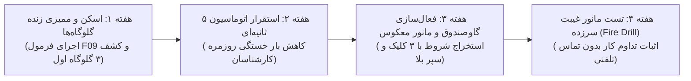

# سند کالبدشکافی عمیق گلوگاه‌های استراتژیک، عملیاتی و روانی سازمان‌ها
## راهنمای جامع شناسایی، سنجش و حذف قطعی گلوگاه‌های کسب‌وکار توسط پلتفرم سینارو (SEYNARO)

**نسخه سند:** ۲٫۵ یکپارچه  
**تاریخ صدور:** نوامبر ۲۰۲۶ (آبان ۱۴۰۵)  
**مرجع کلان پروژه:** `D:\Seynaro\Document\About Project\About Project.md`  
**سطح محرمانگی:** محرمانه تجاری / راهبردی (C-Suite & Board Level)  

---

## ۱. تئوری محدودیت‌های شناختی در سازمان‌ها (Cognitive Theory of Constraints)

طبق نظریه محدودیت‌های الیاهو گلدرات (TOC)، **سرعت و راندمان هر زنجیره ارزش، توسط کندترین و باریک‌ترین گلوگاه (Bottleneck) آن تعیین می‌شود.** در عصر مدرن، گلوگاه کارخانجات و هلدینگ‌های تجاری دیگر «ظرفیت ماشین‌آلات» یا «کمبود نقدینگی» نیست؛ بلکه **«اصطکاک شناختی، انحصار اطلاعاتی در مغز چند فرد خاص و ترس‌های روانی پرسنل»** است.

اگر یک سازمان مجهز به مدرن‌ترین ماشین‌آلات صنعتی آلمانی باشد، اما تصمیم‌گیری برای فرمولاسیون خوراک دستگاه یا ترخیص گمرکی مواد اولیه در گروی حضور یک کارشناس خاص باشد که امروز مرخصی است یا سر قهر دارد، کل کارخانه متوقف می‌شود.

```
┌─────────────────────────────────────────────────────────────────────────────────────────┐
│                     نقشه ۷ گلوگاه کشنده سازمانی و پادزهر سینارو                          │
├──────────────────────────────────┬─────────────────────────────┬────────────────────────┤
│ گلوگاه سازمانی (The Bottleneck)  │ پیامد مخرب در صورت عدم حل   │ پادزهر ساختاری سینارو  │
├──────────────────────────────────┼─────────────────────────────┼────────────────────────┤
│ ۱. وابستگی به تک‌نفر (SPOF)      │ توقف کامل خط تولید یا فروش  │ دوقلوی تصمیم + ZICR > 80%│
│ ۲. انحصارطلبی و باج‌خواهی پنهان  │ گروگان گرفته شدن شرکت       │ تفکیک سند از منطق + رویالتی│
│ ۳. خستگی از بازجویی و فرم‌پرانی │ گورستان اسناد منسوخ (ROT)   │ اصل سکوت در کارهای جاافتاده│
│ ۴. تطبیق دستی و اتلاف زمان      │ سوختن روزانه ۲ ساعت وقت نخبه│ اتوماسیون آنی زیر ۵ ثانیه │
│ ۵. تضاد منافع بین‌دپارتمانی     │ قراردادهای خسارت‌بار و زیان │ داوری خودکار با حل‌کننده Z3│
│ ۶. آنبوردینگ فرسایشی ۶ ماهه     │ فلج شدن شیفت در جابه‌جایی   │ شبیه‌ساز پرواز ShadowBox│
│ ۷. هراس از توبیخ و سرزنش جانشین │ تماس مداوم با نخبه در سفر   │ مهر سیستمی سپر بلای جانشین│
└──────────────────────────────────┴─────────────────────────────┴────────────────────────┘
```

---

## ۲. کالبدشکافی تفصیلی گلوگاه‌های هفت‌گانه و نحوه حذف آن‌ها

### گلوگاه ۱: وابستگی مرگبار به فرد کلیدی (SPOF / Key-Person Dependency)
- **ماهیت گلوگاه:** در بیش از ۸۵٪ شرکت‌ها، فرایندهای حساسی مانند خرید خارجی، ترخیص گمرک، تنظیم دمای اکسترودر کارخانه، یا چانه‌زنی با مشتریان بزرگ، در انحصار یک یا دو نفر است. اگر این افراد به هر دلیلی (تصادف، بیماری، مهاجرت، استعفای ناگهانی) در سازمان نباشند، عملیات مختل می‌شود.
- **شاخص ریاضی سنجش ریسک:** 
  $$	ext{شعاع انفجار (F09: Blast Radius)} = \sum_{j \in 	ext{Downstream}} 	ext{Impact}_j 	imes 	ext{Criticality}_j$$
  $$	ext{ارزش ریالی ریسک مهارنشده (F20: VaR)} = 	ext{Loss}_{	ext{Downtime}} + 	ext{Penalty}_{	ext{Contract}}$$
- **حذف قطعی توسط سینارو:** ماژول `M17` (دوقلوی تصمیم کارمند) و `M16` (شبیه‌ساز تداوم عملیات). در نبود کارمند، سیستم پرونده‌های مشابه را با همان شروط قضاوت فرد در قالب قواعد `IF-THEN-UNLESS` حل می‌کند و نرخ تداوم بدون مداخله (`F18: ZICR`) را به بالای ۸۰٪ می‌رساند.

---

### گلوگاه ۲: انحصارطلبی اطلاعاتی و گروگان‌گیری تجاری (Rent-Seeking Knowledge Hoarding)
- **ماهیت گلوگاه:** کارمندان خبره به تجربه آموخته‌اند که اگر دانش خود را مکتوب کنند، بی‌ارزش شده و ارزان‌تر جایگزین می‌شوند. بنابراین، فرمول‌ها و روابط کلیدی را در فلش‌مموری، دفترچه شخصی یا تلگرام قفل می‌کنند و شرکت را برای حقوق و اختیارات تحت فشار می‌گذارند.
- **چرا راه‌حل‌های سنتی شکست خوردند؟** شرکت‌ها سعی کردند با پاداش‌های ریالی اندک یا اجبار حراستی فایل‌ها را مصادره کنند؛ کارمندان در پاسخ، فایل‌های ناقص یا گمراه‌کننده تحویل دادند (Adversarial Sandbagging).
- **حذف قطعی توسط سینارو:** 
  1. تفکیک مطلق سند از منطق (`CORE-03`): فایل خام در گاوصندوق شخصی کارمند قفل می‌ماند و مصادره نمی‌شود.
  2. رویالتی انتقال تجارب (`STRAT-28`): کارمند در سود پایدار تصمیمات ثبت‌شده در سال‌های آینده سهیم می‌شود.
  3. وستینگ ترفیع (`STRAT-24`): کارمند ارشد تا جانشین خود را مسلط نکند، به پست بالاتر ارتقا نمی‌یابد.

---

### گلوگاه ۳: خستگی از بازجویی اداری و سندروم صفحه سفید (Interrogation & Form Fatigue)
- **ماهیت گلوگاه:** پلتفرم‌های سنتی (کانفلوئنس، نوشن، فرم‌های ایزو) از کارمند می‌خواهند کارش را رها کند و انشاهای طولانی SOP بنویسد. سپس نوتیفیکیشن‌های مکرر تایید کارت برایش ارسال می‌کنند (مثل گورو و بلوم‌فایر). کارمند احساس بازجویی شدن و بیگاری اداری پیدا می‌کند و سیستم را دور می‌زند.
- **حذف قطعی توسط سینارو:** 
  1. مانور معکوس ۳ کلیکی (`STRAT-09`): سیستم خودش رفتار جانشین را حدس می‌زند و کارمند فقط با ۳ کلیک شروط را اصلاح می‌کند (قانون کانینگهام).
  2. اصل سکوت در کارهای جاافتاده (`بند ۲۹٫۷`): به محض بلوغ فرایند، هیچ سوال یا پاپ‌آپی ظاهر نمی‌شود؛ کار آماده است و تنها ۱ تیک سریع ۱ ثانیه‌ای می‌خواهد.

---

### گلوگاه ۴: اتلاف وقت در تطبیق دستی و فرسایش اداری (Manual Cross-Matching Lag)
- **ماهیت گلوگاه:** کارشناسان خبره روزانه بین ۱ تا ۳ ساعت از زمان طلایی خود را صرف کارهای ملال‌آور مانند تطبیق پیش‌فاکتور با رسید انبار، کشف مغایرت‌های دفاتر پایان ماه، صدور پیش‌نویس استعلام قیمت و چک کردن دستی موجودی اکسل می‌کنند. این اتلاف وقت باعث خستگی، خطاهای انسانی و تأخیر در پاسخ به بازار می‌شود.
- **حذف قطعی توسط سینارو:** ماژول `M01` و اسکیل‌های اتوماسیون آنی (`sub-second-3way-match`, `instant-quote-proposal-drafting`). کارهای ۳ ساعته در **زیر ۵ ثانیه** توسط هوش مصنوعی پردازش شده و فقط تایید نهایی را از کارشناس می‌گیرد.

---

### گلوگاه ۵: تضاد منافع و بن‌بست‌های بین‌دپارتمانی (Cross-Departmental Clashes)
- **ماهیت گلوگاه:** هر واحد سازمانی بر اساس اهداف جزیره‌ای خود تصمیم می‌گیرد:
  - واحد فروش برای بستن تارگت ماه، تخفیف ۴۵ روزه به خریدار می‌دهد.
  - واحد مالی شرط نقدینگی را زیر ۳۰ روز تعیین کرده است.
  - واحد انبار ظرفیت فیزیکی برای دپوی خرید ارزان بازرگانی را ندارد.  
  این تعارضات زمانی کشف می‌شوند که قرارداد امضا شده و خسارات سنگین مالی به بار آورده است.
- **حذف قطعی توسط سینارو:** ماژول `M06` (حل‌کننده فرمال Z3 SMT) و فرمول `F26` (اعتماد زنجیره چندگامی). سیستم قیود واحدهای مختلف را با منطق قطعی ریاضی ارزیابی کرده و پیش از ارسال هر پیش‌نویس، تناقضات شرطی را کشف و متوقف می‌سازد.

---

### گلوگاه ۶: برزخ آموزش و آنبوردینگ ۶ ماهه جانشینان (Succession & Onboarding Lag)
- **ماهیت گلوگاه:** وقتی نیروی جدیدی استخدام می‌شود، بین ۳ تا ۶ ماه طول می‌کشد تا فوت‌وفن‌های تجربی و نانوشته کار را یاد بگیرد. در این مدت، یا خطاهای فاحش انجام می‌دهد یا وقت کارشناس ارشد را برای پاسخگویی به سوالات تکراری تلف می‌کند.
- **حذف قطعی توسط سینارو:** ماژول `M10` و شبیه‌ساز پرواز تعاملی ShadowBox. نیروی جدید پشت شبیه‌ساز می‌نشیند و ۵۰ پرونده واقعی تاریخی را حل می‌کند. سیستم با الگوریتم ردیابی بیزی (`F16: BKT`) مهارت‌های او را می‌سنجد و بدون درگیر کردن مربی، آمادگی او را تضمین می‌کند.

---

### گلوگاه ۷: هراس از توبیخ و فرار جانشین از پذیرش مسئولیت (Blame Culture & Liability)
- **ماهیت گلوگاه:** در فرهنگ‌های سمی سازمانی، اگر نیروی جانشین تصمیم حساسی بگیرد و خطایی رخ دهد، فوراً توبیخ یا جریمه می‌شود. به همین دلیل جانشینان جرات اقدام مستقل ندارند و در کوچک‌ترین مسائل، با تلفن کارمند ارشد در مسافرت یا مرخصی تماس می‌گیرند.
- **حذف قطعی توسط سینارو:** پیاده‌سازی اصل ۱۱ غیرقابل مذاکره: **«سپر بلای جانشین (STRAT-10)»**. لاگ رسمی نرم‌افزار ثبت می‌کند که جانشین طبق رویه مستندشده اقدام کرده است؛ در نتیجه هرگونه خطا به عنوان باگ فرایندی ثبت شده و مصونیت از توبیخ فردی جاری می‌گردد.

---

## ۳. ماتریس نگاشت گلوگاه‌های ۷‌گانه به ماژول‌ها و فرمول‌های ۲۸‌گانه سینارو

| گلوگاه سازمانی | ماژول متناظر در سینارو | فرمول‌های محاسباتی پشتیبان | خروجی ملموس تجاری |
| :--- | :--- | :--- | :--- |
| **۱. وابستگی به تک‌نفر (SPOF)** | `M16` (تداوم) و `M17` (دوقلوی تصمیم) | `F09` (شعاع انفجار), `F18` (نرخ ZICR), `F20` (VaR) | تداوم ۱۰۰٪ عملیات در غیاب فرد |
| **۲. انحصارطلبی اطلاعاتی** | `M02` (گاوصندوق) و `M15` (حساب امانی) | `F01`, `F02` (مطلوبیت کارمند), `F22` (تسهیم درآمد) | حذف انحصارطلبی بدون اجبار |
| **۳. خستگی از بازجویی اداری** | `M01` (هسته استنتاج) و `M10` (ردیابی) | `F11` (انتخاب بهینه سؤال BOED) | تیک سریع ۱ ثانیه‌ای بدون فرم |
| **۴. اتلاف زمان تطبیق دستی** | `M01` (اتوماسیون) و `M05` (حافظه COALA) | `F10` (نگهداشت فرمول), `F11` (سرعت چرخه) | کاهش ۸۰٪ زمان چرخه فرایند |
| **۵. تضاد منافع دپارتمان‌ها** | `M06` (حل‌کننده فرمال Z3) | `F12` (شاخص‌های عینی), `F26` (اعتماد زنجیره) | کشف تناقضات پیش از امضا |
| **۶. آنبوردینگ فرسایشی** | `M10` (یادگیری بیزی) و `M14` (کارنامه) | `F05` (Glicko-2), `F16` (BKT), `F17` (Pathfinder) | کاهش زمان آموزش از ۶ ماه به ۲ هفته |
| **۷. هراس از توبیخ و سرزنش** | `M08` (کنترل حاکمیت) و `M12` (تداوم) | `F08` (حریم دسترسی), `F13` (امضای تصمیم) | استقلال کامل جانشین در مرخصی |

---

## ۴. برنامه استقرار گام‌به‌گام حذف گلوگاه‌ها (The 30-Day De-Bottlenecking Protocol)



با این پروتکل ۳۰ روزه، شرکت خریدار از یک وضعیت شکننده و متکی به احساسات افراد، به یک سیستم عامل تاب‌آور، چابک و با راندمان بالا تبدیل می‌شود.
