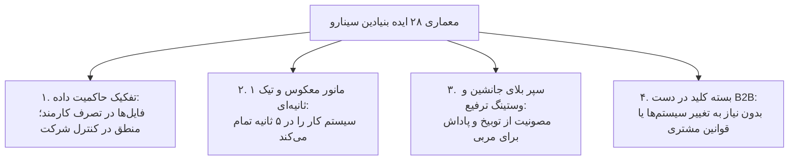

# خلاصه راهبردی و سند توجیهی کلان پروژه سینارو (SEYNARO Executive Project Brief)
## سیستم عامل هوشمند تداوم عملیات و تثبیت سرمایه شناختی سازمان‌ها (Enterprise Operational Continuity OS)

**نسخه گزارش:** ۲٫۵ مدیریتی  
**تاریخ نگارش:** نوامبر ۲۰۲۶ (آبان ۱۴۰۵)  
**مخاطبان هدف:** اعضای هیئت مدیره، مدیران عامل هلدینگ‌ها، مدیران ارشد مالی (CFO) و عملیات (COO)  
**سند تفصیلی مرجع:** `D:\Seynaro\Document\About Project\About Project.md`  

---

## ۱. بیانیه مأموریت در یک جمله (The Core Value Proposition)

> **«سینارو به گروگان‌گیری اطلاعاتی و فلج شدن سازمان‌ها در نبود افراد کلیدی پایان می‌دهد؛ این کار از طریق استخراج خودکار "منطق تصمیم‌گیری" در زیر ۵ ثانیه و بدون نیاز به مصادره اسناد شخصی یا تایپ فرم‌های خسته‌کننده انجام می‌شود.»**

---

## ۲. ریشه‌یابی بحران: چرا شرکت‌ها سالانه میلیاردها تومان خسارت می‌دهند؟

در هر کارخانه، شرکت بازرگانی، شرکت پخش یا مؤسسه مالی، **بیش از ۸۰٪ ارزش اقتصادی شرکت بر پایه «خرد نانوشته (Tacit Knowledge)» چند نفر محدود است.**  
- اگر مدیر بازرگانی یا کارشناس گمرک قهر کند، ۳۰ میلیارد تومان خرید خارجی در گمرک فاسد می‌شود یا جریمه دیرکرد می‌خورد.
- اگر سرپرست تولید شیفت شب کارخانه جابجا شود، نرخ ضایعات خط به دلیل ندانستن فوت کوزه‌گری تنظیم اکسترودر تا ۲۰٪ جهش می‌کند.
- اگر حسابدار ارشد شرکت استعفا دهد، بستن دفاتر مالی ماهانه هفته‌ها عقب می‌افتد.

### چرا تمام ابزارهای گذشته (کانفلوئنس، نوشن، سلونیس، ویوا تاپیکس) شکست خوردند؟
1. **انسان‌ها از نگارش انشا متنفرند:** هیچ مدیر فروش یا کارشناس خریدی وقت و حوصله پر کردن صفحات طولانی ویکی را ندارد.
2. **پارانویای از دست دادن امنیت شغلی:** کارمند حس می‌کند اگر دانشش را مکتوب کند، شرکت بلافاصله او را با یک نیروی ارزان‌تر جایگزین می‌کند؛ در نتیجه شگردها را پنهان می‌کند.
3. **شکست مایکروسافت و کانفلوئنس:** مایکروسافت پلتفرم Viva Topics را در اوایل ۲۰۲۵ رسماً خاموش کرد چون نویز تولید می‌کرد؛ کانفلوئنس نیز به گواه گارتنر دارای ۷۲٪ اسناد منسوخ و خاک‌خورده است.

---

## ۳. فرمول برنده سینارو: چرخش پارادایم به «تفکیک سند از منطق عمل»

سینارو مسئله را نه با «اجبار اداری»، بلکه با **«مهندسی نفع شخصی ارگونومیک»** حل کرده است:



1. **داکیومنت دست کارمند، منطق دست شرکت:**  
   فایل‌های خام، اکسل‌ها و چرک‌نویس‌ها با کلید رمزنگاری محلی کارمند قفل می‌مانند و مصادره نمی‌شوند. شرکت تنها **منطق شرطی (`IF-THEN-UNLESS`)** را در اختیار می‌گیرد تا چرخ‌های عملیات در نبود فرد نچرخد.
2. **اصل سکوت در کارهای جاافتاده و تیک سریع ۱ ثانیه‌ای:**  
   سیستم هیچ فرمی برای پر کردن ندارد. در کارهای روتین، پرونده در ۵ ثانیه در پس‌زمینه آماده است و کارمند فقط یک تیک ۱ ثانیه‌ای می‌زند. زدن تیک ۱۰ برابر آسان‌تر از بهانه‌تراشی است!
3. **پیمان‌نامه سپر بلای جانشین (Successor Blame Shield):**  
   خطای نیروی تازه‌کار اگر طبق منطق مستندشده باشد، خطای سیستمی قلمداد می‌شود و نه مربی و نه جانشین توبیخ نمی‌شوند؛ این اصل ترس از واگذاری کار را صفر می‌کند.
4. **داوری ریاضی با موتور حل‌کننده قطعی Z3 SMT:**  
   تناقضات بین واحدهای مختلف (مثلاً تضاد شرایط تخفیف فروش با سقف نقدینگی مالی) قبل از امضای قرارداد توسط موتور فرمال ریاضی کشف و متوقف می‌شود.

---

## ۴. بسته تجاری‌سازی کلید در دست فروشنده بیرونی (Turnkey B2B Deployment)

شما به عنوان ارائه‌دهنده B2B بدون نیاز به ورود به سیاست‌های داخلی مشتری محصول را می‌فروشید:
* **الحاقیه حقوقی ۲ صفحه‌ای Safe Harbor:** سند آماده‌ای که به امضای وکیل مشتری می‌رسد و تضمین می‌کند داده‌های ثبت‌شده برای تعدیل پرسنل استفاده نمی‌شود.
* **استقرار سبک به صورت افزونه (Smart Overlay):** کار در کنار سپیدار، همکاران سیستم و اکسل‌های قدیمی بدون نیاز به یک ریال هزینه مهاجرت دیتابیس.
* **کیف پول بن‌های رفاهی خودکار:** سیستم مستقیماً کدهای تخفیف اسنپ و دیجی‌کالا را در ازای مشارکت به شماره کارمندان پیامک می‌کند؛ بدون درگیر شدن واحد حسابداری مشتری.
* **پایلوت ۳۰ روزه مشروط (No-Cure-No-Pay):** «اگر ظرف ۳۰ روز زمان اجرای ۳ فرایند گلوگاهی شما ۷۰٪ کاهش نیافت، صفر تومان پرداخت می‌کنید.»

---

## ۵. اقتصاد واحد، قیمت‌گذاری و نرخ بازگشت سرمایه (ROI & Unit Economics)

```
┌────────────────────────────────────────────────────────────────────────────────────────┐
│                        شاخص‌های کلیدی اقتصاد واحد پلتفرم سینارو                        │
├───────────────────────────────┬───────────────────────────────┬────────────────────────┤
│ شاخص اقتصادی                  │ مقدار هدف در مدل B2B           │ منبع ارزیابی و استاندارد│
├───────────────────────────────┼───────────────────────────────┼────────────────────────┤
│ دوره بازگشت سرمایه خریدار    │ کمتر از ۴۵ روز از شروع پایلوت │ فرمول F20 (ارزش ریسک مهارشده)│
├───────────────────────────────┼───────────────────────────────┼────────────────────────┤
│ کاهش زمان چرخه کارهای روتین   │ بین ۷۰٪ تا ۹۰٪ کاهش زمان      │ فرمول F11 (سرعت چرخه فرایند)│
├───────────────────────────────┼───────────────────────────────┼────────────────────────┤
│ نرخ تبدیل پایلوت به خرید قطعی │ بالای ۷۰٪ شرکت‌های ورودی      │ اسکیل b2b-pilot-loi    │
├───────────────────────────────┼───────────────────────────────┼────────────────────────┤
│ نرخ نگه‌داشت خالص درآمد (NRR)  │ بالای ۱۱۰٪ با گسترش لایسنس    │ اسکیل b2b-customer-success│
├───────────────────────────────┼───────────────────────────────┼────────────────────────┤
│ نسبت LTV به CAC برای فروشنده  │ بیشتر از ۳٫۵ به ۱              │ پکیج فرآیندی بدون کاستومایز│
└───────────────────────────────┴───────────────────────────────┴────────────────────────┘
```

---

## ۶. اعتبارسنجی تجربی: نتایج تست سوارم ۱۰۰ ایجنت کارمند

ایده سینارو در دو مرحله به سوارم ۱۰۰ ایجنت کارمند واقعی در ۶ دپارتمان خورانده شد:
1. **آزمون پایه (توزیع نرمال سازمانی):** **۹۱٫۸٪ نرخ همکاری موثر** (۶۴٪ مشتاقانه، ۲۸٪ عمل‌گرایانه، ۸٪ محتاط، ۰٪ بایکوت).
2. **آزمون تخاصم شدید (۱۰۰ ایجنت فوق‌بدبین و استاد پیچوندن):** **۸۷٫۹٪ نرخ همکاری موفق**؛ اثبات شد که به دلیل اصل «تیک سریع ۱ ثانیه‌ای»، پیچوندن سیستم برای کارمندان رند انرژی بیشتری نسبت به همکاری دارد!

---

## ۷. دوازده کاربرد ثروت‌آفرین برای هیئت مدیره فراتر از شبیه‌سازی فردی

با پیاده‌سازی سینارو، شرکت خریدار به امکانات زیر مجهز می‌شود:
1. **دوقلوی تصمیم‌گیری متخصص (USE-01):** تصمیم‌گیری دقیق در غیاب نخبگان.
2. **داوری تضاد منافع واحدها (USE-02):** حل تناقضات فروش و مالی پیش از امضا.
3. **مانور شوک بازار و قو سیاه (USE-03):** تست مقاومت در جهش نرخ ارز و قطعی گاز.
4. **اتوماسیون مستقیم تسک‌ها (USE-04):** بستن پرونده‌های بی‌خطر در ۰٫۵ ثانیه.
5. **کشف تقلب و تبانی مالی (USE-05):** مچ‌گیری از تخفیف‌های مشکوک در خرید و فروش.
6. **تکثیر ترفندهای شیفت برتر به سایر کارخانجات (USE-06).**
7. **شبیه‌ساز پرواز آنبوردینگ (USE-07):** کاهش زمان آموزش نیرو از ۶ ماه به ۲ هفته.
8. **مذاکره‌کننده خودکار تجاری (USE-08).**
9. **جهش ارزش‌گذاری شرکت در بانک و بورس (USE-09).**
10. **نگهداری پیشگیرانه تجربی تجهیزات کارخانه (USE-10).**
11. **قیمت‌گذاری پویا بر مبنای حاشیه سود و خواب انبار (USE-11).**
12. **کشف شکاف واقعیت کف کارخانه با آیین‌نامه‌ها (USE-12).**

---

## ۸. خط زمانی استقرار و نقشه راه ۹۰ روزه اثبات ارزش

* **ماه اول (روز ۱ تا ۳۰):** اجرای پایلوت مشروط روی ۳ فرایند گلوگاهی، ممیزی زنده ریسک تک‌نفر (SPOF)، اثبات کاهش ۷۰٪ زمان و تبدیل به قرارداد سالانه.
* **ماه دوم (روز ۳۱ تا ۶۰):** استقرار دوقلوهای تصمیم، فعال‌سازی گاوصندوق‌های شخصی و سپر بلای جانشین در کلیه دپارتمان‌ها.
* **ماه سوم (روز ۶۱ تا ۹۰):** برگزاری نخستین مانور غیبت سرزده بدون توقف عملیات (Fire Drill)، ارائه گزارش پایداری به هیئت مدیره و توسعه لایسنس به سایر زیرمجموعه‌ها.

---

**نتیجه‌گیری:** سینارو ابزاری برای انشا نوشتن نیست؛ بلکه موتور بقای کسب‌وکار در تلاطم‌های اقتصادی و انسانی بازار مدرن است.
