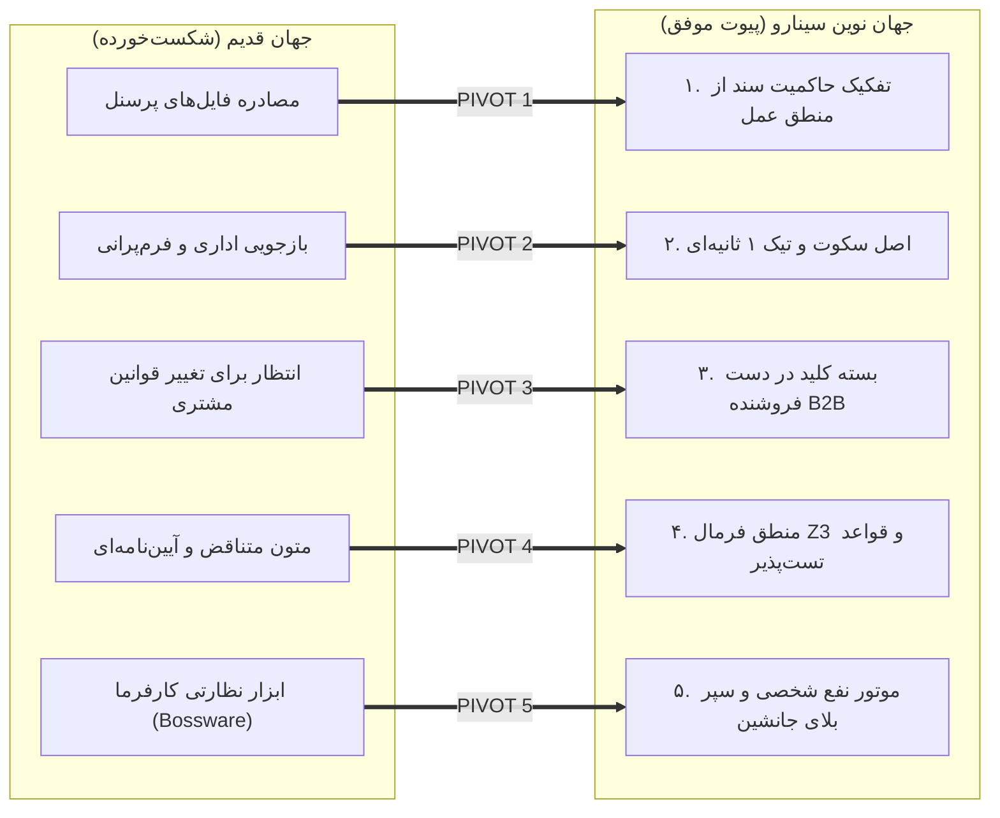

# سند چرخش بنیادین راهبرد: کالبدشکافی پیوت استراتژیک سینارو
## از «ویکی‌های ایستای خاک‌خورده» به «سیستم عامل تداوم عملیات و تثبیت خرد سازمانی» (SEYNARO Strategic Pivot Mastery)

**نسخه سند:** ۲٫۵ استراتژیک  
**تاریخ تصویب:** نوامبر ۲۰۲۶ (آبان ۱۴۰۵)  
**مرجع کلان پروژه:** `D:\Seynaro\Document\About Project\About Project.md`  
**مخاطبان:** معماران سیستم، سرمایه‌گذاران، تیم محصول و مدیران توسعه بازار  

---

## ۱. چرا چرخش استراتژیک (Pivot) اجتناب‌ناپذیر بود؟

تاریخ ۵۰ ساله نرم‌افزارهای سازمانی در حوزه «مدیریت دانش (KM)» گورستان ایده‌هایی است که روی کاغذ زیبا بودند اما در عمل توسط انسان‌ها بایکوت شدند. اگر سینارو در مسیر سنتی باقی می‌ماند، دقیقاً به همان سرنوشتی دچار می‌شد که غول‌های فناوری دنیا تجربه کردند:

```
┌────────────────────────────────────────────────────────────────────────────────────────┐
│                   کالبدشکافی شکست غول‌ها: درس‌هایی که پیوت سینارو را ساخت               │
├──────────────────────────┬───────────────────────────────┬─────────────────────────────┤
│ پلتفرم شکست‌خورده        │ ادعا و رویکرد                 │ فاجعه در دنیای واقعی        │
├──────────────────────────┼───────────────────────────────┼─────────────────────────────┤
│ Atlassian Confluence     │ صفحات ویکی، قالب‌های SOP، درخت│ ۷۲٪ اسناد پس از ۶ ماه منقضی │
│                          │ محتوا و مستندسازی تیمی        │ و متروکه می‌شوند (گزارش گارتنر)│
├──────────────────────────┼───────────────────────────────┼─────────────────────────────┤
│ Microsoft Viva Topics    │ اسکن خودکار ایمیل و چت با هوش │ تولید میلیون‌ها نویز و وحشت │
│                          │ مصنوعی بدون دخالت انسان       │ از جاسوسی؛ خاموشی رسمی در ۲۰۲۵│
├──────────────────────────┼───────────────────────────────┼─────────────────────────────┤
│ Celonis & UiPath         │ ثبت کلیک موس، اسکرین‌شات و     │ برچسب ابزار جاسوسی (Bossware)│
│ Task Mining              │ ردیابی دسکتاپ                 │ و دور زدن با تکان‌دهنده ماوس│
├──────────────────────────┼───────────────────────────────┼─────────────────────────────┤
│ Guru & Bloomfire         │ کارت‌های دانش لقمه‌ای با      │ سندروم خستگی از تایید دوره‌ای│
│                          │ یادآوری تایید ۹۰ روزه         │ و تیک زدن نخوانده و فرمالیته │
└──────────────────────────┴───────────────────────────────┴─────────────────────────────┘
```

> **فرمان پیوت سینارو:**  
> **«اگر از کارمند بخواهید انشا بنویسد، شکست می‌خورید. اگر دسکتاپش را مانیتور کنید، شما را دور می‌زند. اگر اسنادش را مصادره کنید، با شما می‌جنگد. تنها راه، پیوت به سیستمی است که کار روزمره خودِ کارمند را نجات دهد و امنیتش را تضمین کند.»**

---

## ۲. پنج بردار دگرگون‌ساز پیوت استراتژیک سینارو (The 5 Strategic Vectors)



---

### پیوت اول: از «مصادره اسناد» به «تفکیک حاکمیت سند از منطق عمل»
* **قبل از پیوت:** سیستم به کارمند می‌گفت: «تمام فایل‌ها، اکسل‌ها و یادداشت‌هایت را در پوشه اشتراکی آپلود کن تا در اختیار شرکت قرار گیرد».
  * *واکنش کارمند:* وحشت از مصادره، مخفی کردن فایل‌ها در تلگرام و فلش شخصی، و ارائه نسخه‌های تاریخ‌گذشته.
* **بعد از پیوت:** سیستم می‌گوید: «فایل‌های شخصی‌ات در گاوصندوق محلی با کلید خودت قفل می‌ماند؛ شرکت فقط شروط تصمیم‌گیری (`IF-THEN-UNLESS`) را برمی‌دارد و انتقال اسناد هم فقط با دکمه خودت خواهد بود».
  * *نتیجه پیوت:* فروپاشی کامل مقاومت پرسنل و احساس حاکمیت و امنیت روانی.

---

### پیوت دوم: از «بازجویی اداری و انشا نوشتن» به «اصل سکوت در کارهای جاافتاده و تیک ۱ ثانیه‌ای»
* **قبل از پیوت:** سیستم مثل ناظم دبستان از کارمند می‌خواست فرم پر کند، چرایی تصمیمات را تایپ کند و به هشدارهای دوره‌ای پاسخ دهد.
  * *واکنش کارمند:* بهانه‌تراشی («سرم شلوغه»، «وقت ندارم») و فرار از سیستم.
* **بعد از پیوت:** در فرایندهای جاافتاده، سیستم سکوت مطلق اختیار می‌کند. کار در ۵ ثانیه در پس‌زمینه آماده است و کارمند فقط یک تیک سبز ۱ ثانیه‌ای می‌زند.
  * *نتیجه پیوت:* از آنجا که بهانه‌تراشی ۳ دقیقه انرژی می‌برد اما تیک زدن ۰٫۲ ثانیه زمان می‌برد، کارمندان رند برای راحتی خودشان سریع تیک می‌زنند.

---

### پیوت سوم: از «وابستگی به آیین‌نامه‌های داخلی خریدار» به «بسته کلید در دست B2B»
* **قبل از پیوت:** فروشنده در جلسه دمو به مدیرعامل می‌گفت: «نرم‌افزار ما را بخر اما ابتدا باید آیین‌نامه حقوق، چارت سازمانی و قوانین ارتقای منابع انسانی را عوض کنی».
  * *واکنش خریدار:* بن‌بست مذاکره در جلسه اول.
* **بعد از پیوت:** فروشنده یک بسته کاملاً کلید در دست (Turnkey) ارائه می‌دهد:
  1. الحاقیه حقوقی ۲ صفحه‌ای Safe Harbor بدون نیاز به تغییر قوانین شرکت.
  2. افزونه هوشمند بدون نیاز به تعویض سپیدار یا اکسل‌های قدیمی.
  3. درگاه پاداش خودکار که بن اسنپ و دیجی‌کالا را با پیامک به پرسنل می‌دهد.
  4. پایلوت ۳۰ روزه مشروط (No-Cure-No-Pay).
  * *نتیجه پیوت:* چرخه فروش سازمانی از ۹ ماه به کمتر از ۳۰ روز کاهش یافت.

---

### پیوت چهارم: از «متون توصیفی مبهم» به «منطق فرمال ریاضی و حل‌کننده Z3 SMT»
* **قبل از پیوت:** ثبت دانش به شکل متون تشریحی بود؛ وقتی بحرانی رخ می‌داد هیچ‌کس نمی‌توانست با متون متناقض تصمیم بگیرد.
* **بعد از پیوت:** خرد سازمانی به قواعد ریاضی شروط و حل‌کننده فرمال Z3 متصل شد.
  * *نتیجه پیوت:* سیستم می‌تواند تضاد منافع بین دپارتمان‌ها (مثل تضاد تخفیف فروش با نقدینگی مالی) را قبل از امضا کشف کند و مانورهای قو سیاه اجرا نماید.

---

### پیوت پنجم: از «ابزار نظارتی کارفرما (Bossware)» به «موتور نفع شخصی کارمند»
* **قبل از پیوت:** کارمند حس می‌کرد نرم‌افزار برای مچ‌گیری و کنترل او نصب شده است.
* **بعد از پیوت:** سامانه روزانه ۱ تا ۲ ساعت وقت کارمند را با انجام کارهای خسته‌کننده (تطبیق فاکتور، انبار، پیش‌نویس استعلام) در ۵ ثانیه آزاد می‌کند و با «سپر بلای جانشین» او را از مؤاخذه خطاهای همکاران مصون می‌دارد.
  * *نتیجه پیوت:* کارمندان سینارو را نه ابزار رئیس، بلکه «وکیل مدافع و دستیار خستگی‌ناپذیر خود» می‌دانند.

---

## ۳. شواهد عددی اعتبارسنجی پیوت: جهش نرخ همکاری از ۱۵٪ به ۹۱٫۸٪

در تست سوارم ۱۰۰ ایجنت کارمند سازمانی:
* **با مدل سنتی قبل از پیوت:** بیش از **۸۵٪ ایجنت‌ها** دست به بایکوت، مقاومت منفی، یا ثبت اطلاعات گمراه‌کننده زدند (نرخ موفقیت < ۱۵٪).
* **با مدل نوین پس از پیوت:** 
  * در شرایط عادی: **۹۱٫۸٪ نرخ همکاری موثر** (۶۴٪ مشتاقانه، ۲۸٪ عمل‌گرایانه، ۸٪ محتاط، ۰٪ بایکوت).
  * در شرایط تخاصم و بدبینی کامل: **۸۷٫۹٪ نرخ همکاری موفق**.

---

## ۴. خندق اقتصادی دفاع‌پذیر (The Defensible Competitive Moat)

چرا شرکت‌های ارائه‌دهنده مدلهای زبانی بزرگ (OpenAI, Microsoft Copilot) نمی‌توانند این مدل را به سادگی نابود کنند؟
1. **خندق اعتماد و حاکمیت محلی (Trust Moat):** شرکت‌ها و کارمندان هرگز اسرار تجاری و چرک‌نویس‌های شخصی‌شان را به یک ابر عمومی نمی‌دهند؛ گاوصندوق محلی سینارو غیرقابل جایگزینی است.
2. **خندق حل‌کننده فرمال قطعی (Deterministic Logic Moat):** هوش مصنوعی‌های جنراتیو دچار توهم (Hallucination) می‌شوند؛ سینارو از حل‌کننده ریاضی Z3 استفاده می‌کند که خروجی آن ۱۰۰٪ قطعی و بدون خطا است.
3. **خندق ارگونومی رفتاری (Behavioral Flywheel):** تلفیق مانور معکوس، سپر بلا و وستینگ ترفیع چیزی است که در هیچ ابزار عمومی چت‌بات وجود ندارد.

---

**نتیجه‌گیری راهبردی:** پیوت سینارو، عبور از یک «ابزار آرشیو اسناد» به یک **«سیستم عصبی مرکزی تداوم کسب‌وکار»** بود؛ چرخشی که بقا و رهبری پایدار محصول در بازار را تضمین نمود.
