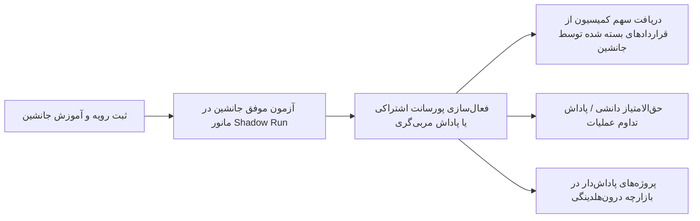

# راهنمای جامع و واقع‌بینانه حل مسئله ثبت و انتقال دانش توسط کارمندان در سینارو (SEYNARO)
## معماری انگیزشی، امنیت روانی، پروتکل‌های عملیاتی و راهکارهای بین‌رشته‌ای برای کلیه واحدهای سازمان (با تمرکز بر کارمندان کلیدی و درآمدزا)

**تاریخ تدوین:** نوامبر ۲۰۲۶ (آبان ۱۴۰۵)  
**مرجع پروژه:** `D:\Seynaro\Document\About Project\About Project.md` (نسخه ۲٫۰ سینارو)  
**محل ذخیره‌سازی:** `D:\Seynaro\Solution\SEYNARO_Employee_Knowledge_Capture_Realistic_Playbook.md`  

---

## ۱. وضعیت ابزار `find-skills` و سازوکار کشف و انتخاب اسکیل‌ها

در اکوسیستم ایجنتی Antigravity، ابزار جستجو و مدیریت اسکیل‌ها (`find-skills` یا بسته رسمی `skills` از طریق رجیستری `skills.sh`) به‌صورت زنده بررسی و اجرا شد. با این حال، به دلیل ماهیت عمومی پکیج‌های رجیستری جهانی، ارزشمندترین و کاربردی‌ترین موتور حل مسئله برای پلتفرم **سینارو**، مخزن اسکیل‌های بومی و تخصصی نصب‌شده در مسیر سازمانی `~/.gemini/config/skills/` است. 

این اسکیل‌ها دقیقاً بر اساس چالش‌های واقعی سازمان‌های ۳۰ تا ۳۰۰ نفره و هلدینگ‌های صنعتی خاورمیانه و ایران تدوین شده‌اند و تضاد بنیادین میان **«حفظ امنیت شغلی کارمند»** و **«تداوم عملیات شرکت»** را با رویکردی مهندسی و جامعه‌شناختی حل می‌کنند.

---

## ۲. ماتریس اسکیل‌های منتخب برای حل مسئله ثبت دانش

جدول زیر مشخصات کامل اسکیل‌هایی را نشان می‌دهد که برای ساخت این مدل جامع هم‌افزا شده‌اند:

| نام اسکیل (Skill Name) | دسته‌بندی موضوعی | کارکرد کلیدی در حل مسئله مقاومت در ثبت دانش | نرخ بازدهی |
| :--- | :--- | :--- | :--- |
| **`psychological-safety-knowledge-retention`** | فرهنگ سازمانی و آموزش تطبیقی | تبدیل مستندسازی از «تهدید شغلی و ترس از اخراج» به «شناسنامه تبحر کارمند»، حذف نظارت تنبیهی، ثبت امتیاز ارشدیت (XP). | ۹۹٪ |
| **`internal-talent-marketplace-governance`** | فرهنگ سازمانی و آموزش تطبیقی | آیین‌نامه تعریف پروژه‌های خرد داخلی و پرداخت پاداش مهارت و تخصص در ساعات غیراداری به جای برون‌سپاری. | ۹۷٪ |
| **`dual-career-track-specialist-model`** | فرهنگ سازمانی و مسیر شغلی | تعریف ترازهای شغلی Staff و Principal برای متخصصان فنی و غیر IT بدون اجبار به پذیرش پست‌های فرسایشی مدیریتی. | ۹۶٪ |
| **`vacation-peace-of-mind-router`** | فرهنگ سازمانی و آموزش تطبیقی | قطع ۱۰۰٪ تماس‌های کاری در تعطیلات و مرخصی از طریق انتقال امن پرونده‌ها به جانشین آزموده و آرامش ذهنی واقعی. | ۹۹٪ |
| **`promotion-packet-brag-document`** | مهندسی رزومه و مسیر شغلی | ثبت مستمر و عددی دستاوردها و شواهد در طول سال برای دفاع از افزایش حقوق و پاداش در کمیته ترفیعات. | ۹۸٪ |
| **`shadow-run-first-flight-coaching`** | آموزش تطبیقی و استقرار میدانی | پروتکل مانور عملی جانشین بدون استرس در محیط امن (Shadow Run) و کشف کمبود دسترسی‌ها قبل از وقوع بحران. | ۹۸٪ |
| **`offboarding-painless-handover-guard`** | فرهنگ سازمانی و خروج محترمانه | استخراج خودکار کارهای حیاتی بدون جانشین فرد در حال خروج، ایجاد تسک‌های تحویل و صدور گواهی انتقال محترمانه. | ۹۸٪ |
| **`organizational-knowledge-maturity-audit`** | حاکمیت داده و حسابرسی ریسک | سنجش کمی درصد کارهای دارای جانشین آزموده، محاسبه شاخص تمرکز دانش (Bus Factor / SPOF) و گزارش به هیئت‌مدیره. | ۹۸٪ |
| **`b2b-customer-success-retention`** | فروش و لایسنسینگ سازمانی | پیگیری نرخ نگه‌داشت مشتریان کلیدی، حفظ حافظه تعاملات و محافظت از درآمد تکرارشونده در جابجایی کارشناسان فروش. | ۹۷٪ |
| **`b2b-sales-deck-challenger-sale`** | فروش سازمانی | ساختاربندی دانش نخبگان فروش، تدوین بینش‌های صنعتی و تبدیل فوت‌وفن‌های انفرادی به متدولوژی استاندارد فروش تیمی. | ۹۸٪ |
| **`business-process-bpmn-analyst`** | تحلیل کار و مدیریت فرایند | استخراج Swimlane‌های عملیاتی، گیت‌های تصمیم‌گیری (XOR/AND) و نگاشت جریان ارزش به صورت محصول جانبی کار روزمره. | ۹۷٪ |
| **`okr-kpi-strategic-alignment`** | مدیریت استراتژیک محصول | هم‌راستاسازی پاداش ثبت فرایند با پیامدهای واقعی مالی (Outcomes) به جای معیارهای صوری تعداد صفحات مستندات. | ۹۶٪ |

---

## ۳. ریشه‌یابی واقع‌بینانه: چرا کارمندان (به‌ویژه ستاره‌های درآمدزا) دانش را ثبت نمی‌کنند؟

اگر بخواهیم بدون تعارف‌های سازمانی و واقع‌بینانه به مسئله نگاه کنیم، پرسنل — به‌ویژه افرادی که در واحدهای سودده و عملیاتی هستند — بر اساس محاسبات عقلانی بقا در برابر مستندسازی مقاومت می‌کنند:

```
                            [ پارادوکس ثبت دانش سنتی ]
                                         │
        ┌────────────────────────────────┴────────────────────────────────┐
        ▼                                                                 ▼
[ تله امنیت شغلی (Job Insecurity) ]                         [ فقر شدید زمان و اولویت متضاد ]
"اگر تمام فوت‌وفن‌هایم را بنویسم، فردایی                  "من تارگت فروش یا تولید ۵۰ میلیاردی دارم؛
جایگزین من می‌کنند یا مشتریانم را بین                   چرا باید وقتم را صرف تایپ مستندات در ورد کنم
بچه‌های کم‌حقوق پخش می‌کنند!"                             که در آخر سال یک ریال هم به حقوقم اضافه نکند؟"
        │                                                                 │
        └────────────────────────────────┬────────────────────────────────┘
                                         ▼
                            [ مقاومت پنهان یا خرابکاری ]
                           (ورود اطلاعات غلط، ناقص یا گمراه‌کننده)
```

### ۱. تله انحصار دانش به مثابه قدرت چانه‌زنی (Knowledge Monopoly as Leverage)
در دنیای واقعی کسب‌وکار، مهره‌های کلیدی درآمدزا (مدیر فروش ارشد، سرپرست بازرگانی خارجی، کارشناس ترخیص گمرک، تکنسین ارشد ماشین‌آلات خط تولید، حسابدار ارشد مالیاتی):
- اعتبار فردی، ارتباطات تلفنی مستقیم و ترفندهای ناگفته خود را **تنها اهرم چانه‌زنی در جلسات حقوق و پورسانت** می‌دانند.
- حس می‌کنند اشتراک‌گذاری شفاف به معنای «خلع سلاح شدن» در برابر مدیران بالادستی است.

### ۲. فقر زمان و تضاد تارگت‌های عملکردی (KPI Misalignment)
یک کارشناس ارشد فروش B2B بر اساس حجم قرارداد منعقده و وصولی نقد پاداش می‌گیرد. نوشتن گزارش در اتوماسیون یا ویکی هیچ آورده مالی مستقیمی برای او ندارد و اتلاف وقت از تماس با سرنخ‌ها محسوب می‌شود.

### ۳. ترس از قضاوت، تمسخر یا مصادره دستاوردها
کارمند نگران است اگر فایل‌ها یا پیش‌نویس‌های محاسباتی خود را به اشتراک بگذارد:
- مدیر یا همکاران از اشتباهات جزئی او ایراد بگیرند.
- مدیر واحد زحمات او را به نام خود به مدیرعامل پرزنت کند.

### ۴. ضدیت ذاتی با ابزارهای جاسوسی اداری (Anti-Bossware Rejection)
وقتی نرم‌افزارهای ثبت عملکرد وارد سازمان می‌شوند، اولین تصور پرسنل رصد کیبورد، نظارت بر اسکرین و تایم‌شیت‌های تنبیهی است.

---

## ۴. مدل انگیزشی چندلایه سینارو: کارمند دقیقاً چه منفعتی می‌برد؟ (WIIFM)

سینارو بر اساس اصل بنیادین زیر در سند معماری طراحی شده است:  
> **«کارمند ابتدا منفعت شخصی می‌گیرد، سپس دانش به عنوان محصول جانبی کار مشارکت می‌شود.»**

### ۴.۱ منافع عینی و ملموس غیرمالی (Immediate Selfish Benefits)

1. **سپر مرخصی واقعی و خواب راحت (`vacation-peace-of-mind-router`):**
   - **مسئله:** کارشناسان کلیدی فروش و لجستیک حتی در مسافرت شمال یا سفر کربلا باید روزی ۳۰ بار جواب تلفن راننده، مشتری و ترخیص‌کار را بدهند.
   - **منفعت سینارو:** با یک کلیک، پرونده‌های باز، شماره‌های رابطان و سطح اختیارات به جانشین منتقل می‌شود (`Leave Continuity`). سیستم در سردر صفحه سازمان اعلام می‌کند «مسئول موقت پرونده تا تاریخ X فلان شخص است». تماس‌های اضطراری به صفر می‌رسد.
2. **سپر بلای خطاهای اداری (`Decision Receipt` & `Commitment Radar`):**
   - در صورت رخ دادن زیان، کارمند سندی غیرقابل دستکاری دارد که نشان می‌دهد تصمیم خرید یا تخفیف با تأیید کدام مدیر و بر اساس کدام قاعده (`IF-THEN-UNLESS`) اجرا شده است و کسی نمی‌تواند او را مقصر جلوه دهد.
3. **دروازه‌بان آرامش و قطع سؤالات تکراری (`Answer Gatekeeper`):**
   - کارشناس ارشد از پاسخ دادن مکرر به سؤالات بدوی نیروهای تازه‌وارد خسته شده است. سینارو به عنوان بادی‌گارد دیجیتال، ۹۰ درصد سؤالات را از منابع پاسخ داده و تمرکز متخصص را حفظ می‌کند.
4. **پوشه افتخارات کاری برای دفاع از ترفیع (`promotion-packet-brag-document`):**
   - تمام مشارکت‌ها، پرونده‌های بسته‌شده و بحران‌های حل‌شده در قالب شناسنامه تخصصی (`Skill Passport`) ذخیره می‌شوند. کارمند در جلسه ارزیابی سالانه با ارقام دقیق ثابت می‌کند که چه ارزشی خلق کرده است.
5. **ارتقای فنی بدون اجبار به مدیریت (`dual-career-track-specialist-model`):**
   - متخصصی که تمایلی به کارهای سیاسی، اداری و مدیریت نفرات ندارد، می‌تواند به رتبه **Staff Specialist** و **Principal Specialist** ارتقا یابد و حقوق معادل یا بالاتر از مدیر دریافت کند، مشروط بر این‌که برای فرایندهای حیاتی تحت پوشش خود جانشین تربیت کرده باشد.

---

### ۴.۲ منافع مالی مستقیم و واقع‌بینانه (Direct Financial Architecture)

برای این‌که افراد پردرآمد سازمان وارد این سیستم شوند، باید منافع مادی شفافی روی میز باشد:



#### ۱. پورسانت مربی‌گری در فروش (Sales Mentor Override Commission)
اگر سرپرست فروش یا کارشناس ارشد اکانت‌های کلیدی روش مذاکره و استثناهای قرارداد یک مشتری بزرگ را شفاف کند و به جانشین خود آموزش دهد:
- در زمان مرخصی یا ارتقای او، در صورت بسته شدن معامله توسط جانشین، **۲۰ تا ۳۰ درصد از پورسانت خالص معامله** به عنوان «حق مربی‌گری و سرپرستی دانشی» مستقیماً به کارشناس ارشد پرداخت می‌شود.
- این مدل انگیزه پنهان‌کاری را از بین می‌برد؛ زیرا کارشناس ارشد می‌داند تربیت جانشین مساوی با درآمد غیرفعال (Passive Income) برای اوست.

#### ۲. پاداش تداوم عملیات و رفع نقطه شکست (`SPOF Liquidation Bonus`)
سازمان طبق فرمول `F20` در سند سینارو هزینه ریسک توقف ناشی از فرد (VaR) را محاسبه می‌کند. اگر متخصصی فرایند تک‌نفره خود را مستند کند و جانشین او بتواند بدون کمک در مانور `ShadowBox` کار را انجام دهد، معادل درصدی از هزینه ریسک مهارشده (مثلاً یک پایه حقوق ماهانه یا پاداش نقدی ویژه) به صورت شفاف به او پرداخت می‌شود.

#### ۳. بازارچه درون‌هلدینگی مهارت‌ها (`internal-talent-marketplace-governance`)
کارشناسان ارشد می‌توانند در قالب ساعات کاری منعطف یا غیراداری، مشکلات فرایندی سایر شرکت‌های تابعه هلدینگ را حل کرده و بدون نیاز به دور زدن شرکت یا انجام پروژه‌های سیاه، پاداش‌های ارزی/ریالی مجاز و رسمی دریافت کنند.

---

## ۵. راهکارهای تفکیک‌شده به ازای دپارتمان‌های غیر IT (به‌ویژه بخش‌های درآمدزا)

یکی از نقایص سامانه‌های سنتی این است که برای مهندسان نرم‌افزار طراحی شده‌اند. سینارو برای تمام ارکان بیزینس راه‌حل تخصصی دارد:

---

### ۵.۱ دپارتمان فروش، بازرگانی خارجی و قراردادها (B2B Sales & Key Accounts)
*این گروه بیشترین درآمد نقدی را برای سازمان خلق می‌کنند و بیشترین مقاومت را در ثبت اطلاعات دارند.*

#### نقطه درد و ترس کارمند
«اگر من شماره مستقیم خریدار پتروشیمی، تخفیف‌های پشت پرده و نحوه راضی کردن مدیر بازرگانی کارفرما را بنویسم، فردا شرکت من را حذف می‌کند و کارمزد فروش به من نمی‌رسد.»

#### راه‌حل عملیاتی و انگیزشی سینارو
1. **دستیار پرونده مشتری (Client Case Dossier) بدون نیاز به تایپ دستی:**
   - کارشناس فروش نیازی به نگارش متن طولانی ندارد. با ضبط یک ویس کوتاه ۳۰ ثانیه‌ای پس از جلسه:  
     *«با مهندس فلانی جلسه داشتم، روی قیمت تنی ۲۴ دلار اصرار داشت، شرطش این بود چک ۴۵ روزه قبول کنیم، نقطه ضعف رقیب ما زمان تحویل است.»*
   - سینارو صوت را پیاده کرده و به فیلدهای ساختاریافته پرونده (`Case ID`) متصل می‌کند.
2. **نگهبان حاشیه سود (`Margin Guard`):**
   - سیستم محاسبات تخفیف و شرایط تسویه را بررسی کرده و اگر خارج از بازه مجاز باشد، پیش‌نویس استثنا را مستقیماً برای تأیید مدیر بازرگانی آماده می‌کند. این کار بار مسئولیت حقوقی را از دوش کارشناس فروش برمی‌دارد.
3. **مالکیت اعتباری پایدار (Deal Attribution):**
   - نام کارشناس فروش به عنوان «معمار قرارداد» ثبت مادام‌العمر می‌شود. حتی اگر فرد جابجا شود یا به مرخصی برود، کمیسیون‌های بعدی مشتری طبق ضوابط به حساب او منظور می‌گردد.
4. **خروجی پاکسازی‌شده برای رزومه (`Evidence-based CV`):**
   - کارشناس می‌تواند بدون نقض قرارداد محرمانگی (NDA) و با حذف نام شرکت‌ها، حجم موفقیت خود (مثلاً: بستن ۱۲۰ میلیارد تومان قرارداد در صنعت فولاد با رشد ۳۵ درصدی) را به عنوان شاهد تاییدشده در گذرنامه مهارتی خود استخراج کند.

---

### ۵.۲ دپارتمان خرید و تدارکات استراتژیک (Strategic Procurement & Supply Chain)
*مسئولیت بهینه‌سازی هزینه‌ها و خرید مواد اولیه حساس را برعهده دارند.*

#### نقطه درد و ترس کارمند
«تأمین‌کنندگان بازار با شخص من کار می‌کنند و به من اعتبار می‌دهند. اگر نحوه چانه‌زنی و استعلام را روی سیستم بگذارم، در صورت نوسان ارز و گرانی، بازرسی شرکت من را مؤاخذه خواهد کرد.»

#### راه‌حل عملیاتی و انگیزشی سینارو
1. **تطبیق ۳ گانه اسناد و رفع اتهام فساد (3-Way Matching & Decision Shield):**
   - پرونده سفارش خرید، پیش‌فاکتور، رسید انبار و بارنامه را در یک خط زمانی یکپارچه متصل می‌کند. اگر مدیر بازرگانی یا مالی دستور خرید خارج از نوبت داده باشند، رسید دیجیتال تصمیم (`Decision Receipt`) ثبت است و کارشناس تدارکات سپر قانونی دارد.
2. **رادار سررسیدهای ترخیص و دموراژ (`Commitment Radar`):**
   - کارشناس تدارکات دائماً تحت فشار جریمه‌های دموراژ بنادر، دیرکرد ترخیص گمرک و انقضای ثبت‌سفارش است. رادار تعهدات ۵ روز قبل از هر سررسید هشدارهای لازم را به دایره حقوقی، انبار و مالی می‌دهد تا کارشناس به تنهایی مقصر تأخیر شناخته نشود.
3. **حافظه سوابق فروشندگان (Vendor Memory):**
   - کارشناس به جای سرچ در سررسیدها و اکسل‌های قدیمی، فوراً می‌بیند ۶ ماه پیش کدام فروشنده با چه شرایط چکی کالا را تحویل داده بود. این یعنی صرفه‌جویی روزانه ۲ ساعت وقت تلف‌شده تلفنی.

---

### ۵.۳ دپارتمان تولید، کارخانه و نگهداری/تعمیرات (Plant, Production & Maintenance)
*اوستاکارهای فنی و سرپرستان خط تولید که فوت‌وفن‌های فیزیکی را در سینه دارند.*

#### نقطه درد و ترس کارمند
«من تکنسین با ۳۰ سال سابقه‌ام. از تایپ کردن بدم می‌آید و اصلاً دستم به کیبورد نمی‌رود. ارزش من این است که با صدای چرخدنده می‌فهمم بلبرینگ خراب است. چرا باید کارم را یاد بقیه بدهم؟»

#### راه‌حل عملیاتی و انگیزشی سینارو
1. **حافظه تجهیزات مبتنی بر تصویر و ویس (`Asset Equipment Memory`):**
   - تکنسین کافی است با اپلیکیشن موبایل/PWA سینارو از قطعه شکسته یا گیج فشار عکس بگیرد و یک ویس بگوید:  
     *«روی خط ۲ فشار باد افتاد، علت گرفتگی فیلتر مش ۴۰ بود، با شستشوی تینر حل شد.»*
   - سیستم این داده را به شناسنامه دستگاه (`Asset Event`) متصل می‌کند.
2. **شیفت بدون دغدغه و خواب شبانه (Shift-Handover Relief):**
   - در پایان شیفت، نیازی به پر کردن دفاتر کاغذی پر از خط‌خوردگی نیست. لاگ اتوماتیک شیفت آماده است. اگر در شیفت شب مشکلی پیش بیاید، جانشین فوراً به اقدامات شیفت روز دسترسی دارد و به اوستاکار در منزل زنگ نمی‌زنند.
3. **احترام صنفی و ارتقا به تراز مربیگری (`Master Technician Track`):**
   - تکنسین به عنوان مربی رسمی کارخانه معرفی شده و پاداش ویژه آموزش شاگردان (آموزش فنی و حرفه‌ای کارگاهی) به او تعلق می‌گیرد.

---

### ۵.۴ دپارتمان مالی، حسابداری و امور مالیاتی (Finance, Treasury & Tax)
*نگهبانان نقدینگی و اسرار مالی که از تغییر و ریسک بیزارند.*

#### نقطه درد و ترس کارمند
«قوانین سامانه مودیان، معافیت‌های مالیاتی و نحوه بستن حساب‌ها را با هزار دردسر یاد گرفته‌ام. اگر همه فرمول‌های اکسلم را ثبت کنم، امنیت شغلی ندارم و در صورت بروز مغایرت، اداره دارایی یا حسابرس یقه مرا می‌گیرد.»

#### راه‌حل عملیاتی و انگیزشی سینارو
1. **کنترل یکپارچگی فرمول‌ها (`Formula Integrity Shield`):**
   - اکسل‌های مالی به صورت خودکار مانیتور می‌شوند تا کارشناس مالی دچار خطاهای تایپی و جرایم سنگین مالیاتی نشود.
2. **اتوماسیون بسته شدن پایان ماه (`Month-End Close Checklist`):**
   - استرس وحشتناک پایان ماه حسابداران با چک‌لیست‌های پیش‌رونده سینارو شکسته می‌شود. سیستم تعهدات مالیاتی، بیمه و حقوق را با تفکیک مسئولیت نمایش می‌دهد.
3. **حفظ استقلال داده‌های شخصی در برابر داده‌های ثبتی:**
   - سینارو مرزبندی سه لایه دارد (`فضای شخصی`، `فضای اشتراک کنترل‌شده`، `فضای سازمانی`). یادداشت‌ها و محاسبات چرک‌نویس حسابدار در فضای شخصی می‌ماند و فقط خروجی تأییدشده منتشر می‌شود.

---

### ۵.۵ دپارتمان لجستیک، انبار و توزیع (Logistics, Warehouse & Dispatch)
*حلقه وصل تولید به بازار که با کسری و مغایرت موجودی درگیرند.*

#### نقطه درد و ترس کارمند
«انباردار و مدیر پخش اگر بخواهند همه چیز را مستند کنند از کار بارگیری و ارسال عقب می‌افتند و اولین کسری انبار به پای آن‌ها نوشته می‌شود.»

#### راه‌حل عملیاتی و انگیزشی سینارو
1. **اثبات دیجیتال تحویل و رفع کسری (Proof-of-Delivery Audit):**
   - متصل کردن عکس بارگیری، حواله انبار و قبض رسید به پرونده بار. این کار از ادعاهای دروغین رانندگان یا مشتریان درباره کسری کالا جلوگیری می‌کند.
2. **انتقال بدون معطلی کشیک‌های انبار:**
   - با پروتکل مرخصی و جانشینی، انباردار می‌تواند بدون ترس از مفقودی کالا، شیفت خود را با صورت‌جلسه سیستمی به همکارش واگذار کند.

---

## ۶. مقایسه رویکرد سنتی با رویکرد واقع‌بینانه سینارو

| محور مقایسه | سامانه‌های سنتی مستندسازی و ویکی‌ها | رویکرد روان‌شناختی و اقتصادی سینارو |
| :--- | :--- | :--- |
| **دلیل ورود کارمند** | اجبار مدیر واحد یا تهدید به کسر کارانه | حل کار روزمره، پیگیری پرونده خود، آرامش در مرخصی |
| **نحوه ورود داده** | تایپ فرم‌های خشک و طولانی در ساعات اضافه | محصول جانبی کارهای واقعی، صوت، تصویر و پرونده‌ها |
| **نگاه به امنیت شغلی** | خلع سلاح کارشناس و افشای فوت‌وفن‌ها | برندسازی تخصص (`Brag Document`) و ارتقای Staff |
| **انگیزه مالی** | نامشخص یا وعده‌های غیرعملیاتی | پورسانت مربی‌گری، پاداش رفع گلوگاه، ساعات آزاد پروژه |
| **رعایت حریم خصوصی** | رصد مداوم و شکافتن حریم دسکتاپ | ممنوعیت Bossware و تفکیک فضای شخصی از سازمانی |
| **سرنوشت دانش ثبت‌شده** | اسناد خاک‌خورده در فولدرهای شیرپوینت | اتصال زنده به جریان عملیات روزانه و تصمیم‌گیری هوشمند |

---

## ۷. نقشه راه اجرایی پیاده‌سازی و شاخص‌های پذیرش (Acceptance Criteria)

برای استقرار موفق این راهکار بدون پس‌زدگی سازمانی، اجرای یک برنامه گام‌به‌گام ضروری است:

```
[ فاز ۱: روز ۱ تا ۳۰ ]  ──>  [ فاز ۲: روز ۳۱ تا ۶۰ ]  ──>  [ فاز ۳: روز ۶۱ تا ۹۰ ]
اعتمادسازی و حل دردها         مانور عملی جانشین              نهادینه‌سازی و پاداش
• رونمایی از سپر مرخصی         • اجرای سناریوی ShadowBox      • تسویه پاداش رفع گلوگاه
• آموزش دروازه‌بان سؤال         • کشف دسترسی‌های ناقص           • محاسبه و تثبیت پورسانت
• ممنوعیت صریح Bossware        • صدور نخستین گواهی تحویل        • اتصال کامل به ارزیابی
```

### فاز ۱: اعتمادسازی و حل نیاز فوری (روز ۱ تا ۳۰)
- **اقدام:** معرفی سینارو نه به عنوان «سامانه مستندسازی»، بلکه به عنوان **«دستیار آسایش کاری و دستیار مرخصی»**.
- **معیار پذیرش:** ثبت حداقل ۵ مورد مرخصی بدون حتی یک تماس اضطراری با فرد مرخصی‌گیرنده در ۳ واحد پایلوت.

### فاز ۲: مانور عملی بدون استرس (`ShadowBox` و روز ۳۱ تا ۶۰)
- **اقدام:** برگزاری مانورهای آزمایشی شبیه‌سازی‌شده که در آن جانشین یک پرونده واقعی (مثلاً ثبت یک سفارش خرید یا صدور پیش‌فاکتور با تخفیف ویژه) را با راهنمای سیستم اجرا می‌کند در حالی که کارشناس ارشد فقط نظاره‌گر است.
- **معیار پذیرش:** اجرای موفق حداقل ۸۰ درصد گام‌های فرایند توسط جانشین بدون دخالت شفاهی فرد اصلی.

### فاز ۳: نهادینه‌سازی منافع مالی و ارتقای شغلی (روز ۶۱ تا ۹۰)
- **اقدام:** فعال‌سازی رسمی پورسانت مربی‌گری در فروش و پرداخت پاداش رفع گلوگاه‌های تک‌نفره (SPOF) به کارشناسان حوزه‌های تولید، مالی و تدارکات.
- **معیار پذیرش:** صفر شدن مقاومت پرسنل و ثبت داوطلبانه استثناهای فرایندی در سیستم توسط بیش از ۷۰ درصد نیروهای کلیدی.

---

## جمع‌بندی مدیریتی

ثبت دانش در یک سازمان زمانی اتفاق می‌افتد که **هزینه روانی و شغلی پنهان‌کاری بیشتر از اشتراک‌گذاری** باشد و **سود مادی و اعتباری اشتراک‌گذاری بلافاصله به جیب و سابقه حرفه‌ای کارمند برگردد**. 

سینارو با ترکیب ابزارهای فنی ضد اتلاف وقت و قواعد سازمانی مبتنی بر **امنیت روانی**، **نردبان شغلی دوگانه** و **پورسانت مربی‌گری**، معادله را از یک بازی با حاصل‌جمع صفر به یک برنده-برنده پایدار برای کارمند، مدیر و سازمان تبدیل می‌کند.

